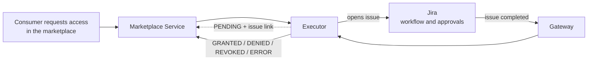

# ODM Platform Marketplace Executor for Jira

> Fulfil the access requests of the [Open Data Mesh Platform](https://dpds.opendatamesh.org/) marketplace through **Jira issues and Jira Service Management requests**: an issue is opened for every subscribe or unsubscribe, and the request is completed when the issue is completed in Jira.

## What it does

When someone asks for access to a data product in the marketplace (or asks for it to be removed), the executor opens a **Jira issue** (or a Jira Service Management request) with everything already filled in. Your team handles it in Jira as usual. When the issue is completed, the marketplace shows whether access was **granted, denied, revoked or failed**, with the issue link, the resolution and the last comment.

## Capabilities

- **Your existing process.** Access approvals follow the Jira workflow you already run, including approvals and the customer portal.
- **Three ways to create the issue.** The Jira Issue API, a Jira Service Management request raised on behalf of the requester, or your own Jira Automation rule.
- **Jira Cloud and Data Center.** Cloud with a service account or an API token, Data Center 8.14 or later with a Personal Access Token.
- **Subscribe and unsubscribe.** Each has its own issue definition and outcome mapping.
- **Configuration only.** Issue content, where it is created and how statuses and resolutions map to outcomes are YAML, with no code.
- **Request filter.** Send only some data products, consumers or requests to Jira, so several executors can work side by side.
- **Serverless, scales to zero.** A small native image that runs on Cloud Run, Knative, KEDA or Azure Container Apps and costs nothing when idle.
- **Safe by design.** One issue covers all the ports of a request, so there are no partial grants, and the first final status wins.

## Get started in three steps

### 1. Pick your scenario

| Your organisation... | Scenario |
|:--|:--|
| lets a team handle access requests as normal tasks in a Jira project | [**Jira issue**](docs/scenarios/issue.md): the fastest to set up |
| runs requests through a Jira Service Management portal, with approvals | [**Service Management request with approvals**](docs/scenarios/service-desk.md) |
| wants the issue built by its own Automation logic (routing, extra fields, sub-tasks) | [**Your own Automation rule**](docs/scenarios/automation-webhook.md) |

Not sure? Start with the **Jira issue**: it works on any project with a `Task` issue type and you can switch later by changing one file. Every scenario handles both access requests and access removals. The scenario pages use Jira Cloud; for Data Center see [Examples](docs/reference/examples.md#jira-data-center).

The scenario page covers the Jira side and gives you the executor configuration file.

### 2. Pick your platform

| You run on... | Quickstart |
|:--|:--|
| Google Cloud | [**Cloud Run**](docs/platforms/cloud-run.md) |
| Kubernetes with Knative | [**Knative Serving**](docs/platforms/knative.md) |
| Kubernetes with KEDA | [**KEDA HTTP add-on**](docs/platforms/keda-http.md) |
| Azure | [**Azure Container Apps**](docs/platforms/azure-container-apps.md) |

The platform page deploys the executor, connects Jira back to it and runs an end-to-end test. Docker, plain Kubernetes or a VM: see [Deployment](docs/reference/deployment.md).

### 3. Test it

The last step of the platform page: request access in the marketplace, complete the issue in Jira, and watch the request become `GRANTED`.

**What you need before you start:** a Jira Cloud site with an organisation admin and a Jira admin, a running ODM Marketplace Service, a running [blindata-agent](docs/reference/jira-setup.md#option-b-blindata-agent) reachable by Jira over HTTPS (it authenticates the Jira callback), and the rights to deploy on your platform.

## In depth

Read these when you need more than the quickstart: production hardening, other options, every setting.

| Document | Contents |
|:--|:--|
| [Concepts](docs/reference/concepts.md) | Architecture, request lifecycle, mapping, status rules, privacy, security model, limits |
| [Jira setup](docs/reference/jira-setup.md) | Identity, permissions, correlation field, resolutions and workflow, gateway options, OAuth with Entra ID, Automation rule and native webhook channels, secret rotation |
| [Deployment](docs/reference/deployment.md) | Which platforms fit and why, common requirements, containers and Kubernetes, scale-in limit, cost |
| Platform details: [Cloud Run](docs/reference/deploy-cloud-run.md), [Knative](docs/reference/deploy-knative.md), [KEDA](docs/reference/deploy-keda-http.md), [Azure Container Apps](docs/reference/deploy-azure-container-apps.md) | Why each setting, network isolation, alternative gateways, native webhook functions, declarative files, day 2 operations, platform troubleshooting |
| [Configuration reference](docs/reference/configuration-reference.md) | Every property, default, environment variable and validation rule |
| [Templates](docs/reference/templates.md) | Qute templates for issue content and messages, and the data they can use |
| [Examples](docs/reference/examples.md) | Step-by-step example runs per scenario, Jira Data Center, several executors |
| [API reference](docs/reference/api-reference.md) | The three HTTP endpoints, payloads and answers |
| [Build, run locally and release](docs/reference/build-and-run.md) | Maven and Docker builds, local run, tests, CI/CD and releases |
| [Troubleshooting](docs/reference/troubleshooting.md) | Logs, requests stuck in `PENDING`, ignored events, startup errors |

## Related links

- [Open Data Mesh Architecture](https://platform.opendatamesh.org/architecture/)
- [ODM Initiative Discussion](https://github.com/orgs/opendatamesh-initiative/discussions/1)
- Project conventions: [`spdd/norms/`](spdd/norms/README.md)

## Contributing

This project is intended to be forked and customised: fork, create a feature branch, open a pull request against the main branch. Questions and proposals go to the [ODM Initiative Discussion](https://github.com/orgs/opendatamesh-initiative/discussions/1).

## License

Licensed under the [Apache License 2.0](https://www.apache.org/licenses/LICENSE-2.0). Part of the [Open Data Mesh Initiative](https://github.com/opendatamesh-initiative).
