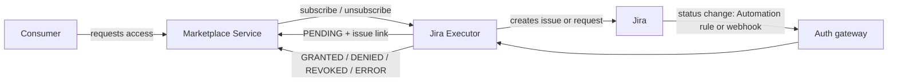

# ODM Platform Marketplace Executor for Jira

[](https://opensource.org/licenses/Apache-2.0)
[](https://openjdk.org/)
[](https://quarkus.io/)

Fulfil the access requests of the [Open Data Mesh Platform](https://dpds.opendatamesh.org/) marketplace through **Jira issues and Jira Service Management requests**.

## What it is

In a data mesh, people ask the marketplace for access to data products ("subscribe") and later ask to give it back ("unsubscribe"). Someone has to approve and carry out those requests. Most companies already do this kind of work in Jira, with their own projects, workflows and approvers.

The Jira executor connects the two worlds. For every subscribe or unsubscribe request it opens a Jira issue (or a service desk request). Your team handles it in Jira as usual. When the issue is completed, the executor tells the marketplace the outcome: access granted, denied, revoked, or failed. Nobody has to copy information between tools.

## What problem it solves

- **No parallel process.** Access approvals follow the Jira workflow you already run, including approvals and the customer portal.
- **A complete trail.** The marketplace shows the Jira issue key and link while the request is pending, and a descriptive final message (who closed it, the resolution, the last comment).
- **Safe by design.** One issue always covers all the ports of a request, so there are no partial grants. The first final outcome wins and later issue edits cannot change it.
- **Configuration only.** What goes into the issue, where it is created and how Jira statuses map to outcomes are all settings, not code.

## Main capabilities

- Creates an issue per `MARKETPLACE_SUBSCRIBE` or `MARKETPLACE_UNSUBSCRIBE` request, with a different setup for each.
- Three ways to create the issue: the Jira **Issue API**, the **Jira Service Management request API** (raised on behalf of the requester) or a **Jira Automation incoming webhook**.
- Works with **Jira Cloud** and **Jira Data Center** (8.14 or later).
- Receives completion notifications from Jira (an Automation rule or a native webhook) and turns the issue status and resolution into `GRANTED`, `DENIED`, `REVOKED` or `ERROR`.
- Request filter, so several executors can serve different data products behind one marketplace.
- Message and issue content written as templates, with optional rich text (ADF) on Jira Cloud.
- Stateless: the issue carries the request UUID in a custom field.

## Use cases

| You want to... | Use | Details |
|:--|:--|:--|
| Let a team handle access requests as normal Jira tasks in a project | `ISSUE` | [Use case 1](docs/use-cases.md#use-case-1---jira-software-issues-issue-api) |
| Show requests in the Service Management portal, with approvals, raised for the real requester | `SERVICE_DESK_REQUEST` | [Use case 2](docs/use-cases.md#use-case-2---jira-service-management-requests) |
| Build the issue with your own Automation logic | `AUTOMATION_WEBHOOK` | [Use case 3](docs/use-cases.md#use-case-3---jira-automation-incoming-webhook) |
| Run on Jira Data Center | any of the above, with a Personal Access Token | [Use case 4](docs/use-cases.md#use-case-4---jira-data-center) |
| Route data products to different executors | request filter | [Use case 5](docs/use-cases.md#use-case-5---several-executors-behind-one-marketplace) |

Example: a consumer requests access to `urn:dp:finance:sales` in the marketplace. The executor opens issue `ACC-42` and the marketplace shows it as pending with the issue link. An approver sets the issue to *Done* with a comment. The marketplace request becomes `GRANTED` with a message such as "GRANTED through Jira issue ACC-42 ... Comment: Access granted".

## Supported variants

- **Deployment type:** `CLOUD` (default) or `DATA_CENTER`. Cloud authenticates with a service account (OAuth 2.0 client credentials) or an API token. Data Center uses a Personal Access Token, or a service account on Data Center 11.1 or later. REST v3 and rich text are Cloud only.
- **Interface type:** per operation, `ISSUE`, `SERVICE_DESK_REQUEST` or `AUTOMATION_WEBHOOK`. Subscribe and unsubscribe can use different ones.

## How it works



Details in [Concepts](docs/concepts.md).

## Quick start

You need a running Marketplace Service and a Jira site with a correlation custom field, plus either Java 21 (Maven option) or Docker (image option).

**With Maven**

```bash
export JIRA_SITE_URL=https://acme.atlassian.net
export JIRA_API_URL=https://api.atlassian.com/ex/jira/<cloudId>
export JIRA_CLIENT_ID=... JIRA_CLIENT_SECRET=...
export JIRA_CORRELATION_FIELD=customfield_10050
./mvnw quarkus:dev          # listens on port 9019
```

**With Docker** (published on every release, no Java needed)

```bash
docker run --rm -p 9019:9019 \
  -e JIRA_SITE_URL=https://acme.atlassian.net \
  -e JIRA_API_URL=https://api.atlassian.com/ex/jira/<cloudId> \
  -e JIRA_CLIENT_ID=... -e JIRA_CLIENT_SECRET=... \
  -e JIRA_CORRELATION_FIELD=customfield_10050 \
  -e ODM_PRODUCT_PLANE_MARKETPLACE_SERVICE_ADDRESS=http://host.docker.internal:8085 \
  -v "$(pwd)/config/application.yml:/work/config/application.yml:ro" \
  ghcr.io/opendatamesh-initiative/odm-platform-adapter-marketplace-executor-jira:<version>
```

The image is also on Docker Hub as `opendatamesh/odm-platform-adapter-marketplace-executor-jira`.

You must also provide the issue profiles (`jira.profiles.subscribe` and `jira.profiles.unsubscribe`) in an external `config/application.yml` (mounted at `/work/config/application.yml` in the container). The full walkthrough is in [Provisioning](docs/provisioning.md); ready-made profiles are in [Use cases](docs/use-cases.md).

## Documentation

| Document | What you find there |
|:--|:--|
| [Concepts](docs/concepts.md) | Architecture, request lifecycle, status rules, mapping, privacy, scope |
| [Use cases](docs/use-cases.md) | Five use cases, each with configuration and an example run |
| [Jira setup](docs/jira-setup.md) | What a Jira admin must prepare: identity, permissions, fields, rules, webhooks |
| [Provisioning](docs/provisioning.md) | Build, run (Maven or Docker), deploy, CI/CD and releases, secure the notification endpoints, verify, rotate secrets |
| [Configuration reference](docs/configuration-reference.md) | Every property, default, environment variable and validation rule |
| [Templates](docs/templates.md) | Qute templates for issue content and messages, and the data they can use |
| [API reference](docs/api-reference.md) | The three HTTP endpoints, payloads and answers |
| [Troubleshooting](docs/troubleshooting.md) | Logs, requests stuck in `PENDING`, ignored events, startup errors |

## Related links

- [Open Data Mesh Architecture](https://platform.opendatamesh.org/architecture/)
- [ODM Initiative Discussion](https://github.com/orgs/opendatamesh-initiative/discussions/1)
- Project conventions: [`spdd/norms/`](spdd/norms/README.md)

## Contributing

This project is intended to be forked and customised: fork, create a feature branch, open a pull request against the main branch. Questions and proposals go to the [ODM Initiative Discussion](https://github.com/orgs/opendatamesh-initiative/discussions/1).

## License

Licensed under the [Apache License 2.0](https://www.apache.org/licenses/LICENSE-2.0). Part of the [Open Data Mesh Initiative](https://github.com/opendatamesh-initiative).
