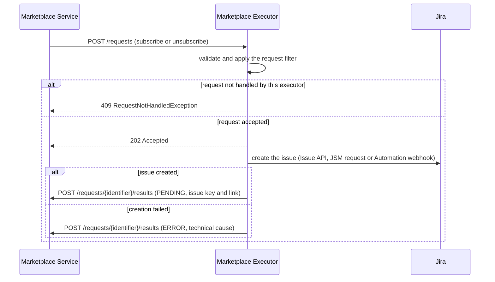
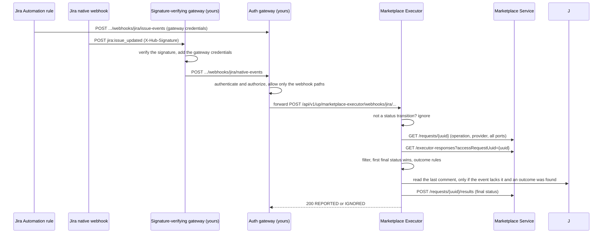

# Concepts

[Back to README](../README.md)

## Overview

When someone asks the marketplace for access to a data product, a person has to decide and act. The Jira executor makes that person's usual tool, Jira, the place where this happens. It opens an issue for the request, waits until the issue is completed, and tells the marketplace how it ended.

The executor has no database. Everything it needs is either in the marketplace request (held by the Marketplace Service) or in a custom field on the Jira issue that stores the request UUID.

Related: [Use cases](use-cases.md) · [Jira setup](jira-setup.md) · [Configuration reference](configuration-reference.md)

## Architecture

| Component | Role |
|:--|:--|
| **Marketplace Service** | Receives the access request, holds its data and result history, forwards it to executors |
| **Jira executor** (this project) | Quarkus service on port 9019. Opens issues and turns completion events into results |
| **Jira** (Cloud or Data Center) | Where the request is handled. Provides the issue API, the Service Management API, Automation and webhooks |
| **Auth gateway** (yours) | Authenticates the completion notifications coming from Jira and forwards only the webhook paths to the executor |
| **Signature-verifying gateway** (yours) | Only for native Jira webhooks: verifies the signature and adds the credentials your auth gateway expects (it can be the same component) |

The executor is stateless and never reads or writes anything other than Jira, the Marketplace Service and (for the Automation interface) the Automation webhook URL.

## Request lifecycle

The lifecycle has two legs.

### Leg 1: the issue is opened



The executor answers `202` at once and works asynchronously. One issue covers all the ports of the request. With the Automation interface the executor never learns the issue key, so the `PENDING` message says that the request was submitted to the Jira Automation rule.

### Leg 2: the issue is completed

Two channels carry the completion event to the executor and share the same outcome logic.



The checks run in this order. The operation, provider and ports always come from the Marketplace Service, never from the notification. The last comment is read from Jira (`GET /rest/api/{v}/issue/{key}/comment`, newest first, one item) only after an outcome has been determined, at most once. A failure there is logged as a warning and never blocks the result.

## Mapping between marketplace requests and Jira issues

| Marketplace request | Jira |
|:--|:--|
| `request.identifier` (UUID) | Stored in the correlation custom field (`jira.correlation.field`); optionally also the label `bdmp-<uuid>` (`jira.correlation.label`) |
| `operation` | Selects the profile: `jira.profiles.subscribe` or `jira.profiles.unsubscribe` |
| `provider.dataProductFqn`, `dataProductPortsFqn` | Available to the templates; all ports are always reported back |
| `consumer`, `requester`, `properties`, `startDate`, `endDate` | Available to the templates. The requester (type `USER`, identified by email) is also the reporter or the "on behalf of" user |
| Issue key, id, link | Reported in the `PENDING` message; the link is `{site-url}/browse/{key}` |
| Issue status, resolution | Evaluated by the outcome rules to produce the final result |

Issue content is built from the profile `fields`, `object-fields` and `list-fields` (see [Templates](templates.md)). Per-interface behaviour:

| Type | Endpoint called | Body | Correlation | Reference |
|:--|:--|:--|:--|:--|
| `ISSUE` | `POST /rest/api/{v}/issue` | `{fields: {project, issuetype, ...rendered fields, reporter?, labels?}}` | `fields.<correlation field>` = UUID; label `bdmp-<uuid>` when `correlation.label` | key `/key`, id `/id`, link `{site-url}/browse/{key}` |
| `SERVICE_DESK_REQUEST` | `POST /rest/servicedeskapi/request` | `{serviceDeskId, requestTypeId, requestFieldValues, raiseOnBehalfOf, isAdfRequest}` | `requestFieldValues.<correlation field>` = UUID; or, with `correlation-via-edit`, `PUT /rest/api/{v}/issue/{key}` right after creation | key `/issueKey`, id `/issueId`, link `{site-url}/browse/{key}` |
| `AUTOMATION_WEBHOOK` | `POST {webhook-url}` with the header `X-Automation-Webhook-Token` | `{correlationId, operation, request: {...request data}, fields: {...rendered fields}}` | your rule must copy `correlationId` into the correlation field | none: key, id and link are empty |

The Automation Incoming Webhook is called **without** the Jira credentials: only its own token header is sent.

### Reserved fields

The executor sets these **after** rendering, so a template cannot drop or override them. A profile that declares one of them in `fields`, `object-fields` or `list-fields` makes the executor refuse to start:

- the correlation field (`jira.correlation.field`)
- `project` and `issuetype`
- `reporter`, when `set-reporter` is `true`
- `correlationId`, for `AUTOMATION_WEBHOOK`

When `correlation.label` is on, your `labels` list is kept and `bdmp-<uuid>` is appended. `summary` is truncated to 255 characters.

### REST v3 and ADF

With `jira.api-version: 3` (Cloud only) every rendered string value whose field is in `rich-text-fields` is sent as a minimal Atlassian Document Format document: blank-line separated blocks become paragraphs and single newlines become line breaks. JSM requests send `isAdfRequest=true`. Comments read back from Jira are flattened to plain text. With version `2` values stay plain or wiki text.

### Requester resolution ("on behalf of")

JSM requests are always raised **on behalf of the marketplace requester**, and `ISSUE` does the same for the reporter when `set-reporter` is on. The requester must be of type `USER`. The executor searches Jira users by email (`GET /rest/api/{v}/user/search?query=<email>` on Cloud, `GET /rest/api/2/user/search?username=<email>` on Data Center), takes the user whose `emailAddress` equals the identifier (ignoring case) or, if exactly one active user came back, that user. Otherwise no issue is created and an `ERROR` is reported. The executor never falls back to the integration identity.

On Cloud a user's email may be hidden by their privacy settings: the executor then relies on the "exactly one active result" rule.

## Status taxonomy and rules

The final status depends on the **operation** and on the **cause** the outcome rules assign to the issue. Rules only ever declare a cause, never a status, so a configuration cannot produce a status that is not allowed for the operation.

| Cause (from outcome rules) | `MARKETPLACE_SUBSCRIBE` | `MARKETPLACE_UNSUBSCRIBE` |
|:--|:--|:--|
| `FULFILLED` | `GRANTED` | `REVOKED` |
| `REFUSED` | `DENIED` | `ERROR` (message states that the request was refused on Jira) |
| `FAILED` | `ERROR` | `ERROR` |

| Status | Sent when |
|:--|:--|
| `PENDING` | The issue has been opened (once per accepted request, never from the notification endpoints) |
| `ERROR` | The issue could not be opened (technical cause in the message), or one of the `ERROR` cases above |

Rules of the game:

- **No partial grants.** One issue handles all the ports. Sub-tasks, if your process uses them, are only an internal breakdown: the executor sees the one issue. Every result carries *all* the requested ports, taken from the Marketplace Service. A request that matches the filter only for some ports is declined as a whole.
- **First final status wins.** Once `GRANTED`, `DENIED`, `REVOKED` or `ERROR` exists for a request, later issue events for it (reopened and re-completed issues) are acknowledged and ignored. `PENDING` does not count as final.
- **Non-final updates are not results.** An event that is not a status transition, or that matches no outcome rule, is acknowledged and ignored, and the request stays `PENDING`.
- **Messages are descriptive.** Every result message says what happened: issue key and link, status, resolution, the last comment and, by default, the Jira user who completed the issue. For `UNSUBSCRIBE` a refusal is an `ERROR`, and its message makes clear that it is a Jira-side refusal and not a platform failure.

### Outcome rules

Evaluated **in order** against the normalised event fields (`key`, `id`, `project`, `issueType`, `status`, `statusCategory`, `resolution`, `actor`, `lastComment`, plus any [extra fields](configuration-reference.md#connection-and-authentication)). A rule matches when every `when` entry names a field that is present and whose value matches the regex entirely. The **first match wins**; no match means the event is ignored (`NON_TERMINAL_STATE`). Each profile needs at least one rule, at least one `FULFILLED`, and every rule needs a non-empty `when`.

```yaml
outcome-rules:
  - when:
      statusCategory: "done"
      resolution: '(?i)(Done|Fixed|Resolved|Granted|Revoked)'
    outcome: FULFILLED
  - when:
      statusCategory: "done"
      resolution: "(?i)(Won't Do|Won't Fix|Declined|Rejected|Cannot Reproduce|Duplicate)"
    outcome: REFUSED
    message: "Request declined on Jira ({ticket.key}). {fields.lastComment}"
  - when:              # fallback, keep it last: a completed issue always yields a final result
      statusCategory: "done"
    outcome: FAILED
```

The resolutions above are the ones shipped by Jira software projects. Check them on your instance, since customers often customise them. [What a resolution is](jira-setup.md#what-a-resolution-is) explains the field, how workflows set it and the recommended setup. The last rule also covers an unset resolution. Without it, such an issue is ignored and the request stays `PENDING`. Use single quotes for regexes with backslashes (`'\d+'`); a regex with an apostrophe (`Won't Do`) goes in double quotes.

## Rate limiting and delivery retries

- **Jira rate limit.** An issue creation answered with `429` is retried up to `jira.rate-limit.max-attempts` times with an exponential back-off starting at `jira.rate-limit.backoff`. A `429` means the request was not processed, so retrying the POST is safe. Other errors are not retried.
- **Result delivery.** Posting to the Marketplace Service is retried on `404` (the Marketplace Service calls the executor inside its own transaction, so the request may not be visible yet), on `5xx` and on I/O errors; other 4xx answers fail immediately. The `PENDING` post is best effort: if it cannot be delivered a warning is logged and the issue stays open. A **final** result that cannot be delivered makes the notification endpoint answer `500`.
- 401 and 403 answers and token failures become `ERROR` results that name the auth type and the deployment and what to check, never any secret.

## Privacy

Result messages go to the Marketplace Service history and, are shown to marketplace users. By default a message contains the **name of the Jira user who completed the issue** and the **last comment**.

- To keep the actor out of messages set `jira.messages.closing-user.include=false` (env `JIRA_MESSAGES_INCLUDE_CLOSING_USER=false`). Then `ticket.closedBy` does not exist and the closing-user field (`jira.messages.closing-user.field`, default `actor`) is removed from `fields.*`, so no template can leak it.
- The last comment is free text written by the fulfiller. Remove `{fields.lastComment}` from the templates if it might hold sensitive data, and do not send it in the Automation body.
- You can also simply not send `actor` in the Automation rule body. The native channel reduces the payload to the normalised fields and drops everything else.

Request headers, tokens, secrets, webhook URLs and request or native payload bodies are never logged.

## Security model

The notification endpoints have **no authentication of their own**. Put them behind an authenticating gateway or reverse proxy that authenticates Jira and forwards only the webhook paths. The executor must be reachable only by the Marketplace Service and by that gateway. Native Jira webhooks always need a signature-verifying gateway, because the executor does not verify `X-Hub-Signature`. See [Provisioning](jira-setup.md#8-securing-the-notification-endpoints).

## Limits and roadmap

- **Unsubscribe while the subscribe issue is still open.** Two issues exist at the same time. The executor does not resolve this: handle it in your Jira process.
- **Automatic revoke on `endDate`.** Not handled. The recommended direction is for the system that owns the request lifecycle (typically the Marketplace Service) to submit a normal `MARKETPLACE_UNSUBSCRIBE` once access expires; this executor then handles it like any other unsubscribe. Templates can carry `startDate` and `endDate` for the fulfillers.
- **Signature-based authentication of native webhooks in the gateway:** today a customer-provided gateway does it.
- **A shared library with the ServiceNow executor:** the two executors copy their platform-agnostic code on purpose.
- Not provided: polling or reconciliation of stuck issues, writing a comment back to the issue, changes to the Marketplace Service.
- Atlassian ends support for Jira Data Center on **2029-03-28**. REST v3 and ADF are Cloud only; a migration to Cloud needs the service account, the `api-url` and, optionally, `api-version: 3`.
