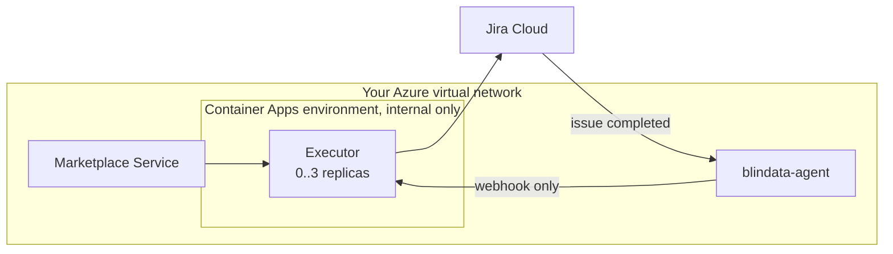

# Quickstart on Azure Container Apps

[README](../../README.md) > 1. Scenario > **2. Platform** > 3. Test

You deploy the executor on Azure Container Apps (it scales to zero) in an internal-only environment, let Jira call it back through blindata-agent, register it in the Marketplace Service and test the whole flow.

**You need:**

- the **client id**, **client secret**, **API URL**, **correlation field id** and **`config/application.yml`** from your [scenario page](../../README.md#1-pick-your-scenario);
- the Azure CLI with the `containerapp` extension, a resource group and a virtual network with a subnet dedicated to the environment;
- the Marketplace Service and blindata-agent in that virtual network (or a peered one), with blindata-agent reachable by Jira over HTTPS.



## 1. Deploy the executor

Create the internal environment (replace `RG`, the virtual network and the subnet names):

```bash
az extension add --name containerapp --upgrade
az provider register --namespace Microsoft.App
az provider register --namespace Microsoft.OperationalInsights

SUBNET_ID=$(az network vnet subnet show -g RG --vnet-name marketplace-vnet -n containerapps --query id -o tsv)
az containerapp env create -g RG -n marketplace-env --location westeurope \
  --infrastructure-subnet-resource-id "$SUBNET_ID" \
  --internal-only true

az containerapp env show -g RG -n marketplace-env \
  --query "{domain:properties.defaultDomain, ip:properties.staticIp}" -o table
```

Callers in the virtual network resolve the app through a **private DNS zone** named after `domain`, with a `*` A record pointing at `ip`, linked to the virtual network: create it now.

Save this as `app.yaml`. Fill in the subscription, the version, your site, the cloudId, the correlation field and the Marketplace Service address, and paste the content of your `config/application.yml` under `jira-executor-profiles`:

```yaml
location: westeurope
properties:
  environmentId: /subscriptions/<sub>/resourceGroups/RG/providers/Microsoft.App/managedEnvironments/marketplace-env
  configuration:
    activeRevisionsMode: Single
    ingress:
      external: true            # internal-only environment: reachable from the VNet only
      targetPort: 9019
      transport: http
    secrets:
      - name: jira-client-id
        value: <client id>
      - name: jira-client-secret
        value: <client secret>
      - name: jira-executor-profiles
        value: |
          jira:
            # ... the content of your config/application.yml, indented
  template:
    containers:
      - name: executor
        image: docker.io/opendatamesh/odm-platform-adapter-marketplace-executor-jira:<version>
        resources:
          cpu: 0.5
          memory: 1Gi
        env:
          - name: JIRA_DEPLOYMENT
            value: CLOUD
          - name: JIRA_SITE_URL
            value: https://<site>.atlassian.net
          - name: JIRA_API_URL
            value: https://api.atlassian.com/ex/jira/<cloudId>
          - name: JIRA_AUTH_TYPE
            value: OAUTH2_CLIENT_CREDENTIALS
          - name: JIRA_CORRELATION_FIELD
            value: customfield_10050
          - name: ODM_PRODUCT_PLANE_MARKETPLACE_SERVICE_ADDRESS
            value: http://marketplace-service.internal.acme:8085
          - name: QUARKUS_CONFIG_LOCATIONS
            value: /etc/executor/application.yml
          - name: JIRA_CLIENT_ID
            secretRef: jira-client-id
          - name: JIRA_CLIENT_SECRET
            secretRef: jira-client-secret
        volumeMounts:
          - volumeName: profiles
            mountPath: /etc/executor
    volumes:
      - name: profiles
        storageType: Secret
        secrets:
          - secretRef: jira-executor-profiles
            path: application.yml
    scale:
      minReplicas: 0
      maxReplicas: 3
      cooldownPeriod: 300
      rules:
        - name: http
          http:
            metadata:
              concurrentRequests: "10"
```

**Automation rule scenario only:** add the two creation rules' URLs and secrets. Under `properties.configuration.secrets`:

```yaml
      - name: jira-automation-subscribe-url
        value: <subscribe webhook url>
      - name: jira-automation-subscribe-token
        value: <subscribe webhook secret>
      - name: jira-automation-unsubscribe-url
        value: <unsubscribe webhook url>
      - name: jira-automation-unsubscribe-token
        value: <unsubscribe webhook secret>
```

and under the container's `env`:

```yaml
          - name: JIRA_AUTOMATION_SUBSCRIBE_URL
            secretRef: jira-automation-subscribe-url
          - name: JIRA_AUTOMATION_SUBSCRIBE_TOKEN
            secretRef: jira-automation-subscribe-token
          - name: JIRA_AUTOMATION_UNSUBSCRIBE_URL
            secretRef: jira-automation-unsubscribe-url
          - name: JIRA_AUTOMATION_UNSUBSCRIBE_TOKEN
            secretRef: jira-automation-unsubscribe-token
```

Create the app and note its address:

```bash
az containerapp create -g RG -n jira-executor --yaml app.yaml
export EXECUTOR_FQDN=$(az containerapp show -g RG -n jira-executor --query properties.configuration.ingress.fqdn -o tsv)
echo $EXECUTOR_FQDN   # for example jira-executor.<unique-id>.westeurope.azurecontainerapps.io
```

Do not commit `app.yaml`: it holds secret values. If the revision fails to provision, read the logs: the executor prints a numbered list of configuration problems (`Invalid Jira executor configuration:`).

```bash
az containerapp logs show -g RG -n jira-executor --type console
```

> The internal-only environment keeps the executor off the internet, which is required because its endpoints have no authentication of their own. The cool-down keeps the replica alive while it opens the issue after answering the Marketplace Service; verify that your CLI and API version accept `cooldownPeriod` (the default is 300 seconds). [Why each setting](../reference/deploy-azure-container-apps.md#settings-that-matter-on-container-apps).

## 2. Connect Jira back through blindata-agent

Jira reaches the executor only through blindata-agent, which authenticates it and lets through only the webhooks.

1. **Route the agent to the executor.** In the ODM proxy configuration of blindata-agent, set the `marketplace-executor-jira` key to `https://$EXECUTOR_FQDN`:

   ```json
   { "servicesURLs": { "marketplace-executor-jira": "https://jira-executor.<unique-id>.westeurope.azurecontainerapps.io" } }
   ```

2. **Create the Jira identity in Blindata.** An application user with the `MARKETPLACE_EDITOR` permission only (never `DATAOPS_ADMIN`), and an API key for it.
3. **Smoke test** (harmless: an unknown request id is acknowledged and ignored):

   ```bash
   export HOOK_URL="https://<agent-host>/agent-api/v1/odm/proxy/<configUuid>/marketplace-executor-jira/api/v1/up/marketplace-executor/webhooks/jira/issue-events"
   curl -i -X POST "$HOOK_URL" -H "Content-Type: application/json" \
     -H "X-BD-User: <application user>" -H "X-BD-ApiKey: <api key>" -H "X-BD-Tenant: <tenant>" \
     -d '{"correlationId":"00000000-0000-0000-0000-000000000000","fields":{"statusCategory":"done"}}'
   # -> 200 {"outcome":"IGNORED","reason":"UNKNOWN_REQUEST"}
   ```

   `403`: the user lacks `MARKETPLACE_EDITOR`. A DNS error from the agent: the private DNS zone is missing or not linked.

4. **Create the completion Automation rule** in Jira. It tells the executor when an issue is completed.
   1. **Project settings > Automation > Create rule** in the project of your scenario.
   2. **Trigger**: *Work item transitioned* (*Issue transitioned*), *From* and *To* empty.
   3. **Condition** for your scenario:

      | Scenario | Project | Condition |
      |:--|:--|:--|
      | Jira issue | `ACC` | *Work item fields condition*: *Status category* equals *Done* |
      | Service Management request | `SD` | *JQL condition*: `statusCategory = Done OR status = Declined` |
      | Your own Automation rule | where your creation rules create issues | *Work item fields condition*: *Status category* equals *Done* |

   4. **Condition**: *JQL condition* `"Marketplace request id" is not EMPTY`.
   5. **Action**: *Send web request* to `$HOOK_URL`, method `POST`, body *Custom data*, headers `Content-Type: application/json`, `X-BD-User`, `X-BD-ApiKey` and `X-BD-Tenant`, each credential marked **Hidden**. Body (replace `customfield_10050` with your field id):

      ```json
      {
        "correlationId": "{{issue.customfield_10050}}",
        "fields": {
          "key": "{{issue.key}}",
          "id": "{{issue.id}}",
          "project": "{{issue.project.key}}",
          "issueType": "{{issue.issueType.name}}",
          "status": "{{issue.status.name}}",
          "statusCategory": "{{issue.status.statusCategory.key}}",
          "resolution": "{{issue.resolution.name}}",
          "actor": "{{initiator.displayName}}",
          "lastComment": "{{issue.comments.last.body.jsonEncode}}"
        }
      }
      ```

   6. Name it (for example *Marketplace - report completion*), set its actor to *Automation for Jira*, and **Turn it on**.

Prefer API Management or Application Gateway, OAuth with Entra ID, or native Jira webhooks instead of a rule? See [Azure gateway options](../reference/deploy-azure-container-apps.md#step-4---expose-the-notification-endpoints) and [Jira setup](../reference/jira-setup.md#9-completion-channel-a---jira-automation-rule-recommended).

## 3. Register the executor in the Marketplace Service

Add it to the Marketplace Service configuration (https, no port) and restart the service if it does not reload configuration. The Marketplace Service must resolve the name through the private DNS zone.

```yaml
odm:
  utility-plane:
    marketplace-executors:
      - name: JIRA
        address: https://jira-executor.<unique-id>.westeurope.azurecontainerapps.io   # https://$EXECUTOR_FQDN
        active: true
```

## 4. Test end to end

1. In the marketplace, request access to a data product matched by your filter (for example `urn:dp:finance:sales`).
2. The request shows **`PENDING`** with the Jira issue key and link. In the Automation rule scenario it shows `Request submitted to the Jira Automation rule ...` without a key: that is expected.
3. In Jira, complete the issue the way your scenario approves it:

   | Scenario | Grant | Deny |
   |:--|:--|:--|
   | Jira issue | Apply the *Grant* transition (resolution *Done*), with a comment | Apply *Decline* (resolution *Won't Do*) |
   | Service Management request | The approver approves, an agent resolves with *Done* | The approver declines |
   | Your own Automation rule | Close the created issue with resolution *Done* | Close it with resolution *Won't Do* |

4. The completion rule's **audit log** shows the web request with status `200`, and the request becomes **`GRANTED`** (or **`DENIED`**), with the issue link, the resolution and the comment.
5. Ask to remove the access: a revoke issue opens, and completing it the same way makes the request **`REVOKED`**.

**It works.** You have tested the whole concept.

## If something goes wrong

| Symptom | Check |
|:--|:--|
| No issue and no `PENDING` | The replica was removed before the background work finished: check `cooldownPeriod` |
| The FQDN does not resolve from the Marketplace Service or the agent | The private DNS zone for the environment's default domain |
| `ERROR` with a Jira message | Your scenario page, *If something goes wrong* |
| Issue completed, request still `PENDING`, nothing in the audit log | The rule's conditions (status category, JQL condition), rule turned on |
| Audit log shows `401`/`403` | The credential headers of the rule |

Automation does not retry: after fixing the cause, re-run the rule for that issue. More in [Container Apps troubleshooting](../reference/deploy-azure-container-apps.md#troubleshooting-on-container-apps) and [Troubleshooting](../reference/troubleshooting.md).

## Before production

- Reference **Azure Key Vault** for the secrets (`keyVaultUrl` plus a user-assigned managed identity) instead of values in `app.yaml`.
- Choose the narrowest [ingress visibility](../reference/deploy-azure-container-apps.md#settings-that-matter-on-container-apps) that still lets the Marketplace Service and the gateway in.
- Read [Day 2 operations](../reference/deploy-azure-container-apps.md#day-2-operations): upgrades, profile changes, secret rotation.
