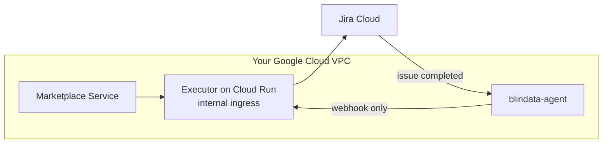

# Quickstart on Google Cloud Run

[README](../../README.md) > 1. Scenario > **2. Platform** > 3. Test

You deploy the executor on Cloud Run (it scales to zero), let Jira call it back through blindata-agent, register it in the Marketplace Service and test the whole flow.

**You need:**

- the **client id**, **client secret**, **API URL**, **correlation field id** and **`config/application.yml`** from your [scenario page](../../README.md#1-pick-your-scenario);
- `gcloud`, logged in, on a project with billing;
- the Marketplace Service and blindata-agent running in the project's VPC, with blindata-agent reachable by Jira over HTTPS.



## 1. Deploy the executor

Fill in the first block, then run the whole thing from the directory that contains `config/application.yml`.

```bash
export PROJECT_ID=my-project
export REGION=europe-west1
export VERSION=<released version, for example 1.0.0>
export JIRA_SITE_URL=https://<site>.atlassian.net
export JIRA_API_URL=https://api.atlassian.com/ex/jira/<cloudId>
export JIRA_CORRELATION_FIELD=customfield_10050
export MARKETPLACE_URL=http://marketplace-service.internal:8085   # as seen from the executor
export JIRA_CLIENT_ID='<client id>'
export JIRA_CLIENT_SECRET='<client secret>'
export EXTRA_SECRETS=""   # Automation rule scenario: see below

gcloud config set project $PROJECT_ID
gcloud services enable run.googleapis.com secretmanager.googleapis.com

# service account and secrets
gcloud iam service-accounts create jira-executor
export SA=jira-executor@$PROJECT_ID.iam.gserviceaccount.com
printf '%s' "$JIRA_CLIENT_ID"     | gcloud secrets create jira-client-id     --data-file=-
printf '%s' "$JIRA_CLIENT_SECRET" | gcloud secrets create jira-client-secret --data-file=-
gcloud secrets create jira-executor-profiles --data-file=config/application.yml
for s in jira-client-id jira-client-secret jira-executor-profiles; do
  gcloud secrets add-iam-policy-binding $s --member=serviceAccount:$SA --role=roles/secretmanager.secretAccessor
done
```

**Automation rule scenario only:** also store the two creation rules' URLs and secrets, before the deploy:

```bash
printf '%s' '<subscribe webhook url>'      | gcloud secrets create jira-automation-subscribe-url     --data-file=-
printf '%s' '<subscribe webhook secret>'   | gcloud secrets create jira-automation-subscribe-token   --data-file=-
printf '%s' '<unsubscribe webhook url>'    | gcloud secrets create jira-automation-unsubscribe-url   --data-file=-
printf '%s' '<unsubscribe webhook secret>' | gcloud secrets create jira-automation-unsubscribe-token --data-file=-
for s in jira-automation-subscribe-url jira-automation-subscribe-token jira-automation-unsubscribe-url jira-automation-unsubscribe-token; do
  gcloud secrets add-iam-policy-binding $s --member=serviceAccount:$SA --role=roles/secretmanager.secretAccessor
done
export EXTRA_SECRETS=",JIRA_AUTOMATION_SUBSCRIBE_URL=jira-automation-subscribe-url:1,JIRA_AUTOMATION_SUBSCRIBE_TOKEN=jira-automation-subscribe-token:1,JIRA_AUTOMATION_UNSUBSCRIBE_URL=jira-automation-unsubscribe-url:1,JIRA_AUTOMATION_UNSUBSCRIBE_TOKEN=jira-automation-unsubscribe-token:1"
```

Deploy:

```bash
# CPU always allocated and internal ingress are mandatory
gcloud run deploy jira-executor \
  --region=$REGION \
  --image=docker.io/opendatamesh/odm-platform-adapter-marketplace-executor-jira:$VERSION \
  --service-account=$SA --port=9019 --cpu=1 --memory=512Mi \
  --no-cpu-throttling --min-instances=0 --max-instances=3 \
  --ingress=internal --no-invoker-iam-check \
  --set-env-vars=JIRA_DEPLOYMENT=CLOUD,JIRA_SITE_URL=$JIRA_SITE_URL,JIRA_API_URL=$JIRA_API_URL,JIRA_AUTH_TYPE=OAUTH2_CLIENT_CREDENTIALS,JIRA_CORRELATION_FIELD=$JIRA_CORRELATION_FIELD,ODM_PRODUCT_PLANE_MARKETPLACE_SERVICE_ADDRESS=$MARKETPLACE_URL,QUARKUS_CONFIG_LOCATIONS=/etc/executor/application.yml \
  --set-secrets=JIRA_CLIENT_ID=jira-client-id:1,JIRA_CLIENT_SECRET=jira-client-secret:1,/etc/executor/application.yml=jira-executor-profiles:1$EXTRA_SECRETS

export EXECUTOR_URL=$(gcloud run services describe jira-executor --region=$REGION --format='value(status.url)')
echo $EXECUTOR_URL   # for example https://jira-executor-xxxxxxxxxx-ew.a.run.app
```

Add `--network=NETWORK --subnet=SUBNET --vpc-egress=private-ranges-only` when the Marketplace Service is reachable only through the VPC. If the revision does not become ready, read the logs: the executor prints a numbered list of configuration problems (`Invalid Jira executor configuration:`).

```bash
gcloud run services logs read jira-executor --region=$REGION --limit=50
```

> `--no-cpu-throttling` is not optional: the executor opens the issue after answering the Marketplace Service, and Cloud Run's default billing freezes the CPU at that point. `--ingress=internal` keeps the executor off the internet, which is required because its endpoints have no authentication of their own. [Why each setting](../reference/deploy-cloud-run.md#settings-that-matter-on-cloud-run).

## 2. Connect Jira back through blindata-agent

Jira reaches the executor only through blindata-agent, which authenticates it and lets through only the webhooks.

1. **Route the agent to the executor.** In the ODM proxy configuration of blindata-agent, set the `marketplace-executor-jira` key to `$EXECUTOR_URL` (https, no port):

   ```json
   { "servicesURLs": { "marketplace-executor-jira": "https://jira-executor-xxxxxxxxxx-ew.a.run.app" } }
   ```

2. **Create the Jira identity in Blindata.** An application user with the `MARKETPLACE_EDITOR` permission only (never `DATAOPS_ADMIN`), and an API key for it.
3. **Smoke test** (harmless: an unknown request id is acknowledged and ignored):

   ```bash
   export HOOK_URL="https://<agent-host>/agent-api/v1/odm/proxy/<configUuid>/marketplace-executor-jira/api/v1/up/marketplace-executor/webhooks/jira/issue-events"
   curl -i -X POST "$HOOK_URL" -H "Content-Type: application/json" \
     -H "X-BD-User: <application user>" -H "X-BD-ApiKey: <api key>" -H "X-BD-Tenant: <tenant>" \
     -d '{"correlationId":"00000000-0000-0000-0000-000000000000","fields":{"statusCategory":"done"}}'
   # -> 200 {"outcome":"IGNORED","reason":"UNKNOWN_REQUEST"}
   ```

   `403`: the user lacks `MARKETPLACE_EDITOR`. `404` or `403` from Google's front end: the agent's traffic is not internal to the VPC ([fix](../reference/deploy-cloud-run.md#network-isolation-hard-requirement)).

4. **Create the completion Automation rule** in Jira. It tells the executor when an issue is completed.
   1. **Project settings > Automation > Create rule** in the project of your scenario.
   2. **Trigger**: *Work item transitioned* (*Issue transitioned*), *From* and *To* empty.
   3. **Condition** for your scenario:

      | Scenario | Project | Condition |
      |:--|:--|:--|
      | Jira issue | `ACC` | *Work item fields condition*: *Status category* equals *Done* |
      | Service Management request | `SD` | *JQL condition*: `statusCategory = Done OR status = Declined` |
      | Your own Automation rule | where your creation rules create issues | *Work item fields condition*: *Status category* equals *Done* |

   4. **Condition**: *JQL condition* `"Marketplace request id" is not EMPTY`.
   5. **Action**: *Send web request* to `$HOOK_URL`, method `POST`, body *Custom data*, headers `Content-Type: application/json`, `X-BD-User`, `X-BD-ApiKey` and `X-BD-Tenant`, each credential marked **Hidden**. Body (replace `customfield_10050` with your field id):

      ```json
      {
        "correlationId": "{{issue.customfield_10050}}",
        "fields": {
          "key": "{{issue.key}}",
          "id": "{{issue.id}}",
          "project": "{{issue.project.key}}",
          "issueType": "{{issue.issueType.name}}",
          "status": "{{issue.status.name}}",
          "statusCategory": "{{issue.status.statusCategory.key}}",
          "resolution": "{{issue.resolution.name}}",
          "actor": "{{initiator.displayName}}",
          "lastComment": "{{issue.comments.last.body.jsonEncode}}"
        }
      }
      ```

   6. Name it (for example *Marketplace - report completion*), set its actor to *Automation for Jira*, and **Turn it on**.

Prefer your own gateway (HTTPS load balancer with Cloud Armor), OAuth with Entra ID, or native Jira webhooks instead of a rule? See [Cloud Run gateway options](../reference/deploy-cloud-run.md#step-4---expose-the-notification-endpoints) and [Jira setup](../reference/jira-setup.md#9-completion-channel-a---jira-automation-rule-recommended).

## 3. Register the executor in the Marketplace Service

Add it to the Marketplace Service configuration and restart the service if it does not reload configuration:

```yaml
odm:
  utility-plane:
    marketplace-executors:
      - name: JIRA
        address: https://jira-executor-xxxxxxxxxx-ew.a.run.app   # $EXECUTOR_URL
        active: true
```

If the Marketplace Service is itself on Cloud Run, give it Direct VPC egress with `--vpc-egress=all-traffic`, otherwise its calls are refused.

## 4. Test end to end

1. In the marketplace, request access to a data product matched by your filter (for example `urn:dp:finance:sales`).
2. The request shows **`PENDING`** with the Jira issue key and link. In the Automation rule scenario it shows `Request submitted to the Jira Automation rule ...` without a key: that is expected.
3. In Jira, complete the issue the way your scenario approves it:

   | Scenario | Grant | Deny |
   |:--|:--|:--|
   | Jira issue | Apply the *Grant* transition (resolution *Done*), with a comment | Apply *Decline* (resolution *Won't Do*) |
   | Service Management request | The approver approves, an agent resolves with *Done* | The approver declines |
   | Your own Automation rule | Close the created issue with resolution *Done* | Close it with resolution *Won't Do* |

4. The completion rule's **audit log** shows the web request with status `200`, and the request becomes **`GRANTED`** (or **`DENIED`**), with the issue link, the resolution and the comment.
5. Ask to remove the access: a revoke issue opens, and completing it the same way makes the request **`REVOKED`**.

**It works.** You have tested the whole concept.

## If something goes wrong

| Symptom | Check |
|:--|:--|
| No issue and no `PENDING` | `--no-cpu-throttling` is missing: `gcloud run services describe jira-executor --region=$REGION` |
| `ERROR` with a Jira message | Your scenario page, *If something goes wrong* |
| Issue completed, request still `PENDING`, nothing in the audit log | The rule's conditions (status category, JQL condition), rule turned on |
| Audit log shows `401`/`403` | The credential headers of the rule |
| `ERROR` naming a connection failure to Jira | Egress: add Cloud NAT if all egress goes through the VPC |

Automation does not retry: after fixing the cause, re-run the rule for that issue. More in [Cloud Run troubleshooting](../reference/deploy-cloud-run.md#troubleshooting-on-cloud-run) and [Troubleshooting](../reference/troubleshooting.md).

## Before production

- Use an [Artifact Registry remote repository](../reference/deploy-cloud-run.md#the-image) instead of pulling from Docker Hub.
- Keep the deployment in version control with the [declarative `service.yaml`](../reference/deploy-cloud-run.md#declarative-alternative).
- Read [Day 2 operations](../reference/deploy-cloud-run.md#day-2-operations): upgrades, profile changes, secret rotation.
