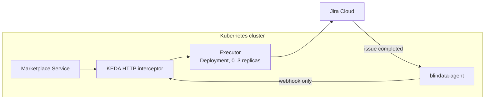

# Quickstart with the KEDA HTTP add-on

[README](../../README.md) > 1. Scenario > **2. Platform** > 3. Test

You deploy the executor as a Kubernetes `Deployment` that the KEDA HTTP add-on scales to zero, let Jira call it back through blindata-agent, register it in the Marketplace Service and test the whole flow.

**You need:**

- the **client id**, **client secret**, **API URL**, **correlation field id** and **`config/application.yml`** from your [scenario page](../../README.md#1-pick-your-scenario);
- a Kubernetes cluster with **KEDA** and the **KEDA HTTP add-on** (installation in [the reference](../reference/deploy-keda-http.md#prerequisites)), and `kubectl` access;
- the Marketplace Service and blindata-agent running in the cluster, with blindata-agent reachable by Jira over HTTPS;
- egress from the cluster to `api.atlassian.com` and `auth.atlassian.com`.

Callers never call the executor's `Service` directly: they call the add-on's **interceptor**, which wakes the executor from zero and routes by the `Host` header.



## 1. Deploy the executor

Create the credentials and the profiles, from the directory that contains `config/application.yml`:

```bash
kubectl create namespace marketplace

kubectl -n marketplace create secret generic jira-executor-credentials \
  --from-literal=JIRA_CLIENT_ID='<client id>' \
  --from-literal=JIRA_CLIENT_SECRET='<client secret>'

kubectl -n marketplace create configmap jira-executor-profiles \
  --from-file=application.yml=config/application.yml
```

**Automation rule scenario only:** create the secret with the two creation rules' URLs and secrets too:

```bash
kubectl -n marketplace create secret generic jira-executor-credentials \
  --from-literal=JIRA_CLIENT_ID='<client id>' \
  --from-literal=JIRA_CLIENT_SECRET='<client secret>' \
  --from-literal=JIRA_AUTOMATION_SUBSCRIBE_URL='<subscribe webhook url>' \
  --from-literal=JIRA_AUTOMATION_SUBSCRIBE_TOKEN='<subscribe webhook secret>' \
  --from-literal=JIRA_AUTOMATION_UNSUBSCRIBE_URL='<unsubscribe webhook url>' \
  --from-literal=JIRA_AUTOMATION_UNSUBSCRIBE_TOKEN='<unsubscribe webhook secret>'
```

Save this as `jira-executor.yaml`, fill in the version, your site, the cloudId, the correlation field and the Marketplace Service address, and apply it:

```yaml
apiVersion: apps/v1
kind: Deployment
metadata:
  name: jira-executor
  namespace: marketplace
spec:
  replicas: 0                         # KEDA manages the replica count
  selector:
    matchLabels: { app: jira-executor }
  template:
    metadata:
      labels: { app: jira-executor }
    spec:
      terminationGracePeriodSeconds: 30
      containers:
        - name: executor
          image: docker.io/opendatamesh/odm-platform-adapter-marketplace-executor-jira:<version>
          ports:
            - containerPort: 9019
          readinessProbe:
            tcpSocket: { port: 9019 }
            periodSeconds: 2
          resources:
            requests: { cpu: 100m, memory: 128Mi }
            limits: { memory: 512Mi }
          envFrom:
            - secretRef:
                name: jira-executor-credentials
          env:
            - name: JIRA_DEPLOYMENT
              value: CLOUD
            - name: JIRA_SITE_URL
              value: https://<site>.atlassian.net
            - name: JIRA_API_URL
              value: https://api.atlassian.com/ex/jira/<cloudId>
            - name: JIRA_AUTH_TYPE
              value: OAUTH2_CLIENT_CREDENTIALS
            - name: JIRA_CORRELATION_FIELD
              value: customfield_10050
            - name: ODM_PRODUCT_PLANE_MARKETPLACE_SERVICE_ADDRESS
              value: http://marketplace-service.marketplace.svc.cluster.local:8085
            - name: QUARKUS_CONFIG_LOCATIONS
              value: /etc/executor/application.yml
          volumeMounts:
            - name: profiles
              mountPath: /etc/executor
              readOnly: true
      volumes:
        - name: profiles
          configMap:
            name: jira-executor-profiles
---
apiVersion: v1
kind: Service
metadata:
  name: jira-executor                 # the real backend, called only by the interceptor
  namespace: marketplace
spec:
  selector: { app: jira-executor }
  ports:
    - port: 9019
      targetPort: 9019
---
apiVersion: v1
kind: Service
metadata:
  name: jira-executor-scaled          # the name callers use
  namespace: marketplace
spec:
  type: ExternalName
  externalName: keda-add-ons-http-interceptor-proxy.keda.svc.cluster.local
---
apiVersion: http.keda.sh/v1alpha1
kind: HTTPScaledObject
metadata:
  name: jira-executor
  namespace: marketplace
spec:
  hosts:                                 # blindata-agent sends the host without the port,
    - jira-executor-scaled.marketplace.svc.cluster.local         # the Marketplace Service with it
    - jira-executor-scaled.marketplace.svc.cluster.local:8080
  scaleTargetRef:
    name: jira-executor
    kind: Deployment
    apiVersion: apps/v1
    service: jira-executor
    port: 9019
  replicas:
    min: 0
    max: 3
  scaledownPeriod: 300                # idle window, in seconds
```

```bash
kubectl apply -f jira-executor.yaml
kubectl -n marketplace get httpscaledobject jira-executor
kubectl -n marketplace get deployment jira-executor     # READY 0/0 when idle
```

The first request starts a pod. If it does not become ready, read its logs: the executor prints a numbered list of configuration problems (`Invalid Jira executor configuration:`).

```bash
kubectl -n marketplace logs deploy/jira-executor
```

> The `HTTPScaledObject` API is still alpha: verify the field names for your add-on version (`kubectl explain httpscaledobject.spec`). The `scaledownPeriod` keeps the pod alive while it opens the issue after answering the Marketplace Service. [Why each setting](../reference/deploy-keda-http.md#step-4---route-callers-through-the-interceptor).

## 2. Connect Jira back through blindata-agent

Jira reaches the executor only through blindata-agent, which authenticates it and lets through only the webhooks.

1. **Route the agent to the executor.** In the ODM proxy configuration of blindata-agent, set the `marketplace-executor-jira` key to the interceptor-routed address:

   ```json
   { "servicesURLs": { "marketplace-executor-jira": "http://jira-executor-scaled.marketplace.svc.cluster.local:8080" } }
   ```

2. **Create the Jira identity in Blindata.** An application user with the `MARKETPLACE_EDITOR` permission only (never `DATAOPS_ADMIN`), and an API key for it.
3. **Smoke test** (harmless: an unknown request id is acknowledged and ignored):

   ```bash
   export HOOK_URL="https://<agent-host>/agent-api/v1/odm/proxy/<configUuid>/marketplace-executor-jira/api/v1/up/marketplace-executor/webhooks/jira/issue-events"
   curl -i -X POST "$HOOK_URL" -H "Content-Type: application/json" \
     -H "X-BD-User: <application user>" -H "X-BD-ApiKey: <api key>" -H "X-BD-Tenant: <tenant>" \
     -d '{"correlationId":"00000000-0000-0000-0000-000000000000","fields":{"statusCategory":"done"}}'
   # -> 200 {"outcome":"IGNORED","reason":"UNKNOWN_REQUEST"}
   ```

   `403`: the user lacks `MARKETPLACE_EDITOR`. `404` from the interceptor: the `Host` header is not in `hosts`.

4. **Create the completion Automation rule** in Jira. It tells the executor when an issue is completed.
   1. **Project settings > Automation > Create rule** in the project of your scenario.
   2. **Trigger**: *Work item transitioned* (*Issue transitioned*), *From* and *To* empty.
   3. **Condition** for your scenario:

      | Scenario | Project | Condition |
      |:--|:--|:--|
      | Jira issue | `ACC` | *Work item fields condition*: *Status category* equals *Done* |
      | Service Management request | `SD` | *JQL condition*: `statusCategory = Done OR status = Declined` |
      | Your own Automation rule | where your creation rules create issues | *Work item fields condition*: *Status category* equals *Done* |

   4. **Condition**: *JQL condition* `"Marketplace request id" is not EMPTY`.
   5. **Action**: *Send web request* to `$HOOK_URL`, method `POST`, body *Custom data*, headers `Content-Type: application/json`, `X-BD-User`, `X-BD-ApiKey` and `X-BD-Tenant`, each credential marked **Hidden**. Body (replace `customfield_10050` with your field id):

      ```json
      {
        "correlationId": "{{issue.customfield_10050}}",
        "fields": {
          "key": "{{issue.key}}",
          "id": "{{issue.id}}",
          "project": "{{issue.project.key}}",
          "issueType": "{{issue.issueType.name}}",
          "status": "{{issue.status.name}}",
          "statusCategory": "{{issue.status.statusCategory.key}}",
          "resolution": "{{issue.resolution.name}}",
          "actor": "{{initiator.displayName}}",
          "lastComment": "{{issue.comments.last.body.jsonEncode}}"
        }
      }
      ```

   6. Name it (for example *Marketplace - report completion*), set its actor to *Automation for Jira*, and **Turn it on**.

Prefer your own ingress gateway, OAuth with Entra ID, or native Jira webhooks instead of a rule? See [KEDA gateway options](../reference/deploy-keda-http.md#step-6---expose-the-notification-endpoints) and [Jira setup](../reference/jira-setup.md#9-completion-channel-a---jira-automation-rule-recommended).

## 3. Register the executor in the Marketplace Service

Use the interceptor-routed address, never the backend `Service`, and restart the Marketplace Service if it does not reload configuration:

```yaml
odm:
  utility-plane:
    marketplace-executors:
      - name: JIRA
        address: http://jira-executor-scaled.marketplace.svc.cluster.local:8080
        active: true
```

## 4. Test end to end

1. In the marketplace, request access to a data product matched by your filter (for example `urn:dp:finance:sales`).
2. The request shows **`PENDING`** with the Jira issue key and link. In the Automation rule scenario it shows `Request submitted to the Jira Automation rule ...` without a key: that is expected.
3. In Jira, complete the issue the way your scenario approves it:

   | Scenario | Grant | Deny |
   |:--|:--|:--|
   | Jira issue | Apply the *Grant* transition (resolution *Done*), with a comment | Apply *Decline* (resolution *Won't Do*) |
   | Service Management request | The approver approves, an agent resolves with *Done* | The approver declines |
   | Your own Automation rule | Close the created issue with resolution *Done* | Close it with resolution *Won't Do* |

4. The completion rule's **audit log** shows the web request with status `200`, and the request becomes **`GRANTED`** (or **`DENIED`**), with the issue link, the resolution and the comment.
5. Ask to remove the access: a revoke issue opens, and completing it the same way makes the request **`REVOKED`**.

**It works.** You have tested the whole concept.

## If something goes wrong

| Symptom | Check |
|:--|:--|
| No issue and no `PENDING` | The deployment was scaled in before the background work finished: check `scaledownPeriod` |
| Requests hang, then time out | The pod cannot become ready: `kubectl describe pod` and the executor logs |
| `ERROR` with a Jira message | Your scenario page, *If something goes wrong* |
| Issue completed, request still `PENDING`, nothing in the audit log | The rule's conditions (status category, JQL condition), rule turned on |
| Audit log shows `401`/`403` | The credential headers of the rule |

Automation does not retry: after fixing the cause, re-run the rule for that issue. More in [KEDA troubleshooting](../reference/deploy-keda-http.md#troubleshooting-with-the-keda-http-add-on) and [Troubleshooting](../reference/troubleshooting.md).

## Before production

- Apply the [network policies](../reference/deploy-keda-http.md#step-5---network-isolation) on the executor pods and on the shared interceptor.
- Use your usual secret tooling (External Secrets, Sealed Secrets, a CSI driver) instead of literal values.
