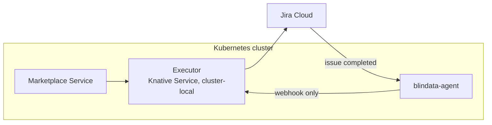

# Quickstart on Knative Serving

[README](../../README.md) > 1. Scenario > **2. Platform** > 3. Test

You deploy the executor as a Knative Service (it scales to zero), let Jira call it back through blindata-agent, register it in the Marketplace Service and test the whole flow.

**You need:**

- the **client id**, **client secret**, **API URL**, **correlation field id** and **`config/application.yml`** from your [scenario page](../../README.md#1-pick-your-scenario);
- a Kubernetes cluster with **Knative Serving** and a networking layer (Kourier, Istio or Contour), and `kubectl` access;
- the Marketplace Service and blindata-agent running in the cluster, with blindata-agent reachable by Jira over HTTPS;
- egress from the cluster to `api.atlassian.com` and `auth.atlassian.com`.



## 1. Deploy the executor

Create the credentials and the profiles, from the directory that contains `config/application.yml`:

```bash
kubectl create namespace marketplace

kubectl -n marketplace create secret generic jira-executor-credentials \
  --from-literal=JIRA_CLIENT_ID='<client id>' \
  --from-literal=JIRA_CLIENT_SECRET='<client secret>'

kubectl -n marketplace create configmap jira-executor-profiles \
  --from-file=application.yml=config/application.yml
```

**Automation rule scenario only:** create the secret with the two creation rules' URLs and secrets too:

```bash
kubectl -n marketplace create secret generic jira-executor-credentials \
  --from-literal=JIRA_CLIENT_ID='<client id>' \
  --from-literal=JIRA_CLIENT_SECRET='<client secret>' \
  --from-literal=JIRA_AUTOMATION_SUBSCRIBE_URL='<subscribe webhook url>' \
  --from-literal=JIRA_AUTOMATION_SUBSCRIBE_TOKEN='<subscribe webhook secret>' \
  --from-literal=JIRA_AUTOMATION_UNSUBSCRIBE_URL='<unsubscribe webhook url>' \
  --from-literal=JIRA_AUTOMATION_UNSUBSCRIBE_TOKEN='<unsubscribe webhook secret>'
```

Save this as `jira-executor.yaml`, fill in the version, your site, the cloudId, the correlation field and the Marketplace Service address, and apply it:

```yaml
apiVersion: serving.knative.dev/v1
kind: Service
metadata:
  name: jira-executor
  namespace: marketplace
  labels:
    networking.knative.dev/visibility: cluster-local    # no external route
spec:
  template:
    metadata:
      annotations:
        autoscaling.knative.dev/min-scale: "0"           # scale to zero
        autoscaling.knative.dev/max-scale: "3"
        autoscaling.knative.dev/scale-to-zero-pod-retention-period: "5m"   # idle window
    spec:
      timeoutSeconds: 300
      containers:
        - image: docker.io/opendatamesh/odm-platform-adapter-marketplace-executor-jira:<version>
          ports:
            - name: http1
              containerPort: 9019
          resources:
            requests: { cpu: 100m, memory: 128Mi }
            limits: { memory: 512Mi }
          envFrom:
            - secretRef:
                name: jira-executor-credentials
          env:
            - name: JIRA_DEPLOYMENT
              value: CLOUD
            - name: JIRA_SITE_URL
              value: https://<site>.atlassian.net
            - name: JIRA_API_URL
              value: https://api.atlassian.com/ex/jira/<cloudId>
            - name: JIRA_AUTH_TYPE
              value: OAUTH2_CLIENT_CREDENTIALS
            - name: JIRA_CORRELATION_FIELD
              value: customfield_10050
            - name: ODM_PRODUCT_PLANE_MARKETPLACE_SERVICE_ADDRESS
              value: http://marketplace-service.marketplace.svc.cluster.local:8085
            - name: QUARKUS_CONFIG_LOCATIONS
              value: /etc/executor/application.yml
          volumeMounts:
            - name: profiles
              mountPath: /etc/executor
              readOnly: true
      volumes:
        - name: profiles
          configMap:
            name: jira-executor-profiles
```

```bash
kubectl apply -f jira-executor.yaml
kubectl -n marketplace get ksvc jira-executor
# NAME            URL                                                    READY
# jira-executor   http://jira-executor.marketplace.svc.cluster.local     True
```

If `READY` stays `False`, read the logs: the executor prints a numbered list of configuration problems (`Invalid Jira executor configuration:`).

```bash
kubectl -n marketplace logs -l serving.knative.dev/service=jira-executor -c user-container
```

> The `cluster-local` label keeps the executor off the internet, which is required because its endpoints have no authentication of their own. The retention period keeps the pod alive while it opens the issue after answering the Marketplace Service. [Why each setting](../reference/deploy-knative.md#step-2---deploy-the-knative-service).

## 2. Connect Jira back through blindata-agent

Jira reaches the executor only through blindata-agent, which authenticates it and lets through only the webhooks.

1. **Route the agent to the executor.** In the ODM proxy configuration of blindata-agent, set the `marketplace-executor-jira` key to the cluster-local address:

   ```json
   { "servicesURLs": { "marketplace-executor-jira": "http://jira-executor.marketplace.svc.cluster.local" } }
   ```

2. **Create the Jira identity in Blindata.** An application user with the `MARKETPLACE_EDITOR` permission only (never `DATAOPS_ADMIN`), and an API key for it.
3. **Smoke test** (harmless: an unknown request id is acknowledged and ignored):

   ```bash
   export HOOK_URL="https://<agent-host>/agent-api/v1/odm/proxy/<configUuid>/marketplace-executor-jira/api/v1/up/marketplace-executor/webhooks/jira/issue-events"
   curl -i -X POST "$HOOK_URL" -H "Content-Type: application/json" \
     -H "X-BD-User: <application user>" -H "X-BD-ApiKey: <api key>" -H "X-BD-Tenant: <tenant>" \
     -d '{"correlationId":"00000000-0000-0000-0000-000000000000","fields":{"statusCategory":"done"}}'
   # -> 200 {"outcome":"IGNORED","reason":"UNKNOWN_REQUEST"}
   ```

   `403`: the user lacks `MARKETPLACE_EDITOR`. `404` from the Knative gateway: wrong host name, use the cluster-local name.

4. **Create the completion Automation rule** in Jira. It tells the executor when an issue is completed.
   1. **Project settings > Automation > Create rule** in the project of your scenario.
   2. **Trigger**: *Work item transitioned* (*Issue transitioned*), *From* and *To* empty.
   3. **Condition** for your scenario:

      | Scenario | Project | Condition |
      |:--|:--|:--|
      | Jira issue | `ACC` | *Work item fields condition*: *Status category* equals *Done* |
      | Service Management request | `SD` | *JQL condition*: `statusCategory = Done OR status = Declined` |
      | Your own Automation rule | where your creation rules create issues | *Work item fields condition*: *Status category* equals *Done* |

   4. **Condition**: *JQL condition* `"Marketplace request id" is not EMPTY`.
   5. **Action**: *Send web request* to `$HOOK_URL`, method `POST`, body *Custom data*, headers `Content-Type: application/json`, `X-BD-User`, `X-BD-ApiKey` and `X-BD-Tenant`, each credential marked **Hidden**. Body (replace `customfield_10050` with your field id):

      ```json
      {
        "correlationId": "{{issue.customfield_10050}}",
        "fields": {
          "key": "{{issue.key}}",
          "id": "{{issue.id}}",
          "project": "{{issue.project.key}}",
          "issueType": "{{issue.issueType.name}}",
          "status": "{{issue.status.name}}",
          "statusCategory": "{{issue.status.statusCategory.key}}",
          "resolution": "{{issue.resolution.name}}",
          "actor": "{{initiator.displayName}}",
          "lastComment": "{{issue.comments.last.body.jsonEncode}}"
        }
      }
      ```

   6. Name it (for example *Marketplace - report completion*), set its actor to *Automation for Jira*, and **Turn it on**.

Prefer your own ingress gateway, OAuth with Entra ID, or native Jira webhooks instead of a rule? See [Knative gateway options](../reference/deploy-knative.md#step-4---expose-the-notification-endpoints) and [Jira setup](../reference/jira-setup.md#9-completion-channel-a---jira-automation-rule-recommended).

## 3. Register the executor in the Marketplace Service

Add it to the Marketplace Service configuration and restart the service if it does not reload configuration. No port: Knative serves on 80 and routes to `9019`.

```yaml
odm:
  utility-plane:
    marketplace-executors:
      - name: JIRA
        address: http://jira-executor.marketplace.svc.cluster.local
        active: true
```

## 4. Test end to end

1. In the marketplace, request access to a data product matched by your filter (for example `urn:dp:finance:sales`).
2. The request shows **`PENDING`** with the Jira issue key and link. In the Automation rule scenario it shows `Request submitted to the Jira Automation rule ...` without a key: that is expected.
3. In Jira, complete the issue the way your scenario approves it:

   | Scenario | Grant | Deny |
   |:--|:--|:--|
   | Jira issue | Apply the *Grant* transition (resolution *Done*), with a comment | Apply *Decline* (resolution *Won't Do*) |
   | Service Management request | The approver approves, an agent resolves with *Done* | The approver declines |
   | Your own Automation rule | Close the created issue with resolution *Done* | Close it with resolution *Won't Do* |

4. The completion rule's **audit log** shows the web request with status `200`, and the request becomes **`GRANTED`** (or **`DENIED`**), with the issue link, the resolution and the comment.
5. Ask to remove the access: a revoke issue opens, and completing it the same way makes the request **`REVOKED`**.

**It works.** You have tested the whole concept.

## If something goes wrong

| Symptom | Check |
|:--|:--|
| No issue and no `PENDING`, the pod disappeared right after | The retention annotation, or the global `scale-to-zero-grace-period` |
| `ERROR` with a Jira message | Your scenario page, *If something goes wrong* |
| Issue completed, request still `PENDING`, nothing in the audit log | The rule's conditions (status category, JQL condition), rule turned on |
| Audit log shows `401`/`403` | The credential headers of the rule |
| `ERROR` naming a connection failure to Jira | Cluster egress to Atlassian |

Automation does not retry: after fixing the cause, re-run the rule for that issue. More in [Knative troubleshooting](../reference/deploy-knative.md#troubleshooting-on-knative) and [Troubleshooting](../reference/troubleshooting.md).

## Before production

- Apply the [network policy](../reference/deploy-knative.md#step-3---network-isolation) that admits only the activator, the networking layer, the Marketplace Service and the gateway.
- Use your usual secret tooling (External Secrets, Sealed Secrets, a CSI driver) instead of literal values.
- Read [Day 2 operations](../reference/deploy-knative.md#day-2-operations): upgrades, profile changes, secret rotation.
