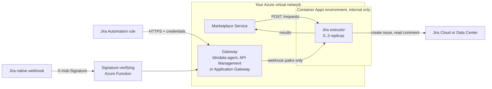

# Azure Container Apps in depth

[Back to README](../../README.md) | [Quickstart on Azure Container Apps](../platforms/azure-container-apps.md)

> This page explains every setting, the alternatives and day 2 operations. To deploy and test quickly, follow the [quickstart](../platforms/azure-container-apps.md).

## Overview

This page deploys the executor on **Azure Container Apps**, so it scales to zero when idle and starts again on the next request. It fits the [serverless rule](deployment.md#which-platforms-fit): a running replica keeps its CPU after the response, and Container Apps removes an idle replica only after a cool-down period, so the issue creation that runs after the `202` completes.



Related: [Deployment](deployment.md) · [Build and run](build-and-run.md) · [Jira setup](jira-setup.md) · [Configuration reference](configuration-reference.md)

## Contents

- [Settings that matter on Container Apps](#settings-that-matter-on-container-apps)
- [Step 1 - Prerequisites](#step-1---prerequisites)
- [Step 2 - The internal environment](#step-2---the-internal-environment)
- [Step 3 - Deploy the container app](#step-3---deploy-the-container-app)
- [Step 4 - Expose the notification endpoints](#step-4---expose-the-notification-endpoints)
- [Step 5 - Register with the Marketplace Service](#step-5---register-with-the-marketplace-service)
- [Step 6 - Verify](#step-6---verify)
- [Day 2 operations](#day-2-operations)
- [Troubleshooting on Container Apps](#troubleshooting-on-container-apps)

The commands use these placeholders: resource group `RG`, location `westeurope`, environment `marketplace-env`, app `jira-executor`.

## Settings that matter on Container Apps

| Setting | Value | Why |
|:--|:--|:--|
| `minReplicas` / `maxReplicas` | `0` / `3` | Scale to zero; the executor is stateless, so several replicas are safe |
| `cooldownPeriod` | `300` (seconds) | The idle window before the last replica is removed. Keep it at several minutes |
| HTTP scale rule | concurrent requests | Wakes the app up on traffic |
| Ingress target port | `9019` | The port the executor listens on |
| Environment | VNet-integrated, **internal only** | Network isolation: the executor's endpoints have no authentication of their own ([why](jira-setup.md#8-securing-the-notification-endpoints)) |
| Profiles file | Secret volume at `/etc/executor` + `QUARKUS_CONFIG_LOCATIONS` | Container Apps has no ConfigMaps; a secret can be mounted as a file |

**Ingress visibility in an internal-only environment.** The environment itself has no public endpoint. Inside it:

- ingress **external** (`external: true`) means reachable from the virtual network (and peered networks), which is what you need when the Marketplace Service or the gateway runs outside the environment (AKS, a VM, another environment);
- ingress **internal** (`external: false`) means reachable only from other apps of the same environment.

Choose the narrowest one that still lets the Marketplace Service and the gateway in.

## Step 1 - Prerequisites

- An Azure subscription, the Azure CLI with the `containerapp` extension, and a virtual network with a dedicated subnet for the environment (check the minimum subnet size for your environment type in the Container Apps networking documentation).
- The Marketplace Service and the gateway in that virtual network (or a peered one).
- Egress to Jira Cloud (`api.atlassian.com`, `auth.atlassian.com`) or a private path to Jira Data Center (VPN or ExpressRoute).
- Jira prepared as in your [scenario](../../README.md#1-pick-your-scenario), and your `config/application.yml` written.

```bash
az extension add --name containerapp --upgrade
az provider register --namespace Microsoft.App
az provider register --namespace Microsoft.OperationalInsights
```

## Step 2 - The internal environment

```bash
SUBNET_ID=$(az network vnet subnet show -g RG --vnet-name marketplace-vnet -n containerapps --query id -o tsv)

az containerapp env create -g RG -n marketplace-env --location westeurope \
  --infrastructure-subnet-resource-id "$SUBNET_ID" \
  --internal-only true
```

An internal-only environment gets a private IP and a default domain. Callers in the virtual network resolve the app names through a **private DNS zone** for that domain with a wildcard record pointing at the environment's static IP:

```bash
az containerapp env show -g RG -n marketplace-env \
  --query "{domain:properties.defaultDomain, ip:properties.staticIp}" -o table
```

Create the zone (named after `domain`), a `*` A record to `ip`, and link it to the virtual network.

**Egress.** By default the environment reaches the internet, so Jira Cloud works. If your Atlassian organisation uses IP allow-listing, give the subnet a **NAT gateway** with a static public IP (supported on workload-profiles environments: verify for yours). Jira Data Center needs the subnet to reach its host (VPN, ExpressRoute, peering).

## Step 3 - Deploy the container app

`app.yaml`, for `az containerapp create --yaml`:

```yaml
location: westeurope
properties:
  environmentId: /subscriptions/<sub>/resourceGroups/RG/providers/Microsoft.App/managedEnvironments/marketplace-env
  configuration:
    activeRevisionsMode: Single
    ingress:
      external: true            # internal-only environment: reachable from the VNet only
      targetPort: 9019
      transport: http
    secrets:
      - name: jira-client-id
        value: <client id>
      - name: jira-client-secret
        value: <client secret>
      - name: jira-executor-profiles
        value: |
          jira:
            profiles:
              subscribe:
                # ... the content of your config/application.yml
  template:
    containers:
      - name: executor
        image: docker.io/opendatamesh/odm-platform-adapter-marketplace-executor-jira:<version>
        resources:
          cpu: 0.5
          memory: 1Gi
        env:
          - name: JIRA_DEPLOYMENT
            value: CLOUD
          - name: JIRA_SITE_URL
            value: https://acme.atlassian.net
          - name: JIRA_API_URL
            value: https://api.atlassian.com/ex/jira/<cloudId>
          - name: JIRA_AUTH_TYPE
            value: OAUTH2_CLIENT_CREDENTIALS
          - name: JIRA_CORRELATION_FIELD
            value: customfield_10050
          - name: ODM_PRODUCT_PLANE_MARKETPLACE_SERVICE_ADDRESS
            value: http://marketplace-service.internal.acme:8085
          - name: QUARKUS_CONFIG_LOCATIONS
            value: /etc/executor/application.yml
          - name: JIRA_CLIENT_ID
            secretRef: jira-client-id
          - name: JIRA_CLIENT_SECRET
            secretRef: jira-client-secret
        volumeMounts:
          - volumeName: profiles
            mountPath: /etc/executor
    volumes:
      - name: profiles
        storageType: Secret
        secrets:
          - secretRef: jira-executor-profiles
            path: application.yml
    scale:
      minReplicas: 0
      maxReplicas: 3
      cooldownPeriod: 300
      rules:
        - name: http
          http:
            metadata:
              concurrentRequests: "10"
```

```bash
az containerapp create -g RG -n jira-executor --yaml app.yaml
az containerapp show -g RG -n jira-executor --query properties.configuration.ingress.fqdn -o tsv
# -> jira-executor.<unique-id>.westeurope.azurecontainerapps.io
```

Notes:

- **`cooldownPeriod`** is part of the scale settings in recent API versions; verify that your CLI and API version accept it (the default is 300 seconds).
- **Secrets.** Do not commit `app.yaml` with values. In production reference **Azure Key Vault** instead (`keyVaultUrl` plus a user-assigned managed identity that can read the secrets), and add the Automation webhook URLs and tokens if your profiles need them.
- **Ingress FQDN.** With `external: false` the FQDN contains `.internal.` (`jira-executor.internal.<unique-id>...`). Verify the exact form with the command above.
- **Startup validation.** With an invalid configuration the revision fails to provision. Read the numbered list (`Invalid Jira executor configuration:`) with `az containerapp logs show -g RG -n jira-executor --type console`.
- **Shutdown.** Background work is not awaited at scale-in: see the [known limit](deployment.md#known-limit-scale-in-during-background-work).

## Step 4 - Expose the notification endpoints

Jira must reach two paths of the executor, and only those, through a component that authenticates it:

```
POST /api/v1/up/marketplace-executor/webhooks/jira/issue-events    (Automation rule)
POST /api/v1/up/marketplace-executor/webhooks/jira/native-events   (native webhook)
```

### Option A: blindata-agent (recommended)

Run blindata-agent in the virtual network (a VM, AKS or another container app), exposed to Jira over HTTPS (on Jira Cloud, allow-list the Atlassian egress IP ranges). Register the executor's FQDN:

```json
{
  "servicesURLs": {
    "marketplace-executor-jira": "https://jira-executor.<unique-id>.westeurope.azurecontainerapps.io"
  }
}
```

The agent sets the `Host` header to the target host, which Container Apps uses to route the call. The Blindata identity for Jira, the URL Jira calls and the smoke test are in [Jira setup, option B](jira-setup.md#option-b-blindata-agent).

### Option B: your own gateway on Azure

**Azure API Management** (in the virtual network) or **Application Gateway** in front of the executor, exposed to Jira, which:

- authenticates the caller (for example an API Management subscription key or a `check-header` policy on a secret header sent by the Automation rule, marked *Hidden* in Jira);
- allows only `POST` on the two paths above (an API with exactly those two operations, or WAF custom rules on Application Gateway);
- forwards to the executor's FQDN.

The full requirements are in [Jira setup, option A](jira-setup.md#option-a-your-own-authenticating-gateway).

### Native webhooks: the signature-verifying function

Native webhooks need a function that verifies `X-Hub-Signature` before the gateway ([Jira setup, section 10](jira-setup.md#10-completion-channel-b---native-webhook)). On Azure use an **Azure Function** with anonymous HTTP access (it authenticates every call by the signature). The logic is the one of the [Cloud Run function](deploy-cloud-run.md#native-webhooks-the-signature-verifying-function), on the Azure Functions Node.js programming model:

```javascript
const { app } = require('@azure/functions');
const crypto = require('crypto');

app.http('jiraNativeWebhook', {
  methods: ['POST'],
  authLevel: 'anonymous',
  handler: async (request) => {
    const raw = Buffer.from(await request.arrayBuffer());   // the raw, unparsed body
    const received = (request.headers.get('x-hub-signature') || '').replace('sha256=', '');
    const expected = crypto.createHmac('sha256', process.env.JIRA_WEBHOOK_SECRET).update(raw).digest('hex');

    const ok = received.length === expected.length &&
               crypto.timingSafeEqual(Buffer.from(received), Buffer.from(expected));
    if (!ok) return { status: 401 };                          // log nothing from the request

    const response = await fetch(process.env.NATIVE_EVENTS_URL, {
      method: 'POST',
      headers: { 'Content-Type': 'application/json', 'x-gateway-key': process.env.GATEWAY_KEY },
      body: raw
    });
    return { status: response.status };                      // a 5xx makes Jira retry
  }
});
```

Keep `JIRA_WEBHOOK_SECRET` and `GATEWAY_KEY` in Key Vault references of the function app settings, and adapt the forwarded headers to your gateway (for blindata-agent: `X-BD-User`, `X-BD-ApiKey`, `X-BD-Tenant`).

## Step 5 - Register with the Marketplace Service

```yaml
odm:
  utility-plane:
    marketplace-executors:
      - name: JIRA
        address: https://jira-executor.<unique-id>.westeurope.azurecontainerapps.io
        active: true
```

The address is the ingress FQDN over HTTPS, without a port. The Marketplace Service must resolve it through the private DNS zone of [Step 2](#step-2---the-internal-environment).

## Step 6 - Verify

1. **From a machine in the virtual network**, the harmless smoke test must answer `IGNORED` (the first call after an idle period waits for a replica to start):

   ```bash
   curl -i -X POST "https://jira-executor.<unique-id>.westeurope.azurecontainerapps.io/api/v1/up/marketplace-executor/webhooks/jira/issue-events" \
     -H "Content-Type: application/json" \
     -d '{"correlationId":"00000000-0000-0000-0000-000000000000","fields":{"statusCategory":"done"}}'
   # -> 200 {"outcome":"IGNORED","reason":"UNKNOWN_REQUEST"}
   ```

2. **From outside the network** the name must not resolve or answer.
3. **Through the gateway**, the smoke test of your option must answer `200 IGNORED`.
4. After the cool-down with no traffic, `az containerapp replica list -g RG -n jira-executor` shows no replica.
5. **End to end**: follow step 4 of the [quickstart](../platforms/azure-container-apps.md#4-test-end-to-end).

## Day 2 operations

- **Upgrade**: `az containerapp update -g RG -n jira-executor --image docker.io/opendatamesh/odm-platform-adapter-marketplace-executor-jira:<new version>`.
- **Change the profiles**: update the `jira-executor-profiles` secret (`az containerapp secret set`), then restart the active revision (`az containerapp revision restart`), because running replicas keep the old file.
- **Rotate Jira credentials**: update the secret (or the Key Vault secret), then restart the revision. See [Rotating secrets](jira-setup.md#rotating-secrets).
- **Logs**: `az containerapp logs show`, or the Log Analytics workspace of the environment. Search for the marketplace request UUID or the issue key.

## Troubleshooting on Container Apps

| Symptom | Likely cause |
|:--|:--|
| Revision fails to provision | Invalid configuration: read `Invalid Jira executor configuration:` in the console logs. Or a Key Vault secret the identity cannot read |
| The FQDN does not resolve from the Marketplace Service | Missing or unlinked private DNS zone for the environment's default domain |
| `404` from the environment | Ingress visibility too narrow (`external: false` while the caller is outside the environment), or a wrong host name |
| The Marketplace Service gets `202` but no issue appears | The replica was removed during background work ([known limit](deployment.md#known-limit-scale-in-during-background-work)), or a `cooldownPeriod` that is too short |
| `ERROR` results naming a connection failure to Jira | Egress: NAT gateway or Atlassian IP allow-listing, or the path to Data Center |

---
[Back to README](../../README.md) | [Deployment](deployment.md) | [Examples](examples.md)
