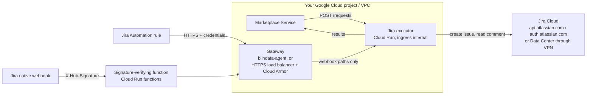

# Google Cloud Run in depth

[Back to README](../../README.md) | [Quickstart on Cloud Run](../platforms/cloud-run.md)

> This page explains every setting, the alternatives and day 2 operations. To deploy and test quickly, follow the [quickstart](../platforms/cloud-run.md).

## Overview

This page deploys the executor as a **Google Cloud Run** service, using the published container image, with **scale to zero**. It is one of the supported serverless platforms: see [Deployment](deployment.md) for the others (Knative, KEDA HTTP add-on, Azure Container Apps) and for the rule that decides which platforms fit. For plain Docker, Kubernetes or a VM, see [Build and run](build-and-run.md).

What you end up with:



- The **Marketplace Service** calls the executor directly, over the VPC. It never goes through the gateway.
- **Jira** calls the executor only through a gateway that authenticates it. The native webhook additionally needs a function that verifies its signature.
- The executor calls Jira and the Marketplace Service.

Related: [Deployment](deployment.md) · [Build and run](build-and-run.md) · [Jira setup](jira-setup.md) · [Configuration reference](configuration-reference.md) · [Troubleshooting](troubleshooting.md)

## Contents

- [Settings that matter on Cloud Run](#settings-that-matter-on-cloud-run)
- [Step 1 - Prerequisites](#step-1---prerequisites)
- [Step 2 - Service account and secrets](#step-2---service-account-and-secrets)
- [Step 3 - Deploy the service](#step-3---deploy-the-service)
- [Step 4 - Expose the notification endpoints](#step-4---expose-the-notification-endpoints)
- [Step 5 - Register with the Marketplace Service](#step-5---register-with-the-marketplace-service)
- [Step 6 - Verify](#step-6---verify)
- [Day 2 operations](#day-2-operations)
- [Other serverless platforms](#other-serverless-platforms)
- [Troubleshooting on Cloud Run](#troubleshooting-on-cloud-run)

The commands use these placeholders: `PROJECT_ID`, `REGION` (`europe-west1` in the examples) and the service name `jira-executor`.

## Settings that matter on Cloud Run

### CPU always allocated (mandatory)

The executor answers the Marketplace Service with `202` immediately and then opens the Jira issue **on a background thread, after the response has been sent**. With the default Cloud Run setting (CPU allocated only while a request is being processed), the CPU is throttled as soon as the `202` goes out, and the issue creation stalls until another request happens to arrive.

Always deploy with **`--no-cpu-throttling`** ("CPU always allocated", instance-based billing). This does **not** prevent scale to zero: it only means that a running instance keeps its CPU between requests.

**Scale to zero and the idle window.** With `--min-instances=0`, Cloud Run removes an instance some time after its last request. It usually keeps idle instances for several minutes (up to about 15), which is far longer than the few seconds the background work needs. This is common behaviour, not a documented guarantee: see the [known limit](deployment.md#known-limit-scale-in-during-background-work). The first request after an idle period waits for a cold start, which takes well under a second with the native image.

| Flag | Value | Why |
|:--|:--|:--|
| `--no-cpu-throttling` | required | Background issue creation keeps running after the `202` |
| `--min-instances` | `0` (scale to zero) | No cost while idle. Use `1` to avoid cold starts, at the cost of one instance billed continuously |
| `--max-instances` | small, for example `3` | The executor is stateless, so several instances are safe; the volume is low |
| `--memory`, `--cpu` | `512Mi`, `1` | The image contains a native executable, which needs little memory |
| `--port` | `9019` | The port the executor listens on |

### The image

Cloud Run pulls images from **Artifact Registry** or **Docker Hub**, not from `ghcr.io` directly. Two options:

- **A. Docker Hub (quick start):** `docker.io/opendatamesh/odm-platform-adapter-marketplace-executor-jira:<version>`.
- **B. Artifact Registry remote repository (production):** a proxy of Docker Hub in your project, so deployments do not depend on Docker Hub rate limits:

  ```bash
  gcloud artifacts repositories create dockerhub-remote \
    --project=PROJECT_ID --location=REGION \
    --repository-format=docker --mode=remote-repository \
    --remote-docker-repo=DOCKER-HUB
  # image: REGION-docker.pkg.dev/PROJECT_ID/dockerhub-remote/opendatamesh/odm-platform-adapter-marketplace-executor-jira:<version>
  ```

Always pin a released version (for example `1.0.0`), never `latest`.

### The profiles file

The issue profiles must be provided in an external YAML file ([why](configuration-reference.md#where-to-put-the-configuration)). Cloud Run has no ConfigMaps: store the file in **Secret Manager** and mount it as a file, then point `QUARKUS_CONFIG_LOCATIONS` at it:

```
--set-secrets=/etc/executor/application.yml=jira-executor-profiles:1
--set-env-vars=QUARKUS_CONFIG_LOCATIONS=/etc/executor/application.yml
```

Mounted secret files are readable by the container user (`1001`). The profiles file holds no credentials (they come from environment variables), but Secret Manager is the Cloud Run way to mount a file and it keeps a version history of your configuration.

### Secrets as environment variables

Credentials come from Secret Manager, exposed as environment variables with `--set-secrets=VAR=secret:version`:

| Auth or interface | Variables |
|:--|:--|
| Cloud, OAuth service account (default) | `JIRA_CLIENT_ID`, `JIRA_CLIENT_SECRET` |
| Cloud, API token | `JIRA_API_TOKEN_EMAIL`, `JIRA_API_TOKEN` |
| Data Center, Personal Access Token | `JIRA_PAT` |
| `AUTOMATION_WEBHOOK` profiles | the variables your profile references, for example `JIRA_AUTOMATION_SUBSCRIBE_URL`, `JIRA_AUTOMATION_SUBSCRIBE_TOKEN`, `JIRA_AUTOMATION_UNSUBSCRIBE_URL`, `JIRA_AUTOMATION_UNSUBSCRIBE_TOKEN` |

Pin secret **versions** (`:1`, `:2`, ...) rather than `:latest`: a new version then takes effect only when you deploy a new revision, which makes changes deliberate and traceable. Run the service with a **dedicated service account** that has `roles/secretmanager.secretAccessor` on these secrets only.

### Network isolation (hard requirement)

The executor's endpoints have **no authentication of their own** ([why](jira-setup.md#8-securing-the-notification-endpoints)). On Cloud Run, isolation comes from the **ingress setting**, which plays the role a Kubernetes `NetworkPolicy` plays elsewhere:

- `--ingress=internal`: only internal traffic reaches the service, that is requests from VPC networks of the same project, a Shared VPC, or the same VPC Service Controls perimeter (see the Cloud Run *ingress* documentation for the exact list). Use `--ingress=internal-and-cloud-load-balancing` only with the [load balancer gateway](#option-b-your-own-gateway-on-google-cloud).
- **No IAM invoker check.** The Marketplace Service calls the executor without credentials, so Cloud Run's IAM authentication cannot be used. Deploy with `--no-invoker-iam-check`. On older `gcloud` versions use `--allow-unauthenticated`; note that the organisation policy *Domain restricted sharing* blocks `allUsers`, which is one more reason to prefer `--no-invoker-iam-check`.
- Since anything internal can call the service, **keep that VPC limited** to the components that need it.
- **Callers:**
  - a Cloud Run service (for example the Marketplace Service, or the gateway) must send its traffic through the VPC: Direct VPC egress with `--vpc-egress=all-traffic`;
  - a VM or GKE node without an external IP needs **Private Google Access** on its subnet to reach `*.run.app`.

### Egress

- **Jira Cloud**: the default internet egress reaches `api.atlassian.com` and `auth.atlassian.com`. Nothing to configure.
- **Jira Data Center inside your network**: add Direct VPC egress (`--network=NETWORK --subnet=SUBNET --vpc-egress=private-ranges-only`) and make the Data Center host reachable from that VPC (Cloud VPN or Interconnect).
- **The Marketplace Service** must be reachable from the executor: internal address through Direct VPC egress, or its public URL.
- If you send **all** egress through the VPC (`--vpc-egress=all-traffic`), internet access needs **Cloud NAT**. Reserve a static IP for it if your Atlassian organisation uses IP allow-listing.

## Step 1 - Prerequisites

- A Google Cloud project with billing, and `gcloud` authenticated with a user that can manage Cloud Run, Secret Manager, IAM and (for the load balancer option) Compute Engine.
- The VPC where the Marketplace Service (and the gateway) run.
- Jira prepared as in your [scenario](../../README.md#1-pick-your-scenario), and your `config/application.yml` written.

```bash
gcloud config set project PROJECT_ID
gcloud services enable run.googleapis.com secretmanager.googleapis.com \
  artifactregistry.googleapis.com compute.googleapis.com
```

## Step 2 - Service account and secrets

```bash
# runtime identity of the executor
gcloud iam service-accounts create jira-executor \
  --display-name="Marketplace executor for Jira"
SA=jira-executor@PROJECT_ID.iam.gserviceaccount.com

# Jira credentials (Cloud, OAuth service account)
printf '%s' "$JIRA_CLIENT_ID"     | gcloud secrets create jira-client-id     --data-file=-
printf '%s' "$JIRA_CLIENT_SECRET" | gcloud secrets create jira-client-secret --data-file=-

# the profiles file
gcloud secrets create jira-executor-profiles --data-file=config/application.yml

# let the executor read them, and nothing else
for s in jira-client-id jira-client-secret jira-executor-profiles; do
  gcloud secrets add-iam-policy-binding "$s" \
    --member="serviceAccount:$SA" --role=roles/secretmanager.secretAccessor
done
```

Add the other secrets of the table above when your profiles need them (for example the Automation webhook URLs and tokens). `printf '%s'` avoids a trailing newline in the secret value.

## Step 3 - Deploy the service

```bash
gcloud run deploy jira-executor \
  --region=REGION \
  --image=docker.io/opendatamesh/odm-platform-adapter-marketplace-executor-jira:<version> \
  --service-account="$SA" \
  --port=9019 \
  --no-cpu-throttling --min-instances=0 --max-instances=3 \
  --memory=512Mi --cpu=1 \
  --ingress=internal --no-invoker-iam-check \
  --set-env-vars=JIRA_DEPLOYMENT=CLOUD,JIRA_SITE_URL=https://acme.atlassian.net,JIRA_API_URL=https://api.atlassian.com/ex/jira/<cloudId>,JIRA_AUTH_TYPE=OAUTH2_CLIENT_CREDENTIALS,JIRA_CORRELATION_FIELD=customfield_10050,ODM_PRODUCT_PLANE_MARKETPLACE_SERVICE_ADDRESS=http://marketplace-service.internal:8085,QUARKUS_CONFIG_LOCATIONS=/etc/executor/application.yml \
  --set-secrets=JIRA_CLIENT_ID=jira-client-id:1,JIRA_CLIENT_SECRET=jira-client-secret:1,/etc/executor/application.yml=jira-executor-profiles:1
```

Add `--network=NETWORK --subnet=SUBNET --vpc-egress=private-ranges-only` when the Marketplace Service or Jira Data Center is reachable only through the VPC.

Get the service URL, used by the Marketplace Service and the gateway:

```bash
gcloud run services describe jira-executor --region=REGION --format='value(status.url)'
# -> https://jira-executor-xxxxxxxxxx-ew.a.run.app
```

**Startup validation.** The executor refuses to start with an invalid configuration. On Cloud Run the new revision then never becomes ready and the deployment fails. Read the numbered list of problems (`Invalid Jira executor configuration:`) in the logs:

```bash
gcloud run services logs read jira-executor --region=REGION --limit=50
```

### Declarative alternative

The same service as a YAML file, for `gcloud run services replace service.yaml --region=REGION` (useful in CI and to review changes):

```yaml
apiVersion: serving.knative.dev/v1
kind: Service
metadata:
  name: jira-executor
  annotations:
    run.googleapis.com/ingress: internal
    run.googleapis.com/invoker-iam-disabled: "true"
spec:
  template:
    metadata:
      annotations:
        run.googleapis.com/cpu-throttling: "false"
        autoscaling.knative.dev/minScale: "0"
        autoscaling.knative.dev/maxScale: "3"
    spec:
      serviceAccountName: jira-executor@PROJECT_ID.iam.gserviceaccount.com
      containers:
        - image: docker.io/opendatamesh/odm-platform-adapter-marketplace-executor-jira:<version>
          ports:
            - containerPort: 9019
          resources:
            limits:
              cpu: "1"
              memory: 512Mi
          env:
            - name: JIRA_DEPLOYMENT
              value: CLOUD
            - name: JIRA_SITE_URL
              value: https://acme.atlassian.net
            - name: JIRA_API_URL
              value: https://api.atlassian.com/ex/jira/<cloudId>
            - name: JIRA_AUTH_TYPE
              value: OAUTH2_CLIENT_CREDENTIALS
            - name: JIRA_CORRELATION_FIELD
              value: customfield_10050
            - name: ODM_PRODUCT_PLANE_MARKETPLACE_SERVICE_ADDRESS
              value: http://marketplace-service.internal:8085
            - name: QUARKUS_CONFIG_LOCATIONS
              value: /etc/executor/application.yml
            - name: JIRA_CLIENT_ID
              valueFrom:
                secretKeyRef: { name: jira-client-id, key: "1" }
            - name: JIRA_CLIENT_SECRET
              valueFrom:
                secretKeyRef: { name: jira-client-secret, key: "1" }
          volumeMounts:
            - name: profiles
              mountPath: /etc/executor
      volumes:
        - name: profiles
          secret:
            secretName: jira-executor-profiles
            items:
              - key: "1"
                path: application.yml
```

## Step 4 - Expose the notification endpoints

Jira must reach two paths of the executor, and only those, through a component that authenticates it:

```
POST /api/v1/up/marketplace-executor/webhooks/jira/issue-events    (Automation rule)
POST /api/v1/up/marketplace-executor/webhooks/jira/native-events   (native webhook)
```

Pick one option. The Marketplace Service leg never goes through the gateway.

### Option A: blindata-agent (recommended)

Run blindata-agent in the same VPC as the executor (Compute Engine or GKE), reachable from Jira over HTTPS. On Jira Cloud, allow-list the Atlassian egress IP ranges on your edge.

Register the executor in the agent's ODM proxy configuration with its Cloud Run URL (https, no port):

```json
{
  "servicesURLs": {
    "marketplace-executor-jira": "https://jira-executor-xxxxxxxxxx-ew.a.run.app"
  }
}
```

The agent sets the `Host` header to the target host when it forwards, which is what Cloud Run needs to route the call. From a VM or GKE node, the agent's calls to `*.run.app` count as internal when they leave through the VPC (Private Google Access for nodes without an external IP).

The Blindata identity for Jira, the URL Jira calls and the smoke test are in [Jira setup, option B](jira-setup.md#option-b-blindata-agent).

### Option B: your own gateway on Google Cloud

A global external Application Load Balancer in front of the executor, with a **Cloud Armor** policy that lets through only `POST` calls to the two webhook paths carrying a shared secret header. Redeploy the executor with `--ingress=internal-and-cloud-load-balancing` so the load balancer can reach it.

```bash
# 1. serverless NEG pointing at the Cloud Run service
gcloud compute network-endpoint-groups create jira-executor-neg \
  --region=REGION --network-endpoint-type=serverless --cloud-run-service=jira-executor

# 2. backend service
gcloud compute backend-services create jira-executor-backend \
  --global --load-balancing-scheme=EXTERNAL_MANAGED
gcloud compute backend-services add-backend jira-executor-backend \
  --global --network-endpoint-group=jira-executor-neg --network-endpoint-group-region=REGION

# 3. URL map, certificate, HTTPS proxy, static IP and forwarding rule
gcloud compute url-maps create jira-executor-lb --default-service=jira-executor-backend
gcloud compute ssl-certificates create jira-executor-cert --global --domains=jira-hooks.acme.com
gcloud compute target-https-proxies create jira-executor-proxy \
  --url-map=jira-executor-lb --ssl-certificates=jira-executor-cert
gcloud compute addresses create jira-executor-ip --global
gcloud compute forwarding-rules create jira-executor-https \
  --global --load-balancing-scheme=EXTERNAL_MANAGED \
  --address=jira-executor-ip --target-https-proxy=jira-executor-proxy --ports=443

# 4. Cloud Armor: deny by default, allow only the webhook calls with the secret header
gcloud compute security-policies create jira-executor-armor
gcloud compute security-policies rules update 2147483647 \
  --security-policy=jira-executor-armor --action=deny-403
gcloud compute security-policies rules create 1000 \
  --security-policy=jira-executor-armor --action=allow \
  --expression="request.method == 'POST' && (request.path == '/api/v1/up/marketplace-executor/webhooks/jira/issue-events' || request.path == '/api/v1/up/marketplace-executor/webhooks/jira/native-events') && request.headers['x-gateway-key'] == '<long random secret>'"
gcloud compute backend-services update jira-executor-backend \
  --global --security-policy=jira-executor-armor
```

Point the DNS name (`jira-hooks.acme.com` here) at the reserved IP; the managed certificate becomes active once DNS resolves. You can add `&& inIpRange(origin.ip, '<range>')` conditions with the Atlassian egress ranges.

The URL Jira calls is then `https://jira-hooks.acme.com/api/v1/up/marketplace-executor/webhooks/jira/issue-events`, with the header `x-gateway-key: <secret>`.

Limits of this option:

- The secret is stored in the Cloud Armor rule, visible to anyone who can read security policies in the project. Rotate it by updating the rule and the Jira Automation header together.
- Cloud Armor compares a header value: it cannot validate OAuth tokens or verify Jira's HMAC signatures. Native webhooks still need the function below.

### Native webhooks: the signature-verifying function

The native webhook channel ([Jira setup, section 10](jira-setup.md#10-completion-channel-b---native-webhook)) only signs its calls (`X-Hub-Signature`). A small **Cloud Run function** verifies the signature, adds the credentials your gateway expects and forwards the call. It must be public, because Jira calls it, and it authenticates every call by the signature.

`index.js`:

```javascript
const crypto = require('crypto');
const functions = require('@google-cloud/functions-framework');

functions.http('jiraNativeWebhook', async (req, res) => {
  if (req.method !== 'POST') return res.status(405).end();

  const raw = req.rawBody;                                  // the raw, unparsed body (Buffer)
  const received = (req.get('x-hub-signature') || '').replace('sha256=', '');
  const expected = crypto.createHmac('sha256', process.env.JIRA_WEBHOOK_SECRET).update(raw).digest('hex');

  const ok = received.length === expected.length &&
             crypto.timingSafeEqual(Buffer.from(received), Buffer.from(expected));   // constant time
  if (!ok) return res.status(401).end();                    // log nothing from the request

  const response = await fetch(process.env.NATIVE_EVENTS_URL, {
    method: 'POST',
    headers: {
      'Content-Type': 'application/json',
      // credentials expected by your gateway, from Secret Manager
      'x-gateway-key': process.env.GATEWAY_KEY
    },
    body: raw
  });
  res.status(response.status).end();                        // a 5xx makes Jira retry
});
```

`package.json`:

```json
{
  "dependencies": { "@google-cloud/functions-framework": "^3.4.0" }
}
```

Deploy it, with the secrets from Secret Manager:

```bash
gcloud functions deploy jira-native-webhook \
  --gen2 --region=REGION --runtime=nodejs20 \
  --source=. --entry-point=jiraNativeWebhook \
  --trigger-http --allow-unauthenticated \
  --set-env-vars=NATIVE_EVENTS_URL=https://jira-hooks.acme.com/api/v1/up/marketplace-executor/webhooks/jira/native-events \
  --set-secrets=JIRA_WEBHOOK_SECRET=jira-webhook-secret:1,GATEWAY_KEY=jira-gateway-key:1
```

Use the function URL as the Jira webhook URL. Adapt the forwarded headers to your gateway (for blindata-agent: `X-BD-User`, `X-BD-ApiKey`, `X-BD-Tenant`, and the agent URL as `NATIVE_EVENTS_URL`). If the function runs in the same project with Direct VPC egress `all-traffic`, it can also call the executor's `*.run.app` URL directly, as internal traffic, without a gateway. Follow the security checklist of [section 10](jira-setup.md#10-completion-channel-b---native-webhook).

## Step 5 - Register with the Marketplace Service

In the Marketplace Service configuration, use the Cloud Run URL (https, no port):

```yaml
odm:
  utility-plane:
    marketplace-executors:
      - name: JIRA
        address: https://jira-executor-xxxxxxxxxx-ew.a.run.app
        active: true
```

The Marketplace Service must reach that URL as internal traffic (see [Network isolation](#network-isolation-hard-requirement)).

## Step 6 - Verify

1. **From inside the VPC** (a VM in the same network, for example), the harmless smoke test must answer `IGNORED`:

   ```bash
   curl -i -X POST "https://jira-executor-xxxxxxxxxx-ew.a.run.app/api/v1/up/marketplace-executor/webhooks/jira/issue-events" \
     -H "Content-Type: application/json" \
     -d '{"correlationId":"00000000-0000-0000-0000-000000000000","fields":{"statusCategory":"done"}}'
   # -> 200 {"outcome":"IGNORED","reason":"UNKNOWN_REQUEST"}
   ```

2. **From outside** (your laptop), the same call must **fail** (`404` or `403` from Google's front end). This proves the ingress setting works.
3. **Through the gateway**, the smoke test of your option must answer `200 IGNORED`. A `401` or `403` comes from the gateway.
4. **End to end**: follow step 4 of the [quickstart](../platforms/cloud-run.md#4-test-end-to-end).

## Day 2 operations

- **Upgrade the image**: `gcloud run deploy jira-executor --region=REGION --image=...:<new version>` (other settings are kept).
- **Change the profiles**: `gcloud secrets versions add jira-executor-profiles --data-file=config/application.yml`, then redeploy with the new version number in `--set-secrets` (`/etc/executor/application.yml=jira-executor-profiles:2`). An invalid file fails the deployment and the previous revision keeps serving.
- **Rotate Jira credentials**: add a new secret version, redeploy pointing at it, then revoke the old credential in Jira. See [Rotating secrets](jira-setup.md#rotating-secrets).
- **Logs**: Cloud Logging, resource *Cloud Run Revision*, service `jira-executor`. Search for the marketplace request UUID or the issue key: they appear in every business log line ([Troubleshooting](troubleshooting.md#logs)).
- **Cost**: with `--min-instances=0` you pay for the time instances are alive, including the idle period after the last request, and nothing while scaled to zero. `--min-instances=1` removes cold starts but bills one instance (with CPU always allocated) continuously.

## Other serverless platforms

The executor also runs with scale to zero on [Knative](deploy-knative.md), the [KEDA HTTP add-on](deploy-keda-http.md) and [Azure Container Apps](deploy-azure-container-apps.md). **AWS Lambda**, **AWS App Runner** and Cloud Run with request-based billing are not supported: they freeze or throttle the runtime once the response has been sent, so the issue creation that starts after the `202` would stall or be lost. The full comparison is in [Serverless deployment](deployment.md#which-platforms-fit).

## Troubleshooting on Cloud Run

| Symptom | Likely cause |
|:--|:--|
| Deployment fails, revision not ready | Invalid configuration: read `Invalid Jira executor configuration:` in the logs. Or a secret the service account cannot read |
| `404` or `403` calling the `run.app` URL from inside the VPC | The call is not counted as internal: Direct VPC egress `all-traffic` for Cloud Run callers, Private Google Access for VMs without an external IP |
| The Marketplace Service gets `202` but no issue appears for minutes | CPU throttling: the service was deployed without `--no-cpu-throttling` |
| A request has no `PENDING` nor `ERROR`, and no `Opened Jira issue` log line | The instance was removed during background work: see the [known limit](deployment.md#known-limit-scale-in-during-background-work) |
| `403` from the load balancer | Cloud Armor: wrong path or method, missing or wrong `x-gateway-key`, or an IP condition |
| `ERROR` results naming a connection failure to Jira | Egress: Cloud NAT missing with `all-traffic`, IP allow-listing on the Atlassian side, or VPN/Interconnect to Data Center |
| Results never reach the Marketplace Service | Its address is wrong or not reachable from the executor (Direct VPC egress) |

---
[Back to README](../../README.md) | [Deployment](deployment.md) | [Examples](examples.md) | [Build and run](build-and-run.md)
