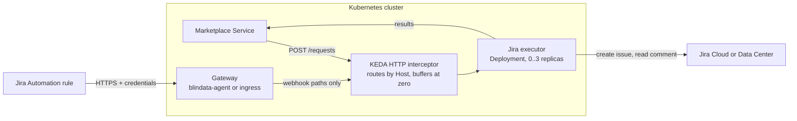

# KEDA HTTP add-on in depth

[Back to README](../../README.md) | [Quickstart on KEDA HTTP add-on](../platforms/keda-http.md)

> This page explains every setting, the alternatives and day 2 operations. To deploy and test quickly, follow the [quickstart](../platforms/keda-http.md).

## Overview

This page deploys the executor as a plain Kubernetes `Deployment` that the **KEDA HTTP add-on** scales to zero when idle and back to one when a request arrives. It fits the [serverless rule](deployment.md#which-platforms-fit): Kubernetes never throttles a running pod, and the add-on removes the last replica only after a configurable scale-down period, so the issue creation that runs after the `202` completes.

With the add-on, callers do not call the executor's Service directly: they call the add-on's **interceptor**, which holds the request while the executor scales from zero and routes it by the `Host` header.



Related: [Deployment](deployment.md) · [Build and run](build-and-run.md) · [Jira setup](jira-setup.md) · [Configuration reference](configuration-reference.md)

## Contents

- [Prerequisites](#prerequisites)
- [Step 1 - Secrets and profiles](#step-1---secrets-and-profiles)
- [Step 2 - Deployment and Service](#step-2---deployment-and-service)
- [Step 3 - Scale with an HTTPScaledObject](#step-3---scale-with-an-httpscaledobject)
- [Step 4 - Route callers through the interceptor](#step-4---route-callers-through-the-interceptor)
- [Step 5 - Network isolation](#step-5---network-isolation)
- [Step 6 - Expose the notification endpoints](#step-6---expose-the-notification-endpoints)
- [Step 7 - Register with the Marketplace Service](#step-7---register-with-the-marketplace-service)
- [Step 8 - Verify](#step-8---verify)
- [Troubleshooting with the KEDA HTTP add-on](#troubleshooting-with-the-keda-http-add-on)

The examples use the namespace `marketplace` and the name `jira-executor`. Field names follow the `http.keda.sh/v1alpha1` API of the add-on: **verify them against your add-on version**, since the API is still alpha and has changed between releases.

## Prerequisites

- A Kubernetes cluster with **KEDA** and the **KEDA HTTP add-on** installed, for example with Helm:

  ```bash
  helm repo add kedacore https://kedacore.github.io/charts
  helm install keda kedacore/keda --namespace keda --create-namespace
  helm install http-add-on kedacore/keda-add-ons-http --namespace keda
  ```

- The Marketplace Service and the gateway running in the cluster.
- Egress to Jira Cloud (`api.atlassian.com`, `auth.atlassian.com`) or a private network path to Jira Data Center.
- Jira prepared as in your [scenario](../../README.md#1-pick-your-scenario), and your `config/application.yml` written.

## Step 1 - Secrets and profiles

```bash
kubectl create namespace marketplace

kubectl -n marketplace create secret generic jira-executor-credentials \
  --from-literal=JIRA_CLIENT_ID="$JIRA_CLIENT_ID" \
  --from-literal=JIRA_CLIENT_SECRET="$JIRA_CLIENT_SECRET"

kubectl -n marketplace create configmap jira-executor-profiles \
  --from-file=application.yml=config/application.yml
```

Add the Automation webhook URLs and tokens to the Secret if your profiles need them.

## Step 2 - Deployment and Service

`jira-executor.yaml`:

```yaml
apiVersion: apps/v1
kind: Deployment
metadata:
  name: jira-executor
  namespace: marketplace
spec:
  replicas: 0                         # KEDA manages the replica count
  selector:
    matchLabels: { app: jira-executor }
  template:
    metadata:
      labels: { app: jira-executor }
    spec:
      terminationGracePeriodSeconds: 30
      containers:
        - name: executor
          image: docker.io/opendatamesh/odm-platform-adapter-marketplace-executor-jira:<version>
          ports:
            - containerPort: 9019
          readinessProbe:
            tcpSocket: { port: 9019 }
            periodSeconds: 2
          resources:
            requests: { cpu: 100m, memory: 128Mi }
            limits: { memory: 512Mi }
          envFrom:
            - secretRef:
                name: jira-executor-credentials
          env:
            - name: JIRA_DEPLOYMENT
              value: CLOUD
            - name: JIRA_SITE_URL
              value: https://acme.atlassian.net
            - name: JIRA_API_URL
              value: https://api.atlassian.com/ex/jira/<cloudId>
            - name: JIRA_AUTH_TYPE
              value: OAUTH2_CLIENT_CREDENTIALS
            - name: JIRA_CORRELATION_FIELD
              value: customfield_10050
            - name: ODM_PRODUCT_PLANE_MARKETPLACE_SERVICE_ADDRESS
              value: http://marketplace-service.marketplace.svc.cluster.local:8085
            - name: QUARKUS_CONFIG_LOCATIONS
              value: /etc/executor/application.yml
          volumeMounts:
            - name: profiles
              mountPath: /etc/executor
              readOnly: true
      volumes:
        - name: profiles
          configMap:
            name: jira-executor-profiles
---
apiVersion: v1
kind: Service
metadata:
  name: jira-executor
  namespace: marketplace
spec:
  selector: { app: jira-executor }
  ports:
    - port: 9019
      targetPort: 9019
```

The executor has no health endpoint; a TCP readiness probe on `9019` is enough. With an invalid configuration the process exits, so the pod never stays ready: read `Invalid Jira executor configuration:` with `kubectl -n marketplace logs deploy/jira-executor`.

## Step 3 - Scale with an HTTPScaledObject

```yaml
apiVersion: http.keda.sh/v1alpha1
kind: HTTPScaledObject
metadata:
  name: jira-executor
  namespace: marketplace
spec:
  hosts:
    - jira-executor-scaled.marketplace.svc.cluster.local
  scaleTargetRef:
    name: jira-executor
    kind: Deployment
    apiVersion: apps/v1
    service: jira-executor
    port: 9019
  replicas:
    min: 0
    max: 3
  scaledownPeriod: 300                # idle window, in seconds
```

`scaledownPeriod` is the idle window: the last replica is removed only after that many seconds without traffic. Keep it at several minutes. Verify the field names (`scaleTargetRef.service`, `scaleTargetRef.port`, `scaledownPeriod`) for your add-on version.

```bash
kubectl apply -f jira-executor.yaml -f jira-executor-httpso.yaml
kubectl -n marketplace get httpscaledobject jira-executor
```

## Step 4 - Route callers through the interceptor

Requests must reach the add-on's interceptor proxy (`keda-add-ons-http-interceptor-proxy` in the `keda` namespace, port `8080`) with a `Host` header that matches one of the `hosts` above. A request sent straight to the `jira-executor` Service does not wake the executor up from zero.

The simplest way for in-cluster callers is an `ExternalName` Service whose name is the host listed in the `HTTPScaledObject`:

```yaml
apiVersion: v1
kind: Service
metadata:
  name: jira-executor-scaled
  namespace: marketplace
spec:
  type: ExternalName
  externalName: keda-add-ons-http-interceptor-proxy.keda.svc.cluster.local
```

Callers then use `http://jira-executor-scaled.marketplace.svc.cluster.local:8080`. Their HTTP client sends `Host: jira-executor-scaled.marketplace.svc.cluster.local:8080`; verify whether your add-on version matches hosts with or without the port, and add the `...:8080` form to `hosts` if needed.

Alternative: an internal Ingress (not exposed outside the cluster) that sends the executor's host name to the interceptor Service.

## Step 5 - Network isolation

The executor's endpoints have **no authentication of their own** ([why](jira-setup.md#8-securing-the-notification-endpoints)). Do not expose the interceptor or the executor outside the cluster for this host, and restrict the executor pods with a `NetworkPolicy` that admits the interceptor (all traffic arrives from it) and nothing else:

```yaml
apiVersion: networking.k8s.io/v1
kind: NetworkPolicy
metadata:
  name: jira-executor-ingress
  namespace: marketplace
spec:
  podSelector:
    matchLabels: { app: jira-executor }
  policyTypes: [Ingress]
  ingress:
    - from:
        - namespaceSelector:
            matchLabels: { kubernetes.io/metadata.name: keda }   # the interceptor
```

The interceptor serves every `HTTPScaledObject` of the cluster, so anything that can reach it can reach the executor by its host name. Restrict access to the interceptor too (a `NetworkPolicy` in the `keda` namespace that admits only the Marketplace Service and the gateway), or dedicate an add-on installation to the marketplace.

## Step 6 - Expose the notification endpoints

Jira must reach the two webhook paths, and only those, through a component that authenticates it:

```
POST /api/v1/up/marketplace-executor/webhooks/jira/issue-events    (Automation rule)
POST /api/v1/up/marketplace-executor/webhooks/jira/native-events   (native webhook)
```

- **blindata-agent** (recommended): run it in the cluster and register the interceptor-routed address. The agent sets the `Host` header to the target host, which is what the interceptor routes on:

  ```json
  {
    "servicesURLs": {
      "marketplace-executor-jira": "http://jira-executor-scaled.marketplace.svc.cluster.local:8080"
    }
  }
  ```

  The Blindata identity for Jira, the URL Jira calls and the smoke test are in [Jira setup, option B](jira-setup.md#option-b-blindata-agent).
- **Your own gateway**: an ingress or API gateway that authenticates Jira, allows only `POST` on the two paths and forwards to the interceptor with the executor's host ([requirements](jira-setup.md#option-a-your-own-authenticating-gateway)).
- **Native webhooks** additionally need a signature-verifying function ([Jira setup, section 10](jira-setup.md#10-completion-channel-b---native-webhook)); the Node.js logic of the [Cloud Run function](deploy-cloud-run.md#native-webhooks-the-signature-verifying-function) runs as a small HTTP server in the cluster too.

## Step 7 - Register with the Marketplace Service

```yaml
odm:
  utility-plane:
    marketplace-executors:
      - name: JIRA
        address: http://jira-executor-scaled.marketplace.svc.cluster.local:8080
        active: true
```

## Step 8 - Verify

1. **Scale from zero**: watch the pods and send the harmless smoke test through the interceptor:

   ```bash
   kubectl -n marketplace get pods -l app=jira-executor -w &
   kubectl -n marketplace run curl --rm -it --restart=Never --image=curlimages/curl -- \
     curl -i -X POST http://jira-executor-scaled.marketplace.svc.cluster.local:8080/api/v1/up/marketplace-executor/webhooks/jira/issue-events \
     -H "Content-Type: application/json" \
     -d '{"correlationId":"00000000-0000-0000-0000-000000000000","fields":{"statusCategory":"done"}}'
   # -> 200 {"outcome":"IGNORED","reason":"UNKNOWN_REQUEST"}
   ```

   A pod appears, answers, and is removed after `scaledownPeriod` without traffic. If a `NetworkPolicy` in `keda` blocks the test pod, test from the gateway instead.
2. **Through the gateway**, the smoke test of your option must answer `200 IGNORED`.
3. **End to end**: follow step 4 of the [quickstart](../platforms/keda-http.md#4-test-end-to-end).

## Troubleshooting with the KEDA HTTP add-on

| Symptom | Likely cause |
|:--|:--|
| `404` from the interceptor | The `Host` header does not match `hosts` (check the form with or without `:8080`) |
| Requests hang, then time out | The Deployment cannot become ready: invalid configuration (pod logs), missing Secret or ConfigMap, image pull error |
| Calls bypass scaling and fail at zero replicas | The caller targets the `jira-executor` Service directly instead of the interceptor |
| The Marketplace Service gets `202` but no issue appears | The replica was removed during background work ([known limit](deployment.md#known-limit-scale-in-during-background-work)), or `scaledownPeriod` is too short |
| `ERROR` results naming a connection failure to Jira | Cluster egress to Atlassian, or the path to Data Center |

---
[Back to README](../../README.md) | [Deployment](deployment.md) | [Examples](examples.md)
