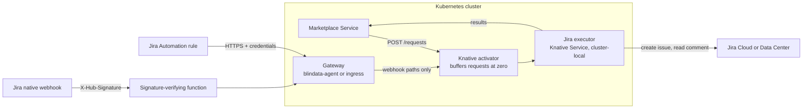

# Knative Serving in depth

[Back to README](../../README.md) | [Quickstart on Knative](../platforms/knative.md)

> This page explains every setting, the alternatives and day 2 operations. To deploy and test quickly, follow the [quickstart](../platforms/knative.md).

## Overview

This page deploys the executor as a **Knative Serving** service on Kubernetes (GKE, EKS, AKS or on-premises), so it scales to zero when idle and starts again on the next request. It fits the [serverless rule](deployment.md#which-platforms-fit): Kubernetes never throttles a running pod, and Knative removes an idle pod only after a configurable retention period, so the issue creation that runs after the `202` completes.



Related: [Deployment](deployment.md) · [Build and run](build-and-run.md) · [Jira setup](jira-setup.md) · [Configuration reference](configuration-reference.md)

## Contents

- [Prerequisites](#prerequisites)
- [Step 1 - Secrets and profiles](#step-1---secrets-and-profiles)
- [Step 2 - Deploy the Knative Service](#step-2---deploy-the-knative-service)
- [Step 3 - Network isolation](#step-3---network-isolation)
- [Step 4 - Expose the notification endpoints](#step-4---expose-the-notification-endpoints)
- [Step 5 - Register with the Marketplace Service](#step-5---register-with-the-marketplace-service)
- [Step 6 - Verify](#step-6---verify)
- [Day 2 operations](#day-2-operations)
- [Troubleshooting on Knative](#troubleshooting-on-knative)

The examples use the namespace `marketplace` and the service name `jira-executor`.

## Prerequisites

- A Kubernetes cluster with **Knative Serving** installed, with a networking layer (Kourier, Istio or Contour), and `kubectl` access.
- The Marketplace Service and the gateway running in the cluster (or able to reach cluster-local services).
- Egress from the cluster to Jira Cloud (`api.atlassian.com`, `auth.atlassian.com`) or a private network path to Jira Data Center.
- Jira prepared as in your [scenario](../../README.md#1-pick-your-scenario), and your `config/application.yml` written.

```bash
kubectl create namespace marketplace
```

## Step 1 - Secrets and profiles

```bash
# Jira credentials (Cloud, OAuth service account). Add the Automation webhook URLs/tokens if your profiles need them.
kubectl -n marketplace create secret generic jira-executor-credentials \
  --from-literal=JIRA_CLIENT_ID="$JIRA_CLIENT_ID" \
  --from-literal=JIRA_CLIENT_SECRET="$JIRA_CLIENT_SECRET"

# the profiles file
kubectl -n marketplace create configmap jira-executor-profiles \
  --from-file=application.yml=config/application.yml
```

Use your usual secret tooling (External Secrets, Sealed Secrets, a CSI driver) instead of literal values in production.

## Step 2 - Deploy the Knative Service

`jira-executor.yaml`:

```yaml
apiVersion: serving.knative.dev/v1
kind: Service
metadata:
  name: jira-executor
  namespace: marketplace
  labels:
    networking.knative.dev/visibility: cluster-local    # no external route
spec:
  template:
    metadata:
      annotations:
        autoscaling.knative.dev/min-scale: "0"           # scale to zero
        autoscaling.knative.dev/max-scale: "3"
        autoscaling.knative.dev/scale-to-zero-pod-retention-period: "5m"   # idle window
    spec:
      timeoutSeconds: 300
      containers:
        - image: docker.io/opendatamesh/odm-platform-adapter-marketplace-executor-jira:<version>
          ports:
            - name: http1
              containerPort: 9019
          resources:
            requests: { cpu: 100m, memory: 128Mi }
            limits: { memory: 512Mi }
          envFrom:
            - secretRef:
                name: jira-executor-credentials
          env:
            - name: JIRA_DEPLOYMENT
              value: CLOUD
            - name: JIRA_SITE_URL
              value: https://acme.atlassian.net
            - name: JIRA_API_URL
              value: https://api.atlassian.com/ex/jira/<cloudId>
            - name: JIRA_AUTH_TYPE
              value: OAUTH2_CLIENT_CREDENTIALS
            - name: JIRA_CORRELATION_FIELD
              value: customfield_10050
            - name: ODM_PRODUCT_PLANE_MARKETPLACE_SERVICE_ADDRESS
              value: http://marketplace-service.marketplace.svc.cluster.local:8085
            - name: QUARKUS_CONFIG_LOCATIONS
              value: /etc/executor/application.yml
          volumeMounts:
            - name: profiles
              mountPath: /etc/executor
              readOnly: true
      volumes:
        - name: profiles
          configMap:
            name: jira-executor-profiles
```

```bash
kubectl apply -f jira-executor.yaml
kubectl -n marketplace get ksvc jira-executor
# NAME            URL                                                    READY
# jira-executor   http://jira-executor.marketplace.svc.cluster.local     True
```

Notes:

- **Idle window.** `scale-to-zero-pod-retention-period` keeps the last pod for at least that long after the last request. Verify that your Knative version supports the per-service annotation; otherwise set the cluster-wide `scale-to-zero-grace-period` / `scale-to-zero-pod-retention-period` in the `config-autoscaler` ConfigMap of `knative-serving`.
- **The port** must be declared with the name `http1`: Knative routes to that single port.
- **Cold start.** At zero, the Knative activator holds the incoming request until the pod is ready; the native image starts in well under a second.
- **Shutdown.** Knative drains in-flight requests before stopping a pod, but not background work: see the [known limit](deployment.md#known-limit-scale-in-during-background-work).
- **Startup validation.** With an invalid configuration the pod exits and the revision never becomes ready: read the numbered list of problems (`Invalid Jira executor configuration:`) with `kubectl -n marketplace logs -l serving.knative.dev/service=jira-executor -c user-container`.

## Step 3 - Network isolation

The executor's endpoints have **no authentication of their own** ([why](jira-setup.md#8-securing-the-notification-endpoints)).

- The `cluster-local` visibility label means Knative creates no external route: the service is reachable only inside the cluster, at `http://jira-executor.marketplace.svc.cluster.local`.
- Inside the cluster, restrict it with a `NetworkPolicy`. With Knative the traffic does not reach the pod directly from the caller: it passes through the **activator** (in `knative-serving`, when scaled to zero or under load) and the networking layer. Admit those, plus the Marketplace Service and the gateway:

```yaml
apiVersion: networking.k8s.io/v1
kind: NetworkPolicy
metadata:
  name: jira-executor-ingress
  namespace: marketplace
spec:
  podSelector:
    matchLabels:
      serving.knative.dev/service: jira-executor
  policyTypes: [Ingress]
  ingress:
    - from:
        - namespaceSelector:
            matchLabels: { kubernetes.io/metadata.name: knative-serving }   # activator
        - namespaceSelector:
            matchLabels: { kubernetes.io/metadata.name: kourier-system }    # networking layer: adapt
        - podSelector:
            matchLabels: { app: marketplace-service }                        # adapt to your labels
        - podSelector:
            matchLabels: { app: blindata-agent }                             # the gateway
```

Verify the namespaces and labels of your networking layer (Kourier, Istio, Contour) and of your Marketplace Service and gateway pods.

## Step 4 - Expose the notification endpoints

Jira must reach two paths of the executor, and only those, through a component that authenticates it:

```
POST /api/v1/up/marketplace-executor/webhooks/jira/issue-events    (Automation rule)
POST /api/v1/up/marketplace-executor/webhooks/jira/native-events   (native webhook)
```

### Option A: blindata-agent (recommended)

Run blindata-agent in the cluster, exposed to Jira over HTTPS (on Jira Cloud, allow-list the Atlassian egress IP ranges). Register the executor's cluster-local URL:

```json
{
  "servicesURLs": {
    "marketplace-executor-jira": "http://jira-executor.marketplace.svc.cluster.local"
  }
}
```

The Blindata identity for Jira, the URL Jira calls and the smoke test are in [Jira setup, option B](jira-setup.md#option-b-blindata-agent).

### Option B: your own gateway

An ingress (or API gateway) exposed to Jira that authenticates the caller, allows **only `POST`** on the two paths above and forwards to `jira-executor.marketplace.svc.cluster.local`. Requirements are in [Jira setup, option A](jira-setup.md#option-a-your-own-authenticating-gateway).

### Native webhooks

Native webhooks need a signature-verifying function in front of the gateway ([Jira setup, section 10](jira-setup.md#10-completion-channel-b---native-webhook)). It can be another Knative Service, with **public** visibility (Jira calls it) and authenticating every call by the signature. The Node.js logic of the [Cloud Run function](deploy-cloud-run.md#native-webhooks-the-signature-verifying-function) works as a plain HTTP server too.

## Step 5 - Register with the Marketplace Service

```yaml
odm:
  utility-plane:
    marketplace-executors:
      - name: JIRA
        address: http://jira-executor.marketplace.svc.cluster.local
        active: true
```

The address has no port: Knative serves the service on port 80 and routes to the container's `9019`.

## Step 6 - Verify

1. **From a pod in the cluster**, the harmless smoke test must answer `IGNORED`. Watch the pods at the same time to see the scale from zero:

   ```bash
   kubectl -n marketplace get pods -l serving.knative.dev/service=jira-executor -w &
   kubectl -n marketplace run curl --rm -it --restart=Never --image=curlimages/curl -- \
     curl -i -X POST http://jira-executor.marketplace.svc.cluster.local/api/v1/up/marketplace-executor/webhooks/jira/issue-events \
     -H "Content-Type: application/json" \
     -d '{"correlationId":"00000000-0000-0000-0000-000000000000","fields":{"statusCategory":"done"}}'
   # -> 200 {"outcome":"IGNORED","reason":"UNKNOWN_REQUEST"}
   ```

   If the `NetworkPolicy` does not admit the test pod, run it with the gateway's labels or test through the gateway.
2. **From outside the cluster** the service must not be reachable at all.
3. **Through the gateway**, the smoke test of your option must answer `200 IGNORED`.
4. After the retention period with no traffic, the pod disappears (`0` pods).
5. **End to end**: follow step 4 of the [quickstart](../platforms/knative.md#4-test-end-to-end).

## Day 2 operations

- **Upgrade**: change the image tag and `kubectl apply`; Knative rolls out a new revision and keeps the old one serving until the new one is ready.
- **Change the profiles**: update the ConfigMap, then create a new revision (for example change an annotation, or `kn service update jira-executor -n marketplace --annotation reload=<date>`), because existing pods keep the old file until they restart.
- **Rotate Jira credentials**: update the Secret, then create a new revision. See [Rotating secrets](jira-setup.md#rotating-secrets).
- **Logs**: `kubectl logs` on the `user-container`, or your cluster's log collector. Search for the marketplace request UUID or the issue key.

## Troubleshooting on Knative

| Symptom | Likely cause |
|:--|:--|
| `READY False`, revision failed | Invalid configuration: read `Invalid Jira executor configuration:` in the `user-container` logs. Or a missing Secret or ConfigMap |
| Calls time out or are refused when scaled to zero | The `NetworkPolicy` does not admit the activator (`knative-serving`) or the networking layer |
| The Marketplace Service gets `202` but no issue appears | The pod was removed during background work ([known limit](deployment.md#known-limit-scale-in-during-background-work)), or a retention period that is too short |
| `ERROR` results naming a connection failure to Jira | Cluster egress to Atlassian, or the path to Data Center |
| Results never reach the Marketplace Service | Wrong `ODM_PRODUCT_PLANE_MARKETPLACE_SERVICE_ADDRESS`, or an egress policy blocking it |

---
[Back to README](../../README.md) | [Deployment](deployment.md) | [Examples](examples.md)
