# Jira Marketplace Executor — issue-driven fulfilment of ODM marketplace access requests

> Base package below is abbreviated as `{base}` = `org.opendatamesh.platform.adapter.marketplace.executor.starter` (kept as-is, see Safeguards).
> Source analysis: `spdd/analysis/BDMD-5340-202610161544-[Analysis]-jira-marketplace-executor.md`.
> Reference design and **source of the copied code**: `odm-platform-adapter-marketplace-executor-servicenow` (branch `BDMD-5340-servicenow-executor`), canvas `spdd/prompt/BDMD-5340-202610161509-[Feat]-service-servicenow-marketplace-executor.md`. Referred to below as **the ServiceNow executor**.
> Agent companion canvas: `blindata-agent/spdd/prompt/BDMD-5340-202610161527-[Feat]-filter-odm-marketplace-executor-auth.md` (generic filter for all marketplace executors).

## Requirements

1. Turn the stateless marketplace executor starter into a **Jira executor**. It fulfils every ODM marketplace access request (`MARKETPLACE_SUBSCRIBE`, `MARKETPLACE_UNSUBSCRIBE`) by **opening a Jira issue or Jira Service Management request**, and reports the operation result **when the issue is completed on Jira**. Data product access then follows the organisation's Jira processes, on **Jira Cloud and Jira Data Center**.
2. Let operators adapt the executor to their Jira practices **through configuration only**:
   - choose, per operation, the **creation interface**: Issue API, Service Management Request API, or Automation Incoming Webhook
   - choose the **target**: project and issue type, service desk and request type, or automation webhook
   - choose the **issue content**: a field map of Qute templates
   - choose the **REST API version**: v2 by default; v3 on Cloud, with ADF conversion
   - define how statuses and resolutions translate into outcomes
   - define the **descriptive result messages**
3. Write the **marketplace request UUID** into a configured Jira text custom field, so completion notifications can be correlated.
4. Report a two-phase result:
   - `PENDING` once the issue is opened, with the issue key (no key for the Automation kind), or `ERROR` if it cannot be opened
   - then exactly one **final** status driven by Jira, respecting the operation taxonomy. **No partial grants**, and the **first final status wins**.
5. Accept completion notifications through **two channels** that share one outcome logic:
   - **Jira Automation "Send web request"**, with the executor's fixed contract
   - **native Jira webhooks**, with the native payload

   Both arrive through the blindata-agent proxy, and the executor does no inbound authentication.
6. Handle only the requests matching a configurable **regex-based request filter**. Decline the others with `409`, so several executors can coexist behind the Marketplace Service and the agent.
7. Authenticate every outbound Jira call with the **best-practice mechanism** for the deployment:
   - **Cloud**: service-account OAuth 2.0 client credentials (default), or an API token
   - **Data Center**: a Personal Access Token (default), or a DC 11.1+ service account (client credentials)

   Raise JSM requests **on behalf of the marketplace requester**. Setting the Issue API reporter to the requester is optional.
8. Make the **inclusion of the Jira actor** (closing user) in result messages configurable (included by default).
9. **Copy the platform-agnostic code from the ServiceNow executor** instead of re-implementing it. That covers the filter, outcome rules, messages, Qute renderer, marketplace client, both use cases, the domain types and the OAuth scope fix.
10. Ship a **README** that explains how to configure the executor, Jira (Cloud and DC), the completion channels and the agent route, with **one basic scenario (base config) per creation interface**.
11. Out of scope:
    - automatic revoke on `endDate`
    - the Blindata-direct mode
    - polling and reconciliation
    - changes to the marketplace server
    - signature verification of native webhooks (it belongs to the customer gateway or a future agent extension)
    - a shared library with the ServiceNow executor

## Entities

```mermaid
classDiagram
direction TB

class MarketplaceRequest {
    <<record, existing>>
    +String name
    +String identifier  // marketplace internal UUID
    +Provider provider
    +Party consumer
    +Party requester
    +Map~String,Object~ properties
    +Date startDate
    +Date endDate
}
class Provider {
    <<record, existing>>
    +String dataProductFqn
    +List~String~ dataProductPortsFqn
}
class Party {
    <<record, existing>>
    +String type
    +String identifier
}
class MarketplaceOperation {
    <<enum, existing>>
    MARKETPLACE_SUBSCRIBE
    MARKETPLACE_UNSUBSCRIBE
}
class MarketplaceRequestStatus {
    <<enum, existing>>
    PENDING
    GRANTED
    DENIED
    REVOKED
    ERROR
}
class MarketplaceResult {
    <<record, existing>>
    +MarketplaceRequestStatus status
    +String message
    +Provider provider
    +Date createdAt
}
class RegisteredAccessRequest {
    <<record, copied>>
    +MarketplaceOperation operation
    +MarketplaceRequest request
}
class IssueReference {
    <<record, new>>
    +String key  // "" for AUTOMATION_WEBHOOK
    +String id
    +String link
}
class TicketEvent {
    <<record, copied + extended>>
    +String correlationId
    +Map~String,String~ fields
    +boolean statusTransition
}
class TicketOutcomeCause {
    <<enum, copied>>
    FULFILLED
    REFUSED
    FAILED
    +MarketplaceRequestStatus statusFor(MarketplaceOperation)
}
class TicketOutcome {
    <<record, copied>>
    +TicketOutcomeCause cause
    +String messageTemplate  // nullable
}
class TicketEventIgnoredReason {
    <<enum, copied + extended>>
    NOT_A_STATUS_TRANSITION  // new
    MISSING_CORRELATION
    UNKNOWN_REQUEST
    NOT_HANDLED_BY_EXECUTOR
    FINAL_RESULT_ALREADY_REPORTED
    NON_TERMINAL_STATE
}
class IssueInterfaceType {
    <<enum, new>>
    ISSUE
    SERVICE_DESK_REQUEST
    AUTOMATION_WEBHOOK
}
class JiraDeploymentType {
    <<enum, new>>
    CLOUD
    DATA_CENTER
}
class JiraAuthType {
    <<enum, new>>
    OAUTH2_CLIENT_CREDENTIALS
    API_TOKEN
    PERSONAL_ACCESS_TOKEN
}
class JiraConfig {
    <<ConfigMapping jira, new>>
    +JiraDeploymentType deployment
    +String siteUrl
    +Optional~String~ apiUrl
    +int apiVersion  // 2 | 3
    +Auth auth
    +Correlation correlation
    +Webhook webhook
    +RateLimit rateLimit
    +Filter filter
    +Profiles profiles
    +Messages messages
}
class Auth {
    <<config, new>>
    +JiraAuthType type
    +OAuth2 oauth2  // clientId, clientSecret, tokenUrl?, scope?
    +ApiToken apiToken  // email, token
    +Pat pat  // token
}
class Correlation {
    <<config, new>>
    +String field  // customfield_NNNNN
    +boolean label
}
class IssueProfile {
    <<config, new>>
    +IssueInterfaceType type
    +Optional~String~ project
    +Optional~String~ issueType
    +Optional~String~ serviceDeskId
    +Optional~String~ requestTypeId
    +boolean correlationViaEdit
    +Optional~String~ webhookUrl
    +Optional~String~ webhookToken
    +boolean setReporter
    +Map~String,String~ fields
    +Map~String,Map~String,String~~ objectFields
    +Map~String,List~String~~ listFields
    +List~String~ richTextFields
    +List~OutcomeRule~ outcomeRules
    +ProfileMessages messages
}
class OutcomeRule {
    <<config, copied shape>>
    +Map~String,String~ when  // field -> full-match regex
    +TicketOutcomeCause outcome
    +Optional~String~ message
}
class ClosingUser {
    <<config, copied shape>>
    +boolean include
    +String field  // default actor
}
class JiraUser {
    <<record, new>>
    +String accountId  // Cloud
    +String name  // DC username
}
class TicketEventCommandRes {
    <<DTO, copied>>
    +String correlationId
    +Map~String,Object~ fields
}
class TicketEventResultRes {
    <<DTO, copied>>
    +String outcome  // REPORTED | IGNORED
    +MarketplaceRequestStatus status
    +TicketEventIgnoredReason reason
}
class JiraWebhookPayload {
    <<external JSON, ObjectNode>>
    +String webhookEvent
    +Object user
    +Object issue
    +Object changelog
}

MarketplaceRequest "1" *-- "1" Provider
MarketplaceRequest "1" *-- "2" Party : consumer, requester
RegisteredAccessRequest "1" --> "1" MarketplaceRequest
RegisteredAccessRequest "1" --> "1" MarketplaceOperation
JiraConfig "1" *-- "2" IssueProfile : subscribe, unsubscribe
JiraConfig "1" *-- "1" Auth
JiraConfig "1" *-- "1" Correlation
JiraConfig --> JiraDeploymentType
Auth --> JiraAuthType
JiraConfig "1" *-- "1" ClosingUser : messages.closing-user
IssueProfile "1" *-- "1..*" OutcomeRule
IssueProfile --> IssueInterfaceType
OutcomeRule --> TicketOutcomeCause
TicketOutcome --> TicketOutcomeCause
TicketOutcomeCause ..> MarketplaceRequestStatus : statusFor(operation)
TicketEventCommandRes --> TicketEvent : Automation channel
JiraWebhookPayload --> TicketEvent : native channel (JiraWebhookEventMapper)
IssueReference --> MarketplaceResult : described in PENDING message
TicketEvent --> MarketplaceResult : final result via rules
JiraUser --> IssueProfile : raiseOnBehalfOf / reporter
```



**Status taxonomy.** `TicketOutcomeCause.statusFor` is copied unchanged and is the single source of truth:

| Cause | `MARKETPLACE_SUBSCRIBE` | `MARKETPLACE_UNSUBSCRIBE` |
|---|---|---|
| FULFILLED | GRANTED | REVOKED |
| REFUSED | DENIED | ERROR (refusal message) |
| FAILED | ERROR | ERROR |

**Normalised event fields.** These are the keys of `TicketEvent.fields` that both channels produce. Outcome rules and message templates read them.

| Key | Meaning | Automation smart value (README) | Native payload source |
|---|---|---|---|
| `key` | issue key | `{{issue.key}}` | `/issue/key` |
| `id` | issue id | `{{issue.id}}` | `/issue/id` |
| `project` | project key | `{{issue.project.key}}` | `/issue/fields/project/key` |
| `issueType` | issue type name | `{{issue.issueType.name}}` | `/issue/fields/issuetype/name` |
| `status` | status name | `{{issue.status.name}}` | `/issue/fields/status/name` |
| `statusCategory` | `new`, `indeterminate` or `done` | `{{issue.status.statusCategory.key}}` | `/issue/fields/status/statusCategory/key` |
| `resolution` | resolution name, `""` when unset | `{{issue.resolution.name}}` | `/issue/fields/resolution/name` |
| `actor` | display name of who triggered the change | `{{initiator.displayName}}` | `/user/displayName` |
| `lastComment` | text of the latest comment | `{{issue.comments.last.body.jsonEncode}}` | last element of `/issue/fields/comment/comments`, as `body`; omitted when that array is absent |
| *extra* | operator-defined | any smart value | `jira.webhook.extra-fields` (name → JSON Pointer) |

## Approach

1. **Mirror the ServiceNow executor, swap the adapter**:
   - The workflow, use cases, filter, outcome rules, messages, templating, marketplace client and error policy are **copied from the ServiceNow executor** (product-owner decision) and keep the same packages, names, contracts and behaviour.
   - Only the target-tool adapter is new: configuration, client, creators, requester resolution, ADF conversion, the native-payload mapper and the REST resource.
   - The copied core services that depended on `ServiceNowConfig` (`RequestFilterService`, `OutcomeRulesService`, `ResultMessageService`, `TicketTemplateRenderer`) move to `{base}.jira.services.core` and depend on `JiraConfig`, whose `Filter`, `OutcomeRule`, `ProfileMessages`, `Messages` and `ClosingUser` shapes are **identical** to ServiceNow's.
   - **Outbound leg** (unchanged policy):
     - `POST /api/v1/up/marketplace-executor/requests` → invariants → filter (`409 RequestNotHandledException` when declined) → `202`.
     - Asynchronously, open the issue through the profile's interface kind, then report `PENDING` (best effort) or `ERROR`.
   - **Inbound leg** (unchanged policy, two entry points):
     - `POST /api/v1/up/marketplace-executor/webhooks/jira/issue-events` (Automation channel, fixed contract `{correlationId, fields}`).
     - `POST /api/v1/up/marketplace-executor/webhooks/jira/native-events` (native channel, raw Jira payload). It is mapped by `JiraWebhookEventMapper` to the same `TicketEvent`.
     - Both run the copied `CompleteTicket` use case, extended with two steps: ignore events that are not status transitions, and fetch the last comment when the event lacks it.
2. **Jira integration**:
   - **Deployment and URLs**:
     - `jira.site-url` (browse links, DC API base)
     - `jira.api-url` (API base; required on Cloud with OAuth or scoped tokens: `https://api.atlassian.com/ex/jira/{cloudId}`; defaults to `site-url`)
     - `jira.api-version` (2 or 3). All platform paths are `/rest/api/{apiVersion}/…`. JSM paths are `/rest/servicedeskapi/…`.
   - **Authentication** is resolved once in a qualified `@JiraApi RestUtils`, produced from `RestUtilsFactory.getAuthenticatedRestUtils`:
     - `OAUTH2_CLIENT_CREDENTIALS` (Cloud default; DC 11.1+ alternative): `Oauth2` with `grant_type=client_credentials`, client id, secret and optional scope. Token URL: `auth.oauth2.token-url`, else Cloud `https://auth.atlassian.com/oauth/token` and DC `{siteUrl}/rest/oauth2/latest/token`. The token is cached until `expires_in` (60 min on Atlassian), with the request form-encoded by the existing template.
     - `API_TOKEN` (Cloud alternative): connection header `Authorization: Basic base64(email:token)`.
     - `PERSONAL_ACCESS_TOKEN` (DC default): connection header `Authorization: Bearer <pat>`.
     - The Automation Incoming Webhook is called with the **unqualified** `RestUtils` and its own `X-Automation-Webhook-Token` header, never with the Jira credentials.
   - **Typed interface kinds** (strategy pattern, one `IssueCreator` per `IssueInterfaceType`):

   | Type | Endpoint | Body | Correlation | Reference |
   |---|---|---|---|---|
   | ISSUE | `POST /rest/api/{v}/issue` | `{fields: {project:{key}, issuetype:{name}, …rendered, reporter?, labels?}}` | `fields.<correlation.field>` = UUID; label `bdmp-<uuid>` when `correlation.label` | key `/key`, id `/id`, link `{siteUrl}/browse/{key}` |
   | SERVICE_DESK_REQUEST | `POST /rest/servicedeskapi/request` | `{serviceDeskId, requestTypeId, requestFieldValues:{…rendered}, raiseOnBehalfOf, isAdfRequest}` | `requestFieldValues.<correlation.field>` = UUID; or, with `correlation-via-edit`, `PUT /rest/api/{v}/issue/{key}` `{fields:{<field>: UUID}}` right after creation | key `/issueKey`, id `/issueId`, link `{siteUrl}/browse/{key}` |
   | AUTOMATION_WEBHOOK | `POST {webhookUrl}` with header `X-Automation-Webhook-Token` | `{correlationId, operation, request:{…template data}, fields:{…rendered}}` | the customer rule must copy `correlationId` into `correlation.field` | none: key, id and link are `""` |

   - **Field value shapes**:
     - `fields` render to JSON strings.
     - `object-fields` render each inner template and build an object (for example `priority: {name: "High"}`).
     - `list-fields` render each item and build an array of strings (for example `labels`).
     - The correlation value, `project`, `issuetype`, `reporter` and the correlation label are **always injected by the executor after rendering**, so templates cannot drop or override them.
   - **ADF (v3 only)**:
     - Writing: `AdfConverter.toAdf(text)` converts each rendered value whose field name is in `rich-text-fields` (default `[description]`) into a minimal ADF document. Blank-line-separated blocks become paragraphs, and single newlines become `hardBreak`s.
     - JSM sends `isAdfRequest=true`.
     - Reading: `AdfConverter.toText(node)` flattens comment bodies. Text nodes are concatenated, and block nodes and `hardBreak` become newlines. Unknown nodes are traversed for their `content`.
     - With v2, values stay plain or wiki text and `isAdfRequest=false`.
   - **Requester resolution** (`JiraUserService`): for JSM `raiseOnBehalfOf` (always) and for the ISSUE reporter (`set-reporter`, default false):
     - Requester type must be `user`.
     - Cloud: `GET /rest/api/{v}/user/search?query=<email>&maxResults=10`.
     - DC: `GET /rest/api/2/user/search?username=<email>&maxResults=10`.
     - Pick the entry whose `emailAddress` equals the identifier (case-insensitive). Otherwise, if exactly one active user was returned, use it. Otherwise fail with "not found" or "ambiguous".
     - Cloud uses `accountId` (reporter `{id}`). DC uses `name` (reporter `{name}`).
   - **Rate limiting**: issue creation retries `429` up to `jira.rate-limit.max-attempts` (default 3) with exponential back-off from `jira.rate-limit.backoff` (default 2s). A 429 means the request was not processed, so retrying a POST is safe. Other errors are not retried.
3. **Configuration and templating** (copied mechanics):
   - Typed `@ConfigMapping(prefix = "jira")`, YAML plus env overrides.
   - Qute is parsed at runtime with a maps-only data model, `strict-rendering=false`, `property-not-found-strategy=noop` and no HTML escaping. Template values may be inline or `file:/path`.
   - Template data:
     - `request.*`, `operation`
     - `ticket.key`, `ticket.id`, `ticket.link`, plus `ticket.closedBy` when inclusion is enabled
     - `fields.*` (normalised event fields)
     - `outcome.*`, `error.message`
   - **No profiles in the packaged `application.yml`**: inherited lesson, because SmallRye merges lists by index. Profiles come only from external configuration, and the README ships reference profiles.
   - **Startup validation** (`JiraConfigValidator`) fails fast on any of these:
     - URL or credential problems
     - deployment/auth/version incompatibilities: v3 on DC; PAT on Cloud; OAuth on Cloud without an `api.atlassian.com/ex/jira/` API URL
     - a correlation field that is not `customfield_<digits>`
     - missing kind settings
     - reserved or correlation keys in field maps
     - rule problems: no rules, no FULFILLED rule, an empty `when`, bad regexes
     - filter regexes
     - unparsable templates
4. **Business logic placement** (`spdd/norms/USE_CASE_IMPLEMENTATION.md`):
   - Policy stays in the copied use cases:
     - decline
     - `PENDING` best effort, `ERROR` on open failure
     - the ignore reasons, including the new `NOT_A_STATUS_TRANSITION`
     - first-final-wins
     - cause → status
     - the final post must succeed
     - fetching the last comment **only after** an outcome is determined
   - Mechanics stay in core services reached through plain port impls:
     - HTTP, auth, ADF, JSON Pointer reads
     - native-payload mapping
     - user search, retry, Qute, regex
5. **Reliability and error handling**:
   - The marketplace result delivery is copied: bounded retry on 404, 5xx and I/O errors, then `InternalException`.
   - A final-result delivery failure answers `500`. Native webhooks are then retried by Jira (up to 5 times); Automation does not retry, as documented.
   - Last-comment fetch failures are logged at warn and **do not** block the final result: the message is rendered without the comment.
   - Jira errors are turned into descriptive `InternalException`s:
     - 401/403 name the auth type and deployment, never secrets
     - 400 includes Jira's `errorMessages` and `errors` map, truncated to 500 characters
     - JSM 400/403 add the hint that the requester must be a customer of the service project and the integration identity an agent
     - OAuth token failures name the token URL
   - All HTTP errors are rendered by the existing `ResponseExceptionMapper`.
6. **Security model**:
   - Both webhook endpoints have no executor-side auth and must be reachable only through blindata-agent (network isolation, a README hard requirement).
   - The agent's generic `marketplace-executor` filter allows `POST …/api/v1/up/marketplace-executor/webhooks/**` for MARKETPLACE_EDITOR and denies everything else. Both Jira endpoints are inside that namespace, so the agent needs no Jira-specific code. The Jira executor is routed as `marketplace-executor-jira`, or any family name.
   - No non-webhook endpoint may be placed under `…/marketplace-executor/webhooks/`, because the agent exposes the whole namespace.
   - **Native webhooks require a customer-provided Webhook Auth Gateway**, which verifies `X-Hub-Signature` (Cloud secret) and adds the Blindata headers. The README gives a reference sketch and a security checklist.
   - The executor never logs request headers, request bodies or tokens.
   - Secrets (`JIRA_CLIENT_SECRET`, `JIRA_API_TOKEN`, `JIRA_PAT`, `JIRA_AUTOMATION_*_TOKEN`) come only from env or mounted secrets.

## Structure

### Inheritance Relationships
1. `UseCase` (existing) is implemented by `ProcessMarketplaceRequest` (copied, adapted) and `CompleteTicket` (copied, extended). Both are package-private.
2. `UseCasePresenter` (existing) is extended by `CompleteTicketPresenter` (copied).
3. `OdmApiException` (existing) is extended by `RequestNotHandledException` (copied, `CONFLICT`).
4. `IssueCreator` (new interface: `IssueInterfaceType type()`, `IssueReference create(IssueProfile profile, Map<String,Object> templateData, MarketplaceRequest request)`) is implemented by `IssueApiCreator`, `ServiceDeskRequestCreator` and `AutomationWebhookCreator` (all `@ApplicationScoped`).
5. Port interfaces and their plain `*OutboundPortImpl` classes:
   - processrequest:
     - `RequestFilterOutboundPort` (copied)
     - `JiraIssueOutboundPort` (new, replaces `ServiceNowTicketOutboundPort`)
     - `ResultMessageOutboundPort` (copied)
     - `MarketplaceResultOutboundPort` (copied)
     - `AsyncExecutionOutboundPort` (existing)
   - completeticket:
     - `CompleteTicketMarketplaceOutboundPort`, `CompleteTicketFilterOutboundPort`, `TicketOutcomeOutboundPort`, `CompleteTicketMessageOutboundPort` (all copied)
     - `TicketDetailsOutboundPort` (new)

### Dependencies
1. `MarketplaceExecutorUseCaseResource` (existing) depends on `MarketplaceExecutorUseCasesService.processRequest`.
2. `JiraIssueEventUseCaseResource` (new) depends on `MarketplaceExecutorUseCasesService.processTicketEvent` and `processJiraWebhookEvent`.
3. `MarketplaceExecutorUseCasesService` depends on `ProcessMarketplaceRequestFactory`, `CompleteTicketFactory`, `ObjectMapper` and `JiraWebhookEventMapper`.
4. `ProcessMarketplaceRequestFactory` injects `RequestFilterService`, `JiraIssueService`, `ResultMessageService`, `MarketplaceServiceClient` and `AsyncExecutorService`.
5. `CompleteTicketFactory` injects `MarketplaceServiceClient`, `RequestFilterService`, `OutcomeRulesService`, `ResultMessageService` and `JiraIssueService`.
6. Core services:
   - `JiraIssueService` depends on `JiraConfig`, `TicketTemplateRenderer`, `Instance<IssueCreator>` and `JiraClient`.
   - Each `IssueCreator` depends on `JiraClient`, `TicketTemplateRenderer`, `JiraConfig` and `AdfConverter`. `IssueApiCreator` and `ServiceDeskRequestCreator` also depend on `JiraUserService`.
   - `JiraClient` depends on `@JiraApi RestUtils` (from `JiraRestUtilsProducer`), the unqualified `RestUtils` (Automation webhook only), `JiraConfig` and `ObjectMapper`.
   - `JiraUserService` depends on `JiraClient` and `JiraConfig`.
   - `JiraWebhookEventMapper` depends on `JiraConfig` and `AdfConverter`.
   - `RequestFilterService` and `OutcomeRulesService` depend on `JiraConfig`.
   - `ResultMessageService` depends on `JiraConfig`, `TicketTemplateRenderer` and `JiraClient` (only for `browseLink`).
   - `TicketTemplateRenderer` depends on Qute `Engine`.
   - `MarketplaceServiceClient` depends on `RestUtils`, `MarketplaceServiceConfig` and `ObjectMapper`.
   - `JiraConfigValidator` depends on `JiraConfig`, `RequestFilterService`, `OutcomeRulesService` and `TicketTemplateRenderer`.

### Layered Architecture
1. **HTTP layer** (`{base}.rest`, `{base}.resources`): thin JAX-RS resources and `*Res` DTOs with OpenAPI. The native endpoint takes the external payload as `ObjectNode`, because it is a third-party contract, not an executor DTO. The existing `ResponseExceptionMapper` handles errors.
2. **Application layer** (`{base}.marketplace.services`): `MarketplaceExecutorUseCasesService` maps `*Res` or `ObjectNode` to commands, and presenter results to `*ResultRes`.
3. **Use case layer**: `{base}.marketplace.services.usecases.processrequest` and `…completeticket`, both copied.
4. **Domain layer** (`{base}.marketplace.domain`): the existing records, the copied `RegisteredAccessRequest`, `TicketEvent`, `TicketOutcomeCause`, `TicketOutcome` and `TicketEventIgnoredReason`, and the new `IssueReference`.
5. **Core / infrastructure layer**:
   - `{base}.jira.services.core` (new): `JiraClient`, `JiraIssueService`, `IssueCreator` plus three creators, `JiraUserService` with `JiraUser`, `AdfConverter`, `JiraWebhookEventMapper`, and the copied `TicketTemplateRenderer`, `RequestFilterService`, `OutcomeRulesService` and `ResultMessageService`.
   - `{base}.marketplace.services.core.MarketplaceServiceClient` (copied).
6. **Configuration layer** (`{base}.config`): `JiraConfig`, `IssueInterfaceType`, `JiraDeploymentType`, `JiraAuthType`, the `JiraApi` qualifier, `JiraRestUtilsProducer`, `JiraConfigValidator`, `MarketplaceServiceConfig` (copied extension) and `RestUtilsProducer` (existing).
7. **Exception layer** (`{base}.exceptions`): the existing hierarchy plus the copied `RequestNotHandledException`.

## Operations

> Execute in order. Each task lists its completion criterion. "**Copy**" means: take the file from the ServiceNow executor working tree (`odm-platform-adapter-marketplace-executor-servicenow`, branch `BDMD-5340-servicenow-executor`), at the same relative path unless stated, then apply only the listed adaptations. When a ServiceNow class has been changed by review since this canvas, copy its reviewed state.

### 1. Update build — `pom.xml`
1. Change `artifactId` to `odm-platform-adapter-marketplace-executor-jira`, `name` to `ODM Platform Adapter Marketplace Executor Jira`, and `description` to `ODM Marketplace Executor that fulfils access requests through Jira issues and Jira Service Management requests`.
2. Add `io.quarkus:quarkus-qute`, with the version managed by the BOM.
3. Leave `template.yaml` and the Java base package untouched.
4. Done when `./mvnw -q compile` succeeds.

### 2. Copy unchanged platform-agnostic code
1. Copy verbatim:
   - `{base}/exceptions/RequestNotHandledException.java`
   - `{base}/marketplace/domain/RegisteredAccessRequest.java`, `TicketOutcomeCause.java`, `TicketOutcome.java`
   - `{base}/config/MarketplaceServiceConfig.java` (with `ResultDelivery`)
   - `{base}/marketplace/services/core/MarketplaceServiceClient.java`
   - `{base}/utils/client/AuthenticatedRestUtilsTemplate.java`: only the change that skips a null or blank `scope` in `buildRequestWithSharedSecret`. Apply it as a diff, and do not overwrite other differences.
   - `{base}/marketplace/services/usecases/processrequest/`: `RequestFilterOutboundPort(Impl)`, `ResultMessageOutboundPort(Impl)`, `MarketplaceResultOutboundPortImpl`. Delete `MarketplaceAccessOutboundPort(Impl)` and `MarketplaceResourceMapper`, as in the ServiceNow executor.
   - `{base}/marketplace/services/usecases/completeticket/`: `CompleteTicketCommand`, `CompleteTicketPresenter`, `CompleteTicketMarketplaceOutboundPort(Impl)`, `CompleteTicketFilterOutboundPort(Impl)`, `TicketOutcomeOutboundPort(Impl)`, `CompleteTicketMessageOutboundPort(Impl)`
   - `{base}/resources/TicketEventCommandRes.java`, `TicketEventResultRes.java`. Change only the `@Schema` descriptions to Jira wording: "Marketplace request UUID stored in the Jira correlation custom field", and "Normalised issue fields used by outcome rules and messages: key, id, project, issueType, status, statusCategory, resolution, actor, lastComment".
   - Tests: `MarketplaceServiceClientTest`, and the use-case tests `ProcessMarketplaceRequestTest` and `CompleteTicketTest` (adapted in tasks 16–17).
2. Copy **into `{base}/jira/services/core/`**, changing the package, every `ServiceNowConfig` reference to `JiraConfig`, and "ServiceNow" wording to "Jira":
   - `TicketTemplateRenderer` (no other change)
   - `RequestFilterService` (no other change)
   - `OutcomeRulesService` (no other change)
   - `ResultMessageService` (adapted in task 11)
   - Their tests `TicketTemplateRendererTest`, `RequestFilterServiceTest` and `ResultMessageServiceTest`, moved to `{test}/jira/services/core/`.
3. Update the imports of the copied port impls and factories to the `jira.services.core` package.
4. Done when the copied classes compile against the configuration from task 4.

### 3. Create/Update Domain Types (`{base}.marketplace.domain`)
1. `public record IssueReference(String key, String id, String link)`. Its compact constructor replaces nulls with `""`.
2. **Copy and extend** `TicketEvent`:
   - `public record TicketEvent(String correlationId, Map<String, String> fields, boolean statusTransition)`.
   - Keep the compact constructor (null `fields` → `Map.of()`, `Map.copyOf`).
   - Add a convenience constructor `TicketEvent(String correlationId, Map<String, String> fields)` that sets `statusTransition = true`. The Automation rule fires on transitions only.
3. **Copy and extend** `TicketEventIgnoredReason`: add `NOT_A_STATUS_TRANSITION` as the **first** value, keeping the copied values.
4. Keep all existing domain types unchanged.

### 4. Create Configuration (`{base}.config`)
1. Create the enums:
   - `public enum IssueInterfaceType { ISSUE, SERVICE_DESK_REQUEST, AUTOMATION_WEBHOOK }`
   - `public enum JiraDeploymentType { CLOUD, DATA_CENTER }`
   - `public enum JiraAuthType { OAUTH2_CLIENT_CREDENTIALS, API_TOKEN, PERSONAL_ACCESS_TOKEN }`
2. `@ConfigMapping(prefix = "jira") public interface JiraConfig`:
   - `JiraDeploymentType deployment()`
   - `String siteUrl()`
   - `Optional<String> apiUrl()`
   - `@WithDefault("2") int apiVersion()`
   - `default String apiBaseUrl()`: `stripTrailingSlash(apiUrl().orElse(siteUrl()))`, implemented as a private interface method
   - `Auth auth()`:
     - `@WithDefault("OAUTH2_CLIENT_CREDENTIALS") JiraAuthType type()`
     - `OAuth2 oauth2()`: `Optional<String>` `clientId`, `clientSecret`, `tokenUrl`, `scope`
     - `ApiToken apiToken()`: `Optional<String>` `email`, `token`
     - `Pat pat()`: `Optional<String> token()`
   - `Correlation correlation()`: `String field()` and `@WithDefault("false") boolean label()`
   - `Webhook webhook()`: `Map<String, String> extraFields()` (field name → JSON Pointer into the native payload, default empty)
   - `RateLimit rateLimit()`: `@WithDefault("3") int maxAttempts()` and `@WithDefault("2s") Duration backoff()`
   - `Filter filter()`: **same shape as `ServiceNowConfig.Filter`**: `operations`, `providerDataProductFqns`, `portFqns`, `consumerTypes`, `consumerIdentifiers`, `requesterIdentifiers` (each `Optional<List<String>>`), plus `Map<String, String> properties()`
   - `Profiles profiles()`: `IssueProfile subscribe()`, `IssueProfile unsubscribe()`, `default IssueProfile forOperation(MarketplaceOperation op)`
   - `IssueProfile`:
     - `IssueInterfaceType type()`
     - `Optional<String>` `project`, `issueType`, `serviceDeskId`, `requestTypeId`, `webhookUrl`, `webhookToken`
     - `@WithDefault("false") boolean correlationViaEdit()`
     - `@WithDefault("false") boolean setReporter()`
     - `Map<String, String> fields()`
     - `Map<String, Map<String, String>> objectFields()`
     - `Map<String, List<String>> listFields()`
     - `@WithDefault("description") List<String> richTextFields()`
     - `List<OutcomeRule> outcomeRules()`
     - `ProfileMessages messages()`
   - `OutcomeRule`, `ProfileMessages` and `Messages`: **same shape as in `ServiceNowConfig`**. `Messages.closingUser()` has `@WithDefault("true") include()` and `@WithDefault("actor") field()`. The default message templates are those of task 13.
3. Done when the application starts with the test `application.yml` from task 13.

### 5. Create Authenticated Client Producer — `JiraApi` + `JiraRestUtilsProducer` (`{base}.config`)
1. `@Qualifier @Retention(RUNTIME) @Target({METHOD, FIELD, PARAMETER, TYPE}) public @interface JiraApi {}`.
2. `@Produces @ApplicationScoped @JiraApi RestUtils jiraRestUtils(JiraConfig config, ObjectMapper objectMapper)` builds `RestUtilsFactory.getAuthenticatedRestUtils(HttpClient.newBuilder().connectTimeout(Duration.ofSeconds(60)).build(), objectMapper, connectionHeaders(config), oauth2(config))`:
   - `OAUTH2_CLIENT_CREDENTIALS`: no connection headers. An `Oauth2` (built with setters, as in `ServiceNowRestUtilsProducer`) with `url = tokenUrl(config)`, `grantType = "client_credentials"`, `scope` (or null), `clientId` and `clientSecret`.
     - `tokenUrl`: `auth.oauth2.token-url`, else `https://auth.atlassian.com/oauth/token` for CLOUD, else `stripTrailingSlash(siteUrl) + "/rest/oauth2/latest/token"` for DATA_CENTER.
   - `API_TOKEN`: `List.of(new HttpHeader("Authorization", "Basic " + base64(email + ":" + token)))` with UTF-8 bytes, and `oauth2 = null`.
   - `PERSONAL_ACCESS_TOKEN`: `List.of(HttpHeader.bearerAuth(token))`, and `oauth2 = null`.
3. `JiraRestUtilsProducerTest`, against a local `com.sun.net.httpserver.HttpServer`:
   - OAuth on CLOUD with a `token-url` override posts `grant_type=client_credentials` without `scope`, then sends `Authorization: Bearer <token>`.
   - API_TOKEN sends `Basic` with the expected base64.
   - PAT sends `Bearer <pat>`.

### 6. Implement Core Service — `JiraClient` (`{base}.jira.services.core`, `@ApplicationScoped`)
1. Dependencies: `@JiraApi RestUtils jiraRestUtils`, `RestUtils plainRestUtils`, `JiraConfig config`, `ObjectMapper objectMapper`.
2. Methods:
   - `String platformPath(String suffix)`: returns `"/rest/api/" + config.apiVersion() + suffix`.
   - `JsonNode post(String path, ObjectNode body)`: `url = config.apiBaseUrl() + path`, headers `[Content-Type: application/json, Accept: application/json]`, `jiraRestUtils.genericPost(url, headers, body, JsonNode.class)`.
     - It retries **only on `ClientException` 429**, up to `rateLimit.maxAttempts`, with `Thread.sleep(backoff * 2^(attempt-1))`, restoring the interrupt flag if interrupted.
   - `void putIssueFields(String issueKey, ObjectNode fields)`: `jiraRestUtils.put(config.apiBaseUrl() + platformPath("/issue/{id}"), headers, issueKey, body {fields}, JsonNode.class)`. An empty 204 body is accepted.
   - `JsonNode get(String path, Map<String, String> queryParams)`: URL-encoded query, then `jiraRestUtils.genericGet(url, headers, null, JsonNode.class)`.
   - `void postAutomationWebhook(String webhookUrl, String token, ObjectNode body)`: `plainRestUtils.genericPost(webhookUrl, [Content-Type, Accept, X-Automation-Webhook-Token: token], body, JsonNode.class)`. Any 2xx is success, including an empty body.
   - `String browseLink(String key)`: returns `""` if blank, otherwise `stripTrailingSlash(siteUrl) + "/browse/" + key`.
   - Exception translation (private `translate(method, path, e)`, shared):
     - `ClientException` 401/403 → `InternalException("Jira rejected the integration credentials (HTTP <code>, auth type <type>, deployment <deployment>) for <path>: check the service account or token, its product access and the project permissions")`
     - `IllegalStateException` from the token request → `InternalException("Unable to obtain a Jira OAuth token from <tokenUrl>: <message>. Check the service account client credentials and scopes")`
     - other `ClientException` → `InternalException("Jira call <method> <path> failed with HTTP <code>: " + jiraErrors(body))`, where `jiraErrors` joins `errorMessages[]` and the `errors{}` entries when the body is Jira JSON, else uses the raw body, truncated to 500 characters
     - `ClientResourceMappingException` → `InternalException("Unexpected Jira response for <path>")`
     - For the Automation webhook, the same translation with "Jira Automation webhook" wording. The URL is never included, because it can embed a secret.
   - Never include header values, tokens, the webhook token or the webhook URL in messages or logs.
3. `JiraClientTest` covers the 401 message without secrets, the token failure, a 400 with an `errors` map, the 429 retry then success, and the 429 retry exhaustion.

### 7. Implement Core Service — `AdfConverter` (`{base}.jira.services.core`, `@ApplicationScoped`)
1. Dependency: `ObjectMapper`.
2. `ObjectNode toAdf(String text)`:
   - Returns `{"type":"doc","version":1,"content":[…]}`.
   - The text is split into blocks on blank lines (`\n\s*\n`). Each block becomes a `paragraph` whose content alternates `{"type":"text","text":line}` and `{"type":"hardBreak"}` between lines.
   - Null or blank text gives empty `content`.
3. `String toText(JsonNode node)`:
   - Null or missing → `""`. Textual → `asText()`.
   - Otherwise a depth-first walk:
     - a `text` node appends its `text`
     - `hardBreak` appends `\n`
     - after each `paragraph`, `heading`, `listItem`, `blockquote` or `codeBlock`, it appends `\n`
     - other node types are walked into `content`
   - The result is trimmed.
4. `AdfConverterTest`: round trip of two paragraphs with a line break, empty input, unknown node types, and nested lists.

### 8. Implement Core Service — `JiraUserService` + `JiraUser` (`{base}.jira.services.core`)
1. `public record JiraUser(String accountId, String name)`.
2. `@ApplicationScoped JiraUserService`, with dependencies `JiraClient` and `JiraConfig`.
   - `JiraUser resolveRequester(Party requester)`, a composed method:
     1. `requireUserParty(requester)`: if the type is not `user` (case-insensitive), throw `InternalException("Jira requests on behalf of the requester require a user requester; got <type>")`.
     2. `searchUsers(identifier)`:
        - CLOUD: `client.get(client.platformPath("/user/search"), {query: identifier, maxResults: "10"})`
        - DATA_CENTER: `client.get("/rest/api/2/user/search", {username: identifier, maxResults: "10"})`
     3. `pickUser(results, identifier)`:
        - the first entry with `emailAddress` equal (ignoring case) to the identifier
        - else, if exactly one entry has `active` not equal to `false`, that entry
        - otherwise none
     4. If none, throw `InternalException("Requester <identifier> not found in Jira, or ambiguous (<n> matches); on Cloud the user's email may be hidden: check the email visibility or the Browse users and groups permission")`.
     5. Return `new JiraUser(accountId, name)`, taking the fields present.
   - `ObjectNode reporterField(JiraUser user)`: CLOUD gives `{id: accountId}`, DC gives `{name: name}`.
   - `String onBehalfOf(JiraUser user)`: CLOUD gives `accountId`, DC gives `name`.
3. `JiraUserServiceTest`: exact email match among several, a single result with a hidden email, no result, an ambiguous result, a non-user requester, and the DC `username` parameter.

### 9. Implement Issue Creators (`{base}.jira.services.core`, each `@ApplicationScoped`, implements `IssueCreator`)
Shared shape. Each `create(profile, data, request)` is a composed method:
1. `renderValues(profile, data)` returns an `ObjectNode`:
   - `fields` → `TextNode(renderer.render(v, data))`
   - `objectFields` → object of rendered strings
   - `listFields` → array of rendered strings
   - when `config.apiVersion() == 3`, every rendered **string** value whose key is in `profile.richTextFields()` is replaced by `adf.toAdf(value)`
   - `summary`, when present, is truncated to 255 characters
2. `buildBody(...)`: per kind. Executor-injected entries are added **last**, so they overwrite anything rendered.
3. `send(...)`: through `JiraClient`.
4. `toReference(...)`:
   - A blank key fails with `InternalException("Jira response did not contain the issue key at <pointer>")`. The Automation kind is exempt.
   - The link comes from `client.browseLink(key)`.

Per kind:
- `IssueApiCreator`:
  - The project and issue type are required (validated at startup; at runtime `InternalException("Issue API profile requires project and issue-type")`).
  - Body `{fields: rendered + project:{key: project} + issuetype:{name: issueType} + <correlation.field>: uuid}`.
  - When `correlation.label`, `labels` = the rendered `labels` list (if any) + `"bdmp-" + uuid`.
  - When `setReporter`, `reporter = users.reporterField(users.resolveRequester(request.requester()))`.
  - `POST client.platformPath("/issue")`. Reference: key `/key`, id `/id`.
- `ServiceDeskRequestCreator`:
  - The service desk id and request type id are required.
  - `onBehalfOf = users.onBehalfOf(users.resolveRequester(request.requester()))`. There is **no** fallback to the integration identity.
  - Body:

    | Key | Value |
    |---|---|
    | `serviceDeskId`, `requestTypeId` | from the profile |
    | `requestFieldValues` | the rendered values, plus `<correlation.field>: uuid` unless `correlationViaEdit` |
    | `raiseOnBehalfOf` | `onBehalfOf` |
    | `isAdfRequest` | `apiVersion == 3` |

  - `POST /rest/servicedeskapi/request`. Reference: key `/issueKey`, id `/issueId`.
  - When `correlationViaEdit`, call `client.putIssueFields(key, {<correlation.field>: uuid})`, plus the label when enabled. On failure, throw `InternalException("Jira request <key> was created but the correlation field could not be set: <cause>; the request will not be completed automatically")`.
  - On a `ClientException`-derived 400/403 from the create, append to the translated message: `"; the requester must be a customer of service desk <id> and the integration identity a service desk agent"`.
- `AutomationWebhookCreator`:
  - The webhook URL and token are required.
  - Body: `{correlationId: uuid, operation: op, request: data.get("request"), fields: rendered}`, built with Jackson `valueToTree` from the maps-only data.
  - Call `client.postAutomationWebhook(url, token, body)`.
  - Return `new IssueReference("", "", "")`.

Tests:
- `IssueApiCreatorTest`: correlation injected and template override ignored, label added, reporter set on CLOUD, v3 description converted to ADF, missing key fails.
- `ServiceDeskRequestCreatorTest`: on-behalf-of set, correlation-via-edit PUT, edit failure message, requester not found means no request is sent.
- `AutomationWebhookCreatorTest`: the token header is sent, no Jira credentials are used, the reference is empty.

### 10. Implement Core Service — `JiraIssueService` (`{base}.jira.services.core`, `@ApplicationScoped`)
1. Dependencies: `JiraConfig`, `TicketTemplateRenderer`, `Instance<IssueCreator>` (into an `EnumMap`), `JiraClient`, `AdfConverter`.
2. `IssueReference openIssue(MarketplaceOperation operation, MarketplaceRequest request)`:
   - `profile = config.profiles().forOperation(operation)`, `data = renderer.requestData(operation, request)`, `return creators.get(profile.type()).create(profile, data, request)`.
   - Log at info: `"Opened Jira issue {key|'via automation'} for request {uuid} operation {op}"`.
3. `Map<String, String> withLastComment(Map<String, String> fields)`:
   - If `fields` contains `lastComment`, or `key` is blank, return `fields` unchanged.
   - Otherwise `client.get(client.platformPath("/issue/" + urlEncode(key) + "/comment"), {orderBy: "-created", maxResults: "1"})` and take `/comments/0/body`, through `adf.toText` when it is not textual.
   - Return a copy of `fields` with `lastComment` set (`""` when there are no comments).
   - **Any** exception: log at warn (`"Last comment of Jira issue {} not read: {}"`) and return `fields` unchanged.

### 11. Adapt Copied Core Service — `ResultMessageService` (`{base}.jira.services.core`)
1. Change the constructor dependency `ServiceNowClient` to `JiraClient`.
2. `pending(op, req, IssueReference issue)`: `ticket` = `{key, id, link}`.
3. `finalOutcome(...)`: `ticket` from the fields: `key`, `id`, `link = client.browseLink(fields.key)`, and `closedBy = fields[closing-user.field]` when inclusion is enabled.
4. Keep the template choice, the field exposure and its removal when the closing user is excluded, the trim and the 4000-character truncation **unchanged**.
5. Adapt `ResultMessageServiceTest` to these keys. It must still cover "closing user excluded → not exposed".

### 12. Implement Core Service — `JiraWebhookEventMapper` (`{base}.jira.services.core`, `@ApplicationScoped`)
1. Dependencies: `JiraConfig`, `AdfConverter`.
2. `TicketEvent toEvent(JsonNode payload)`, a composed method:
   1. A null or non-object payload gives `new TicketEvent(null, Map.of(), false)`.
   2. `statusTransition`: any element of `/changelog/items` whose `fieldId` or `field` equals `status` (case-insensitive).
   3. `correlationId`: `text(payload.at("/issue/fields/" + config.correlation().field()))`, trimmed, `null` when blank.
   4. `fields`: the keys of the **Normalised event fields** table from their native sources. Missing values become `""`, except `lastComment`, which is **omitted** when `/issue/fields/comment/comments` is missing. A non-textual comment `body` goes through `adf.toText`. Each `webhook.extra-fields` entry is added with `text(payload.at(pointer))`.
   5. Return `new TicketEvent(correlationId, fields, statusTransition)`.
   - Only these values are kept. The rest of the payload (personal data) is dropped and never logged.
3. `JiraWebhookEventMapperTest`:
   - a recorded Cloud `jira:issue_updated` with a status changelog
   - a recorded DC payload
   - a non-status edit → `statusTransition=false`
   - a missing correlation field
   - an ADF comment body
   - extra fields

### 13. Update Configuration Files — `src/main/resources/application.yml` (+ `src/test/resources/application.yml`)
1. `quarkus.application.name: odm-platform-adapter-marketplace-executor-jira`, plus the OpenAPI title and description for Jira.
2. Copied from ServiceNow:
   - `quarkus.qute.strict-rendering: false`, `quarkus.qute.property-not-found-strategy: noop`
   - `odm.product-plane.marketplace-service.result-delivery.max-attempts: 5`, `backoff: 1s`
3. `jira` block with env placeholders:
   - `deployment: ${JIRA_DEPLOYMENT:CLOUD}`, `site-url: ${JIRA_SITE_URL}`, `api-url: ${JIRA_API_URL:}`, `api-version: ${JIRA_API_VERSION:2}`
   - `auth.type: ${JIRA_AUTH_TYPE:OAUTH2_CLIENT_CREDENTIALS}`
   - `auth.oauth2.client-id: ${JIRA_CLIENT_ID:}`, `auth.oauth2.client-secret: ${JIRA_CLIENT_SECRET:}`
   - `auth.api-token.email: ${JIRA_API_TOKEN_EMAIL:}`, `auth.api-token.token: ${JIRA_API_TOKEN:}`
   - `auth.pat.token: ${JIRA_PAT:}`
   - `correlation.field: ${JIRA_CORRELATION_FIELD}`
   - `messages.closing-user.include: ${JIRA_MESSAGES_INCLUDE_CLOSING_USER:true}`
   - **No `jira.profiles.*` in the packaged file** (inherited SmallRye merge lesson). A missing profile fails startup.
4. Default `messages` (Qute):
   - `pending`: `{#if ticket.key}Jira issue {ticket.key} opened{#else}Request submitted to the Jira Automation rule{/if} for {operation} of {request.provider.dataProductFqn} (ports: {#each request.provider.dataProductPortsFqn}{it}{#if it_hasNext}, {/if}{/each}). Awaiting fulfilment{#if ticket.link}: {ticket.link}{/if}`
   - `fulfilled`: `{outcome.status} through Jira issue {ticket.key} ({ticket.link}){#if ticket.closedBy} by {ticket.closedBy}{/if}: {fields.status}{#if fields.resolution} / {fields.resolution}{/if}.{#if fields.lastComment} Comment: {fields.lastComment}{/if}`
   - `refused`: `Request refused on Jira: issue {ticket.key} ({ticket.link}){#if ticket.closedBy} by {ticket.closedBy}{/if}, {fields.status}{#if fields.resolution} / {fields.resolution}{/if}.{#if fields.lastComment} Reason: {fields.lastComment}{/if}` (for UNSUBSCRIBE this makes the `ERROR` descriptive)
   - `failed`: `Jira issue {ticket.key} ({ticket.link}) was closed without a recognised resolution ({fields.status}{#if fields.resolution} / {fields.resolution}{/if}).{#if fields.lastComment} Details: {fields.lastComment}{/if}`
   - `technical-error`: `Technical error while processing {operation} on Jira: {error.message}`
5. **Reference profiles**, shipped in the README Issue API scenario and used in the test resources:
   - subscribe = ISSUE project `ACC`, issue type `Task`. Fields:
     - `summary`: `Grant {request.provider.dataProductFqn} to {request.consumer.identifier}`
     - `description`: the UUID, provider, ports, consumer, requester, start and end dates
   - unsubscribe = the same with a revoke summary.
   - Outcome rules, in order:
     1. `statusCategory: "done"` + `resolution: "(?i)(Done|Fixed|Resolved|Granted|Revoked)"` → FULFILLED
     2. `statusCategory: "done"` + `resolution: "(?i)(Won't Do|Won't Fix|Declined|Rejected|Cannot Reproduce|Duplicate)"` → REFUSED
     3. `statusCategory: "done"` → FAILED. This fallback, which also covers an unset resolution, makes sure every completed issue produces a final result.
   - The JSM scenario adds a first rule, `status: "(?i)Declined"` → REFUSED, for approval declines.
6. Test resources:
   - `deployment: CLOUD`, `site-url: https://acme.atlassian.net`, `auth.type: API_TOKEN` (test email and token), `correlation.field: customfield_10050`
   - subscribe = ISSUE `ACC`/`Task`; unsubscribe = SERVICE_DESK_REQUEST `serviceDeskId: "1"`, `requestTypeId: "10"`
   - the reference rules
   - filter `provider-data-product-fqns: ["urn:dp:finance:.*"]`
   - `result-delivery.backoff: 10ms`, `rate-limit.backoff: 10ms`
   - The `@JiraApi RestUtils` and the plain `RestUtils` are mocked in tests.
7. The main `application.yml` has no default for `${JIRA_SITE_URL}` or `${JIRA_CORRELATION_FIELD}`.

### 14. Implement Startup Validation — `JiraConfigValidator` (`{base}.config`, `@ApplicationScoped`)
1. Same structure as `ServiceNowConfigValidator`: copy its composed shape, `onStart(@Observes StartupEvent)` delegating to `public void validate()`, and the aggregated, numbered `IllegalStateException`.
2. The steps of `validate()`:
   1. `verifyConnection()`:
      - `site-url`, and `api-url` when present, are valid `https` URLs (`http://localhost` allowed)
      - `api-version` is 2 or 3
      - DATA_CENTER with v3 → error
      - CLOUD with PERSONAL_ACCESS_TOKEN → error
      - CLOUD with OAUTH2_CLIENT_CREDENTIALS without an `api-url` starting with `https://api.atlassian.com/ex/jira/` → error
      - credentials present for the auth type (OAuth: client id and secret; API_TOKEN: email and token; PAT: token)
   2. `verifyCorrelation()`: `correlation.field` matches `customfield_\d+`.
   3. For each profile, `verifyInterfaceSettings`:
      - ISSUE: project and issue type
      - SERVICE_DESK_REQUEST: service desk id and request type id
      - AUTOMATION_WEBHOOK: `webhook-url` (https) and `webhook-token`
   4. `verifyFields`: no key of `fields`, `object-fields` or `list-fields` equals the correlation field, `project`, `issuetype`, or `reporter` (when `set-reporter`). For the Automation kind, `correlationId` is also reserved.
   5. `verifyRules`: copied (at least one rule, a FULFILLED rule, a non-empty `when`, regex compilation through `OutcomeRulesService.verifyRules()`).
   6. `verifyFilter`: copied.
   7. `verifyTemplates`: every field, object-field and list-field template, every rule message and every message.
3. Never print secrets or the webhook token.
4. `JiraConfigValidatorTest`: v3 on DC, PAT on Cloud, OAuth Cloud without the API URL, a correlation field that is not custom, a field overriding the correlation field, a missing JSM ids, a valid config.

### 15. Verify Copied Core Service — `MarketplaceServiceClient` (`{base}.marketplace.services.core`)
1. No new code: `MarketplaceServiceClient` and its test are copied unchanged in task 2 (bounded retry on 404, 5xx and I/O errors; lookup; final-result check).
2. Done when `MarketplaceServiceClientTest` passes in this repository.

### 16. Adapt Use Case — `processrequest` (`{base}.marketplace.services.usecases.processrequest`)
1. Copy `ProcessMarketplaceRequest` and `ProcessMarketplaceRequestFactory`. Replace `ServiceNowTicketOutboundPort(Impl)` with a new `JiraIssueOutboundPort { IssueReference openIssue(MarketplaceOperation, MarketplaceRequest); }` and its impl, which delegates to `JiraIssueService`.
2. In `ProcessMarketplaceRequest`:
   - Rename `openTicketAndReport` to `openIssueAndReport`.
   - The decline message becomes `"Request <uuid> is not handled by this Jira executor: <reason>"`.
   - The error log becomes `"Unable to open Jira issue for request <uuid>: <cause>"`.
   - The `PENDING` warning becomes `"PENDING result for request {} not delivered; Jira issue {} is open"`.
   - Leave the policy unchanged.
3. `ResultMessageOutboundPort.pendingMessage` takes an `IssueReference`.
4. `ProcessMarketplaceRequestFactory` injects `JiraIssueService` instead of `ServiceNowTicketService`.
5. Adapt `ProcessMarketplaceRequestTest`. Done when it passes.

### 17. Adapt Use Case — `completeticket` (`{base}.marketplace.services.usecases.completeticket`)
1. Create `TicketDetailsOutboundPort { Map<String, String> withLastComment(Map<String, String> fields); }` and its impl, which delegates to `JiraIssueService.withLastComment`.
2. In the copied `CompleteTicket.execute()`, add one step **first**, and one step between outcome evaluation and the final report:
   - `if (!event.statusTransition()) → ignore(NOT_A_STATUS_TRANSITION)`
   - the copied sequence (correlation, lookup, filter, final-result check, outcome)
   - `Map<String, String> fields = detailsPort.withLastComment(event.fields())`. It runs **only** when an outcome was found, so ignored events never call Jira.
   - `reportFinalResult(registered, outcome, fields)` uses the enriched fields for the message.
3. `CompleteTicketFactory` also injects `JiraIssueService` and wires `TicketDetailsOutboundPortImpl`.
4. The ignore log reads `"Jira issue event for request {} ignored: {}"`.
5. Adapt `CompleteTicketTest`. Add the tests from the Gherkin table, including "a non-transition event never calls the marketplace", "the last comment is fetched only after an outcome" and "an enrichment failure still reports".

### 18. Update Use Cases Service — `MarketplaceExecutorUseCasesService`
1. Copy it from ServiceNow (`processTicketEvent` with `trimToNull`, `stringify` and the null-body handling) and inject `JiraWebhookEventMapper`.
2. Add `public TicketEventResultRes processJiraWebhookEvent(ObjectNode payload)`: `new CompleteTicketCommand(mapper.toEvent(payload))`, then the same holder and execution as `processTicketEvent`. A private `run(TicketEvent)` step is shared by both methods.
3. `processRequest` stays unchanged.

### 19. Create REST Resource — `JiraIssueEventUseCaseResource` (`{base}.rest`)
1. `@Path("/api/v1/up/marketplace-executor/webhooks/jira")`, `@Produces` and `@Consumes(MediaType.APPLICATION_JSON)`, and `@Tag(name = "Jira Issue Events", description = "Completion notifications sent by Jira (through the blindata-agent proxy) when an issue changes status")`.
2. Endpoints:
   - `@POST @Path("/issue-events") public TicketEventResultRes receiveIssueEvent(@RequestBody TicketEventCommandRes body)`: the Automation channel.
   - `@POST @Path("/native-events") public TicketEventResultRes receiveNativeEvent(@RequestBody ObjectNode payload)`: the native Jira webhook payload, documented as an object.
3. OpenAPI responses for both: `200` (reported or ignored, `TicketEventResultRes`) and `500` (processing failure; native webhooks are retried by Jira).
4. Copy the `409` `@APIResponse` on `MarketplaceExecutorUseCaseResource` from the ServiceNow executor.

### 20. Update Tests
1. Rework `MarketplaceExecutorUseCaseResourceTest.validSubscribeRequestIsAccepted`:
   - stub `@JiraApi RestUtils.genericPost(contains("/rest/api/2/issue"), …)` to return `{"id":"10001","key":"ACC-1"}`
   - verify the PENDING result posted to `/requests/id-1/results`
   - use `dataProductFqn: "urn:dp:finance:sales"`
2. Every Gherkin scenario maps to one test method whose Javadoc copies the scenario. Each class carries a comment referencing `BDMD-5340`.
3. Use `@QuarkusTest` with `@InjectMock RestUtils` and `@InjectMock @JiraApi RestUtils` for HTTP-level tests, and plain JUnit with `new` and fake ports or mocks for unit tests. Keep the `*Test` suffix: surefire only runs `*Test`, and there is no failsafe.
4. Store recorded native payloads under `src/test/resources/jira/` (`cloud-issue-updated-status.json`, `cloud-issue-updated-no-status.json`, `dc-issue-updated-status.json`), with the personal data anonymised.

### High-level tests (Gherkin)

```gherkin
Feature: Open a Jira issue for a marketplace access request
  Scenario: Subscribe request opens a Jira issue and reports PENDING
    Given the subscribe profile uses the Issue API on project "ACC" with issue type "Task"
    And Jira answers with issue key "ACC-1"
    When the Marketplace Service submits a MARKETPLACE_SUBSCRIBE request "id-1" for data product "urn:dp:finance:sales"
    Then the executor answers 202
    And an issue is created whose field "customfield_10050" is "id-1"
    And a PENDING result mentioning "ACC-1" is posted for request "id-1"

  Scenario: Templates cannot override the correlation field
    Given the subscribe profile renders a field "customfield_10050" with another value
    When the configuration is validated
    Then validation fails naming the correlation field

  Scenario: Unsubscribe request raises a JSM request on behalf of the requester
    Given the unsubscribe profile uses the Service Management Request API on service desk "1" and request type "10"
    And the requester "jane@acme.com" is the Jira Cloud user with accountId "acc-42"
    When the Marketplace Service submits a MARKETPLACE_UNSUBSCRIBE request "id-2" requested by "jane@acme.com"
    Then a request is raised with raiseOnBehalfOf "acc-42" and request field "customfield_10050" set to "id-2"
    And a PENDING result is posted for request "id-2"

  Scenario: Unknown requester fails the JSM request
    Given the unsubscribe profile uses the Service Management Request API
    And no Jira user matches "ghost@acme.com"
    When a MARKETPLACE_UNSUBSCRIBE request "id-3" requested by "ghost@acme.com" is processed
    Then no request is raised
    And an ERROR result stating that the requester was not found is posted for request "id-3"

  Scenario: JSM correlation set by a follow-up edit
    Given the profile enables correlation-via-edit
    When a JSM request "SD-7" is created for request "id-4"
    Then the correlation field of "SD-7" is updated to "id-4"
    And a PENDING result mentioning "SD-7" is posted

  Scenario: Automation webhook kind reports PENDING without an issue key
    Given the subscribe profile uses an Automation Incoming Webhook
    When a subscribe request "id-5" is processed
    Then the webhook is called with the automation token header and correlationId "id-5"
    And no Jira credentials are sent to the webhook
    And a PENDING result stating the request was submitted to the Jira Automation rule is posted

  Scenario: REST v3 converts the description to ADF
    Given the connection uses REST API version 3 on Jira Cloud
    When an issue is created with a two-paragraph description
    Then the description is sent as an ADF document with two paragraphs

  Scenario: Jira rejects the integration credentials
    Given Jira answers 401 to issue creation
    When a subscribe request "id-6" is processed
    Then an ERROR result mentioning the integration credentials is posted for request "id-6"
    And no secret value appears in the message

  Scenario: Rate-limited creation is retried
    Given Jira answers 429 once and then creates issue "ACC-9"
    When a subscribe request "id-7" is processed
    Then a PENDING result mentioning "ACC-9" is posted

  Scenario: Service account client credentials authenticate Jira Cloud calls
    Given the executor is configured with auth type OAUTH2_CLIENT_CREDENTIALS on Jira Cloud
    When the Jira client is produced
    Then it requests a token with grant type "client_credentials" from the configured token URL
    And it sends Jira calls with a Bearer token

  Scenario: Personal access token authenticates Jira Data Center calls
    Given the executor is configured with auth type PERSONAL_ACCESS_TOKEN on Jira Data Center
    When the Jira client is produced
    Then it sends Jira calls with "Authorization: Bearer" and the token

Feature: Request filtering for multi-executor deployments
  Scenario: Request outside the filter is declined without side effects
    Given the filter accepts only data products matching the regex "urn:dp:finance:.*"
    When the Marketplace Service submits a request for data product "urn:dp:hr:payroll"
    Then the executor answers 409 with error "RequestNotHandledException"
    And no Jira call and no result post happen

  Scenario: Request with only some ports inside the port filter is declined as a whole
    Given the port filter accepts only ports matching the regex "urn:dp:finance:sales:port:.*"
    When a request has one matching and one non-matching port
    Then the request is declined

Feature: Complete the access request from Jira Automation
  Scenario: Done issue with a fulfilled resolution grants access for all ports
    Given request "id-1" is a MARKETPLACE_SUBSCRIBE registered in the Marketplace Service with ports "p1" and "p2"
    And no final result exists for "id-1"
    When Jira Automation sends an issue event for "id-1" with statusCategory "done" and resolution "Done"
    Then a GRANTED result with ports "p1" and "p2" is posted for "id-1"
    And the endpoint answers 200 with outcome "REPORTED" and status "GRANTED"

  Scenario: Won't Do resolution denies the subscribe request
    Given request "id-1" is a registered MARKETPLACE_SUBSCRIBE without final result
    When Jira Automation sends an issue event for "id-1" with statusCategory "done", resolution "Won't Do" and lastComment "Not authorised"
    Then a DENIED result whose message contains "Not authorised" is posted

  Scenario: Refused unsubscribe is reported as a descriptive ERROR
    Given request "id-2" is a registered MARKETPLACE_UNSUBSCRIBE without final result
    When Jira Automation sends an issue event for "id-2" with status "Declined" and actor "Jane Doe"
    Then an ERROR result whose message states the request was refused on Jira by "Jane Doe" is posted

  Scenario: Done issue without a recognised resolution is reported as failed
    Given request "id-1" is a registered MARKETPLACE_SUBSCRIBE without final result
    When Jira Automation sends an issue event for "id-1" with statusCategory "done" and an empty resolution
    Then an ERROR result stating the issue was closed without a recognised resolution is posted

  Scenario: Actor is omitted when closing-user inclusion is disabled
    Given closing-user inclusion is disabled
    When a fulfilled issue event with actor "Jane Doe" is processed
    Then the result message does not contain "Jane Doe"

  Scenario: First final status wins after a reopen
    Given request "id-1" already has a GRANTED result in the Marketplace Service
    When Jira Automation sends another done issue event for "id-1" with resolution "Won't Do"
    Then no result is posted
    And the endpoint answers 200 with outcome "IGNORED" and reason "FINAL_RESULT_ALREADY_REPORTED"

  Scenario: In-progress transition is ignored
    Given request "id-1" is a registered MARKETPLACE_SUBSCRIBE without final result
    When Jira Automation sends an issue event for "id-1" with statusCategory "indeterminate"
    Then no result is posted and the reason is "NON_TERMINAL_STATE"

  Scenario: Missing correlation is ignored
    When Jira Automation sends an issue event without correlationId
    Then no result is posted and the reason is "MISSING_CORRELATION"

  Scenario: Marketplace unavailable makes the endpoint fail for retry
    Given request "id-1" is a registered MARKETPLACE_SUBSCRIBE without final result
    And the Marketplace Service results endpoint keeps answering 503
    When Jira Automation sends a fulfilled issue event for "id-1"
    Then the endpoint answers 500

Feature: Complete the access request from native Jira webhooks
  Scenario: Native status transition to Done grants access
    Given request "id-1" is a registered MARKETPLACE_SUBSCRIBE without final result
    When a native "jira:issue_updated" payload arrives for an issue whose "customfield_10050" is "id-1", with a status changelog to a "done" status and resolution "Done"
    Then a GRANTED result is posted for "id-1"

  Scenario: Native edit that does not change the status is ignored without lookups
    When a native "jira:issue_updated" payload without a status changelog item arrives
    Then no Marketplace Service call is made
    And the endpoint answers 200 with outcome "IGNORED" and reason "NOT_A_STATUS_TRANSITION"

  Scenario: Last comment is read from Jira when the payload lacks it
    Given request "id-1" is a registered MARKETPLACE_SUBSCRIBE without final result
    And the native payload has no comment field
    And the latest comment of the issue is "Access granted in Snowflake"
    When the native done event for "id-1" is processed
    Then the GRANTED message contains "Access granted in Snowflake"

  Scenario: Last comment failure does not block the result
    Given reading the issue comments fails with HTTP 500
    When the native done event for "id-1" is processed
    Then a GRANTED result is still posted without a comment

  Scenario: Data Center payload is mapped like Cloud
    When a recorded Jira Data Center "jira:issue_updated" payload with a status change is mapped
    Then the event carries the correlation, status, statusCategory, resolution and actor

Feature: Configuration safety
  Scenario: REST v3 is rejected on Data Center
    Given deployment DATA_CENTER and api-version 3
    When the configuration is validated
    Then validation fails stating that Data Center supports REST v2 only

  Scenario: Cloud OAuth requires the Atlassian API gateway URL
    Given deployment CLOUD, auth type OAUTH2_CLIENT_CREDENTIALS and no api-url
    When the configuration is validated
    Then validation fails naming "api-url"

  Scenario: Missing template values render empty instead of failing
    Given a field template referencing "request.properties.costCenter"
    And the request has no "costCenter" property
    When the issue fields are rendered
    Then the field is rendered without error and without the missing value
```

| Feature / Scenario | Test class | Method |
| --- | --- | --- |
| Open issue / Subscribe request opens a Jira issue and reports PENDING | `MarketplaceExecutorUseCaseResourceTest` | `whenSubscribeRequestThenIssueOpenedAndPendingReported` |
| Open issue / Templates cannot override the correlation field | `JiraConfigValidatorTest` | `whenFieldOverridesCorrelationThenValidationFails` |
| Open issue / Unsubscribe request raises a JSM request on behalf of the requester | `MarketplaceExecutorUseCaseResourceTest` | `whenUnsubscribeRequestThenJsmRequestRaisedOnBehalfOfRequester` |
| Open issue / Unknown requester fails the JSM request | `ServiceDeskRequestCreatorTest` | `whenRequesterNotFoundThenNoRequestRaised` + `ProcessMarketplaceRequestTest.whenIssueCreationFailsThenErrorReported` |
| Open issue / JSM correlation set by a follow-up edit | `ServiceDeskRequestCreatorTest` | `whenCorrelationViaEditThenIssueFieldUpdated` |
| Open issue / Automation webhook kind reports PENDING without an issue key | `AutomationWebhookCreatorTest` | `whenAutomationKindThenTokenSentAndEmptyReference` |
| Open issue / REST v3 converts the description to ADF | `IssueApiCreatorTest` | `whenApiVersion3ThenRichTextFieldsSentAsAdf` |
| Open issue / Jira rejects the integration credentials | `JiraClientTest` | `whenUnauthorizedThenDescriptiveErrorWithoutSecrets` |
| Open issue / Rate-limited creation is retried | `JiraClientTest` | `whenRateLimitedOnceThenRetriedAndSucceeds` |
| Open issue / Service account client credentials authenticate Jira Cloud calls | `JiraRestUtilsProducerTest` | `whenOauthClientCredentialsThenBearerTokenRequested` |
| Open issue / Personal access token authenticates Jira Data Center calls | `JiraRestUtilsProducerTest` | `whenPersonalAccessTokenThenBearerHeaderSent` |
| Filtering / Request outside the filter is declined without side effects | `MarketplaceExecutorUseCaseResourceTest` | `whenRequestOutsideFilterThenConflictAndNoSideEffects` |
| Filtering / Request with only some ports inside the port filter is declined as a whole | `RequestFilterServiceTest` | `whenSomePortsDoNotMatchThenRequestNotAccepted` |
| Automation / Done issue with a fulfilled resolution grants access for all ports | `JiraIssueEventUseCaseResourceTest` | `whenIssueDoneThenGrantedWithAllPorts` |
| Automation / Won't Do resolution denies the subscribe request | `CompleteTicketTest` | `whenSubscribeIssueRefusedThenDenied` |
| Automation / Refused unsubscribe is reported as a descriptive ERROR | `CompleteTicketTest` | `whenUnsubscribeIssueRefusedThenDescriptiveError` |
| Automation / Done issue without a recognised resolution is reported as failed | `CompleteTicketTest` | `whenDoneWithoutRecognisedResolutionThenFailed` |
| Automation / Actor is omitted when closing-user inclusion is disabled | `ResultMessageServiceTest` | `whenClosingUserExcludedThenNotExposedToTemplates` |
| Automation / First final status wins after a reopen | `JiraIssueEventUseCaseResourceTest` | `whenFinalResultExistsThenEventIgnored` |
| Automation / In-progress transition is ignored | `CompleteTicketTest` | `whenNoRuleMatchesThenIgnoredAsNonTerminal` |
| Automation / Missing correlation is ignored | `JiraIssueEventUseCaseResourceTest` | `whenCorrelationMissingThenIgnored` + `whenBodyEmptyThenIgnoredAsMissingCorrelation` |
| Automation / Marketplace unavailable makes the endpoint fail for retry | `JiraIssueEventUseCaseResourceTest` | `whenMarketplaceUnavailableThenServerError` |
| Native / Native status transition to Done grants access | `JiraIssueEventUseCaseResourceTest` | `whenNativeStatusTransitionToDoneThenGranted` |
| Native / Native edit that does not change the status is ignored without lookups | `JiraIssueEventUseCaseResourceTest` | `whenNativeEditWithoutStatusChangeThenIgnoredWithoutLookups` |
| Native / Last comment is read from Jira when the payload lacks it | `CompleteTicketTest` | `whenOutcomeFoundThenLastCommentFetchedForMessage` |
| Native / Last comment failure does not block the result | `JiraIssueServiceTest` | `whenCommentReadFailsThenFieldsReturnedUnchanged` |
| Native / Data Center payload is mapped like Cloud | `JiraWebhookEventMapperTest` | `whenDataCenterPayloadThenNormalisedFields` |
| Config / REST v3 is rejected on Data Center | `JiraConfigValidatorTest` | `whenApiVersion3OnDataCenterThenValidationFails` |
| Config / Cloud OAuth requires the Atlassian API gateway URL | `JiraConfigValidatorTest` | `whenCloudOauthWithoutApiUrlThenValidationFails` |
| Config / Missing template values render empty instead of failing | `TicketTemplateRendererTest` | `whenPropertyMissingThenRendersEmpty` |

### 21. Rewrite Documentation — `README.md`
Rewrite the README for the Jira executor in the ServiceNow README's style (badges, nav links, mermaid, collapsible details). Required sections:
1. **What it does**: two sequence diagrams.
   - Opened leg: Marketplace → Executor → Jira, then PENDING.
   - Completed leg, with both channels: Automation → agent → executor, and native webhook → Webhook Auth Gateway → agent → executor. Both continue with the Marketplace lookup and the result.
2. **Status taxonomy**, plus "no partial grants" (sub-tasks are only an internal breakdown), "first final status wins" (reopen cycles) and the messages.
3. **Quick start**:
   - env vars: `JIRA_DEPLOYMENT`, `JIRA_SITE_URL`, `JIRA_API_URL`, `JIRA_API_VERSION`, `JIRA_AUTH_TYPE` and its credentials, `JIRA_CORRELATION_FIELD`, the marketplace address
   - prerequisites: Jira Cloud, or Jira Data Center 8.14+ (11.1+ for DC service accounts), and blindata-agent. Standalone deployments must bring their own gateway.
4. **Configuration reference**: every `jira.*` key with its default; the per-kind table; field shapes (`fields`, `object-fields`, `list-fields`, `rich-text-fields`); reserved keys; the request filter semantics (copied wording); outcome rules on the normalised fields; messages; retries; rate limiting.
5. **Qute template primer**: copied from ServiceNow and adapted to `ticket.key/id/link`. It must state explicitly that **Qute `{…}` in the executor configuration is not the same as Jira smart values `{{…}}` in Automation rules**.
6. **Jira setup (common)**:
   - **Integration identity**:
     - Cloud: create a **service account**, then an OAuth 2.0 credential with the needed scopes (create and edit issues, read users, service desk requests, read comments). Use `https://api.atlassian.com/ex/jira/{cloudId}` as `api-url`, and explain how to find the cloudId. The alternative is a scoped API token, rotated within 365 days.
     - DC: a dedicated user with a PAT, or a DC 11.1+ service account.
   - **Permissions** per kind: Create issues; Edit issues (labels, correlation-via-edit); Browse users and groups; Modify Reporter (`set-reporter`); service desk agent (JSM `raiseOnBehalfOf`).
   - **Correlation custom field**: a single-line text field, added to the create and edit screens of the target issue types, and to the JSM request type (or `correlation-via-edit`).
   - **Completion channel A — Automation rule** (recommended):
     - trigger "Issue transitioned", with the condition "status category = Done", scoped to the profile projects, plus a JQL condition `"<field name>" is not EMPTY`
     - action "Send web request" to the agent proxy URL, POST, custom body with the normalised fields (a copy-paste JSON with smart values and `jsonEncode`), and **hidden** headers `X-BD-User` and `X-BD-ApiKey`
     - notes: Automation usage, the ~30 s timeout, no retry (check the audit log and re-run), allowed target ports
   - **Completion channel B — native webhook**:
     - System → WebHooks (Cloud), or `/rest/jira-webhook/1.0/webhooks` (DC 10+): event `jira:issue_updated`, a JQL filter on the projects and the correlation field, and a secret (Cloud)
     - **Webhook Auth Gateway requirement**: a reference sketch (for example AWS Lambda behind API Gateway) that verifies `X-Hub-Signature` (HMAC-SHA256 with the secret), adds the Blindata headers from a secret store, and forwards to the agent URL
     - security checklist: TLS, constant-time signature comparison, never logging headers or bodies
     - Jira retries up to 5 times on 5xx
     - choose **one channel per project**
7. **blindata-agent route**:
   - `servicesURLs["marketplace-executor-jira"]` (or any `marketplace-executor-<suffix>`)
   - proxy URLs `/agent-api/v1/odm/proxy/{configUuid}/marketplace-executor-jira/api/v1/up/marketplace-executor/webhooks/jira/issue-events` and `…/webhooks/jira/native-events`
   - a Blindata application user with **MARKETPLACE_EDITOR**, never `DATAOPS_ADMIN`
   - the agent forwards caller headers to the executor
   - the **network isolation requirement**
8. **Basic scenarios, one per creation interface**, each self-contained: (a) base executor YAML, (b) the minimal Jira objects, (c) the Automation rule body (and the native-webhook variant), (d) an example run (request JSON → issue → event payload → result JSON).
   - **Issue API**: project `ACC`, issue type `Task`, the reference rules, Cloud with a service account.
   - **Service Management Request API**: service desk and request type ids (how to find them), the correlation field on the request type or `correlation-via-edit`, the requester-must-be-customer note, the approval-decline rule (`status: Declined` → REFUSED), and portal visibility.
   - **Automation Incoming Webhook**: the creation rule ("Incoming webhook" trigger with a secret token; "Create issue" using `{{webhookData.request.*}}` and **setting the correlation field to `{{webhookData.correlationId}}`**, which is mandatory), plus its completion rule.
9. **Operations notes**: logs (request UUID, issue key); token rotation; "request stays PENDING" troubleshooting (correlation field not set, Automation failure, gateway missing); coexisting executors with exclusive filters; the privacy note on actor names and comments, and how to disable the closing user; Data Center end of life (2029-03-28).
10. **Out of scope / roadmap**: automatic revoke on `endDate`; the Blindata-direct mode; agent signature-based authentication for native webhooks; a shared library with the ServiceNow executor.
11. Keep the Contributing and License sections.

## Norms

1. **Annotation standards** (`spdd/norms/README.md`, `spdd/norms/USE_CASE_IMPLEMENTATION.md`):
   - `@Path` + `@Produces(MediaType.APPLICATION_JSON)` on `*UseCaseResource` in the unversioned `{base}.rest` package.
   - OpenAPI `@Tag`, `@Operation`, `@APIResponses` and `@RequestBody` on resources, in the flavour already used by `MarketplaceExecutorUseCaseResource`. `@Schema` goes on DTO fields.
   - `@ApplicationScoped` only on factories, the use cases service, core services, creators, clients, the mapper, the converter and the validator. **Never** on use case classes or `*OutboundPortImpl`.
   - `@ConfigMapping` + `@WithDefault` for configuration.
2. **Dependency injection**:
   - Constructor injection everywhere.
   - Factories are the composition root and wire port impls with `new` (`USE_CASE_IMPLEMENTATION.md` §7).
   - `IssueCreator` strategies are discovered through `Instance<IssueCreator>`.
   - Qualified `@JiraApi RestUtils` for Jira, and the unqualified `RestUtils` for the Marketplace Service and Automation webhooks.
3. **Exception handling**:
   - Use only the `OdmApiException` hierarchy: `RequestNotHandledException` (409), `BadRequestException`, `NotFoundException`, `InternalException`.
   - The existing `ResponseExceptionMapper` renders `ErrorResponse`. Do not add a mapper.
   - `ClientException` and `ClientResourceMappingException` are translated inside `JiraClient` and `MarketplaceServiceClient`, never leaked to use cases.
   - Messages are descriptive and secret-free (`README.md` › Exceptions and API errors).
4. **Data validation**:
   - Bean validation on `MarketplaceRequestRes` and the existing `enforceInvariants()` stay unchanged.
   - Use cases fail fast in `execute()` (`README.md` › Data validation).
   - Configuration is validated at startup by `JiraConfigValidator`.
5. **Layering and boundaries** (`USE_CASE_IMPLEMENTATION.md` hard boundaries):
   - No `*Res` or `ObjectNode` inside `{base}.marketplace.services.usecases.*`. The native payload is mapped to `TicketEvent` in the use cases service, through `JiraWebhookEventMapper`.
   - Commands and presenters use domain types only.
   - Policy lives in the use cases, mechanics in core services (`USE_CASE_IMPLEMENTATION.md` §5).
6. **Code structure** (`spdd/norms/CODE_STRUCTURE.md`):
   - Composed method (step-down) in every new or adapted public method.
   - Method bodies stay well under ~200 lines.
   - **No `*Utils` or `*Helper` types.** ADF conversion is a named core service (`AdfConverter`), and URL, base64, JSON Pointer and regex helpers are private methods at the bottom of their owner class. Small duplicates across the creators are acceptable.
7. **Outbound HTTP**: always through injected `RestUtils` beans (`README.md` › Outbound HTTP), so tests can `@InjectMock` them. Do not create other HTTP clients outside `JiraRestUtilsProducer`.
8. **Logging**:
   - Use `org.jboss.logging.Logger`, as the copied classes do.
   - Info for business steps (issue opened, event reported or ignored), warn or error for delivery and enrichment failures.
   - Always include the request UUID and issue key.
   - **Never** log tokens, client secrets, the Automation token or URL, request or response headers, the native payload, or full bodies.
9. **Documentation**: OpenAPI on public endpoints, no redundant Javadoc, and package-private use case and port types (`README.md` › Documentation in code).
10. **Testing**:
    - Every Gherkin scenario maps to one test method whose Javadoc copies the scenario.
    - `@QuarkusTest` with `@InjectMock` on the `RestUtils` beans for HTTP-level tests, and plain `new` with fakes for use cases and adapters (`USE_CASE_IMPLEMENTATION.md` §10).
    - Tests are traced to `BDMD-5340`.
11. **Copied code**: copied classes keep their structure, names and behaviour. Adaptations are limited to those listed in Operations, so the two executors stay diff-able.
12. **Not applicable**: `GENERIC-CRUD-GUIDELINES.md` and `TransactionalOutboundPort`. There is no persistence and no transactions.

## Safeguards

1. **Functional constraints**:
   - Exactly two operations are supported. Every final result carries the Marketplace Service's registered provider with **all** requested ports.
   - Outcome rules declare causes only. Status comes solely from `TicketOutcomeCause.statusFor`, and `DENIED` is never produced for UNSUBSCRIBE.
   - A completion event produces at most one result post, and none when a final result already exists.
   - `PENDING` is sent at most once per accepted request, and never from the inbound leg.
   - The correlation UUID is always written by the executor (ISSUE, JSM, or the follow-up edit). For AUTOMATION_WEBHOOK it is always sent as `correlationId`.
   - `project`, `issuetype`, `reporter` and the correlation label are executor-controlled.
2. **Performance constraints**:
   - `POST /requests` answers without waiting for Jira.
   - Result delivery: at most `max-attempts` (default 5) with `backoff` (default 1s).
   - Jira 429 retries: at most `rate-limit.max-attempts` (default 3).
   - OAuth tokens are cached until `expires_in`, templates are cached, and regexes are compiled once.
   - Non-transition native events are ignored **before** any Marketplace or Jira call.
   - The last comment is fetched at most once per reported event, and only when an outcome was found.
3. **Security constraints**:
   - Jira credentials and the Automation token come only from configuration (env or secret). They never appear in logs, exception messages, result messages or OpenAPI.
   - The Automation webhook never receives Jira credentials.
   - JSM requests are raised on behalf of the resolved requester only, never silently as the integration identity.
   - When closing-user inclusion is disabled, the actor never reaches a message.
   - Webhook endpoints have no executor-side auth (product decision). The README states that the executor must be reachable only by the Marketplace Service and blindata-agent, and that native webhooks need a signature-verifying gateway.
   - Request bodies sent to Jira are built with Jackson, never by string concatenation.
   - The native payload is reduced to the normalised fields and never logged.
4. **Integration constraints**:
   - Marketplace Service endpoints are unchanged: `POST /api/v1/pp/marketplace/requests/{uuid}/results`, `GET /api/v1/pp/marketplace/requests/{uuid}`, `GET /api/v1/pp/marketplace/executor-responses?accessRequestUuid=`.
   - The executor inbound `POST /api/v1/up/marketplace-executor/requests` keeps its contract. Only `409` is added.
   - Both webhook paths (`/api/v1/up/marketplace-executor/webhooks/jira/issue-events` and `/api/v1/up/marketplace-executor/webhooks/jira/native-events`) live in the shared **webhooks namespace** `/api/v1/up/marketplace-executor/webhooks/**`, which the blindata-agent generic executor filter exposes. That filter must be released together with this executor. Only webhook endpoints may be placed in the namespace.
   - Jira endpoints: `/rest/api/{2|3}/issue`, `/rest/api/{2|3}/issue/{key}` (PUT), `/rest/api/{2|3}/issue/{key}/comment`, `/rest/api/{2|3}/user/search`, `/rest/servicedeskapi/request`, and the configured Automation webhook URL.
   - REST v3 is used only on Cloud.
   - No code changes in the marketplace server, blindata-api or the ServiceNow executor.
5. **Business rule constraints**:
   - Declined requests produce `409 RequestNotHandledException`, no Jira call and no result post.
   - Ignore cases (`NOT_A_STATUS_TRANSITION`, `MISSING_CORRELATION`, `UNKNOWN_REQUEST`, `NOT_HANDLED_BY_EXECUTOR`, `FINAL_RESULT_ALREADY_REPORTED`, `NON_TERMINAL_STATE`) return `200` `IGNORED` and post nothing.
   - Final-result delivery failures return `500`.
   - A failure to open the issue (including requester not found, a correlation edit failure, 401/403/400, or 429 exhaustion) produces exactly one `ERROR` result with a technical-error message.
   - UNSUBSCRIBE refusals produce `ERROR` with the `refused` message, stating that the refusal happened on Jira.
   - A last-comment enrichment failure never changes the outcome.
6. **Exception handling constraints**:
   - All business exceptions extend `OdmApiException` and are rendered by the existing mapper, with the error name equal to the simple class name.
   - Classification: request scope (`RequestNotHandledException`), input (`BadRequestException`), integration and technical (`InternalException`).
   - Messages never expose tokens, headers, webhook URLs or stack traces. Jira bodies are truncated to 500 characters.
7. **Technical constraints**:
   - Keep the Java base package `{base}` and `template.yaml` untouched. Only the Maven coordinates and names change.
   - Use Quarkus Qute (BOM-managed) with a `Map`/`List`/`String`-only data model (native-image safe), `strict-rendering=false` and `property-not-found-strategy=noop`.
   - Statelessness is mandatory: no database, no local persistence of issues or requests.
   - The only change allowed in the template's client package is the copied `scope` fix in `AuthenticatedRestUtilsTemplate`.
   - No `jira.profiles.*` in the packaged `application.yml`.
8. **Data constraints**:
   - `correlation.field` matches `customfield_\d+`.
   - `summary` is at most 255 characters, and result messages at most 4000 characters.
   - Normalised event fields are strings, with `""` for absent values except `lastComment`, whose absence triggers the fetch.
   - Filter and rule patterns are full-match regexes.
9. **API constraints**:
   - `POST /api/v1/up/marketplace-executor/webhooks/jira/issue-events` takes `TicketEventCommandRes {correlationId, fields}` and returns `TicketEventResultRes {outcome, status, reason}` (nulls omitted), with `200` and `500` (and `400` only for malformed JSON).
   - `POST /api/v1/up/marketplace-executor/webhooks/jira/native-events` takes the native Jira webhook JSON object and returns the same response contract.
   - `MarketplaceExecutorUseCaseResource` documents `202`, `400`, `409` and `500`.
